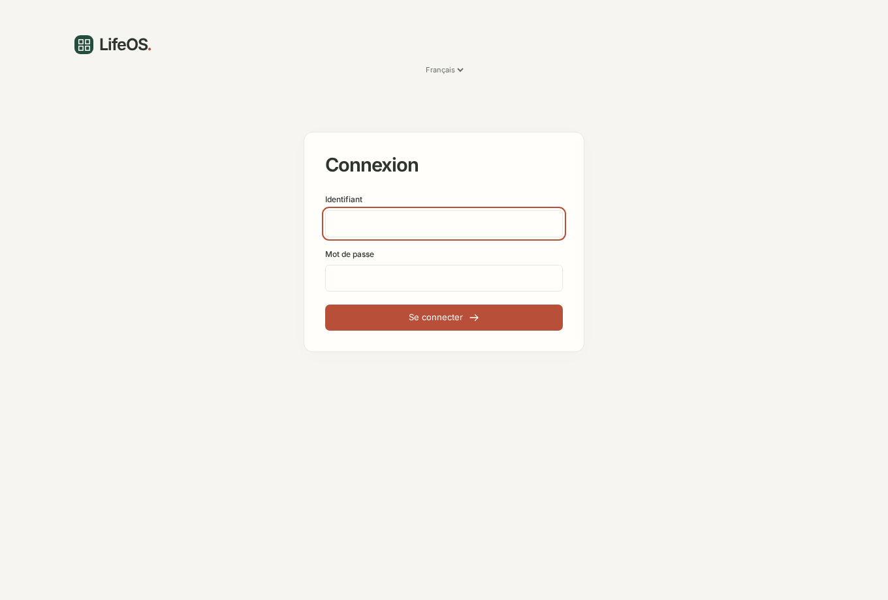
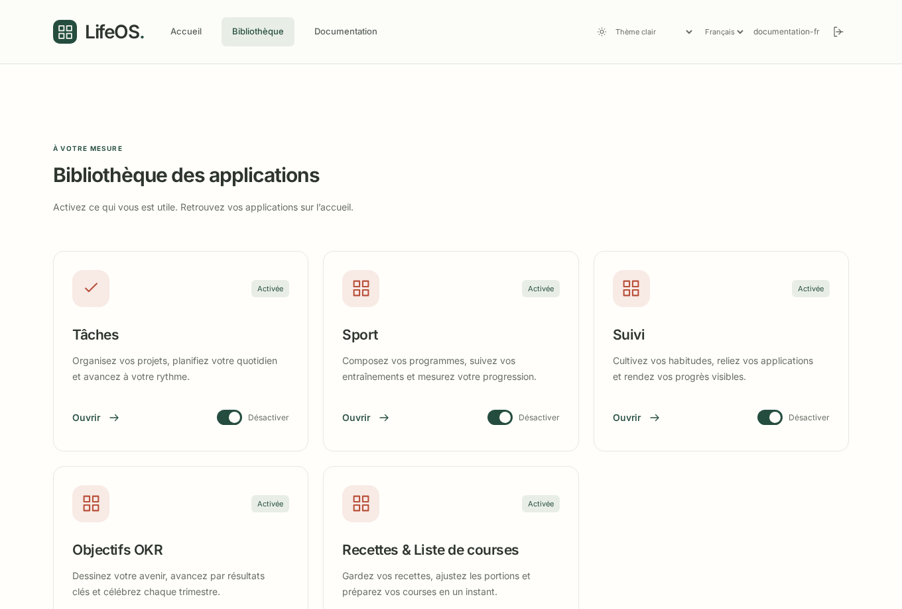
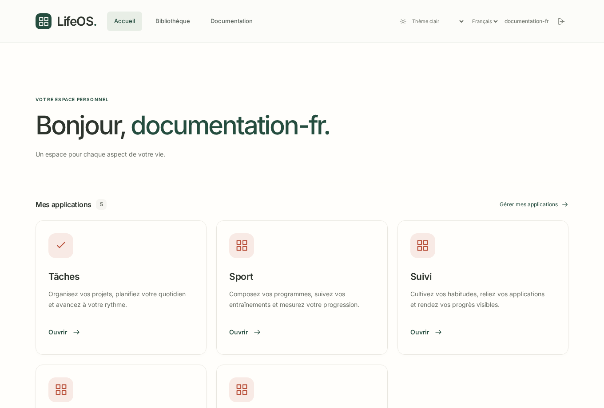
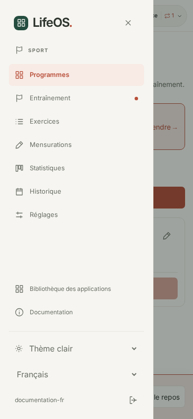

# Vos applications LifeOS

LifeOS réunit vos applications personnelles dans un même espace. Après connexion, l’**Accueil** présente uniquement vos applications activées. Choisissez **Ouvrir** sur une carte pour accéder à son contenu.

## Se connecter

1. Ouvrez LifeOS et saisissez l’identifiant et le mot de passe fournis par votre administrateur. Il n’existe pas d’inscription publique.
2. Choisissez la langue du formulaire si nécessaire, puis **Se connecter**. Votre langue de compte s’applique après connexion.
3. En cas d’oubli, demandez à votre administrateur de réinitialiser le mot de passe ; cela déconnecte les sessions existantes.
4. Utilisez **Se déconnecter** dans le footer quand vous quittez un appareil partagé. Une session expirée demande de se reconnecter.

{ loading=lazy }

## Choisir ses applications

1. Ouvrir **Bibliothèque** dans la navigation, ou **Gérer mes applications** depuis l’accueil.
2. Utiliser l’interrupteur **Activer / Désactiver** sur la carte d’une application.
3. Revenir à l’accueil : la liste reflète immédiatement le choix enregistré.

Le réglage appartient à votre compte et persiste après rechargement, déconnexion et sur vos autres appareils. La bibliothèque affiche l’état enregistré et signale les erreurs ; une erreur réseau ne présente pas un changement comme réussi. Les interrupteurs fonctionnent aussi au clavier (Tab puis Espace).

Une désactivation ne supprime **aucune donnée** : espaces, tâches, archives, échéances, récurrences, préférences et historique restent conservés. L’application disparaît de l’accueil et son accès est bloqué. Un lien direct comme `/tasks?space=…` propose d’ouvrir la bibliothèque. Réactivez l’application pour retrouver vos données. Désactiver n’archive pas les tâches et ne change pas leurs dates.

Si toutes les applications sont désactivées, l’accueil propose d’explorer la bibliothèque. La connexion, le thème et la bibliothèque restent disponibles. Un onglet déjà ouvert actualise le catalogue quand il revient au premier plan ; une requête métier refusée après désactivation affiche également le retour à la bibliothèque. Il n’y a pas de synchronisation instantanée entre appareils.

{ loading=lazy }

*Bibliothèque : activer une application avant de l’ouvrir.*

## Applications disponibles

**Tâches** est la première application livrée : [espaces, agenda, listes, kanban et récurrences](taches.md). Elle est activée par défaut, y compris pour les comptes et données existants.

**Sport** est disponible, désactivée par défaut : [exercices, programmes, entraînements, mensurations et statistiques](sport.md).

Les tâches ménagères et les plantes sont des pistes futures. Ils ne sont pas encore disponibles ni activables. Une nouvelle application apparaîtra dans la bibliothèque lors de sa livraison et sera désactivée par défaut.

## Connexion et apparence

L’accueil, la bibliothèque et les applications partagent la même connexion et le thème clair/sombre/système. Le menu du compte permet de changer l’apparence ou de se déconnecter. Une session expirée ramène au formulaire de connexion et retire les données privées de l’écran. Les pages HTML ne contiennent aucune donnée personnelle ; elles sont chargées par l’API après connexion.

Le catalogue et l’activation sont aussi accessibles par l’[API versionnée](api.md#bibliotheque-et-activation), indépendamment de l’interface.

{ loading=lazy }

*Accueil personnel : ouvrir les applications activées.*

## Français ou anglais

Le menu du compte propose **Langue / Language**, disponible aussi dans la navigation mobile. Le choix est enregistré pour tout LifeOS, indépendamment du thème, et conservé après reconnexion. Les textes personnels restent intacts. Les comptes existants commencent en français ; avant connexion, le navigateur choisit la langue du formulaire. Voir [les règles détaillées](internationalisation.md) et le [guide anglais](en/applications.md).

## Navigation commune

Tâches, Sport, Suivi, Objectifs OKR et Recettes partagent la même barre supérieure et la même barre latérale. Le fil d’Ariane indique l’application et la vue courante. Sur mobile, **Ouvrir la navigation** affiche les mêmes liens et le même footer ; **Échap** ou **Fermer la navigation** referme le menu.

Le footer propose, dans l’ordre, la **Bibliothèque des applications**, la **Documentation** propre à l’application et à la langue courante, le thème **clair / sombre / système**, la **Langue**, puis l’utilisateur et **Se déconnecter**. Thème et langue sont conservés sur le compte par l’API. Les archives et réglages métier restent dans la navigation de chaque application.

{ loading=lazy }

*Navigation mobile : bibliothèque, documentation et préférences du compte.*

## Suivi disponible

**Suivi** est désactivée par défaut. Activez-la pour configurer vos habitudes et objectifs, relier les données Tâches/Sport, remplir les périodes en cours et consulter calendrier, statistiques et réussites. [Guide Suivi](tracking.md). Désactiver une source empêche ses nouvelles lectures dans les intégrations ; les instantanés déjà enregistrés dans Suivi sont conservés.

## Objectifs OKR disponible

**Objectifs OKR** est désactivée par défaut. Activez-la pour définir vos horizons personnels/professionnels, préciser les résultats clés, avancer dans le kanban trimestriel et revoir les réalisations passées. Les plans trimestriels tiennent dans un mois. La source de métriques et les 60 quêtes sont découvertes automatiquement par Suivi lorsque l’application est activée. [Guide OKR](okr.md).

## Recettes et courses disponible

**Recettes & Liste de courses** est désactivée par défaut. Activez-la pour conserver vos recettes, adapter les portions, choisir parmi 301 ingrédients bilingues ou vos ingrédients personnels, préparer des listes qui cumulent les quantités et réutiliser vos modèles ou anciennes listes. Le mode magasin, les quatre métriques Suivi et 60 quêtes sont inclus. [Guide](recipes.md).

## Utiliser la documentation et le clavier

Le lien **Documentation** d’une application ouvre uniquement son guide dans la langue du compte. **Toutes les documentations** permet de changer de guide ; **English / Français** ouvre la même page traduite sans modifier votre compte. La recherche reste limitée au guide et à sa langue.

Utilisez Tab/Maj+Tab pour parcourir les commandes, Entrée ou Espace pour les activer, et Échap pour fermer les menus et dialogues. Sur mobile, ouvrez la navigation pour retrouver tous les liens. Les modifications non enregistrées demandent confirmation avant une sortie concernée. Consultez le [guide de progression](progression.md) pour les niveaux, quêtes, jours d’utilisation et vacances.
