# Architecture

## Vue d'ensemble

Life conserve le monorepo FastAPI / React / MkDocs. Un processus Uvicorn sert l'API, le frontend compilé et la documentation. PostgreSQL 17 est le seul service de données ajouté, conformément à l'[ADR 002](decisions/002-gestion-taches.md).

[Source Mermaid](assets/diagrams/production.mmd)

Caddy termine TLS et transmet à `life-web:8000` sur `multisite_proxy`. Le service web rejoint aussi le réseau Compose interne `database`. PostgreSQL ne rejoint pas le réseau du proxy, ne publie aucun port hôte et conserve ses données dans `postgres_data`. Le rôle applicatif est propriétaire de sa base, sans droits d'administration du cluster.

En développement, Vite, FastAPI et MkDocs disposent de serveurs distincts ; le proxy Vite maintient une origine unique. `compose.dev.yaml` fournit un PostgreSQL local indépendant de la production.

L’organisation par application suit l’[ADR 003](decisions/003-applications-lifeos.md). Les registres explicites assemblent les applications ; le socle ne dépend pas de leurs métiers.

## Responsabilités

| Dossier | Responsabilité |
| --- | --- |
| `core/` | Paramètres, journalisation, engine et sessions SQL |
| `platform/auth/` | Contrats, modèles et services de connexion/autorisation |
| `apps/<id>/` | Manifeste, routes, contrats, modèles et services propres à chaque application |
| `apps/registry.py` | Assemblage explicite des applications disponibles |
| `platform/applications/` | Contrat de manifeste, catalogue, activations et garde d’accès |
| `api/router.py` | Préfixe `/api/v1`, routes du socle et garde d’activation sur chaque routeur métier |
| `web/` | Distribution contrôlée des fichiers statiques |
| `migrations/` | Évolutions du schéma figées et versionnées |
| `frontend/src/app/` | Session commune, routage explicite et chargement des applications activées |
| `frontend/src/apps/<id>/` | Page, composants, types, styles et API propres au métier |
| `frontend/src/components/layout/` | Navigation commune de l'accueil |
| `frontend/src/platform/` | Session, thème, transport HTTP/CSRF et bibliothèque |
| `frontend/src/shared/` | Icônes, dialogues accessibles et styles réutilisables |
| `frontend/src/styles/` | Tokens et styles globaux |
| `docs/` | Documentation publique, sans données personnelles |
| `infrastructure/` | Intégration Caddy et initialisation du rôle PostgreSQL |
| `scripts/` | Tests, publication, sauvegarde et restauration explicites |

Les services métier utilisent SQLAlchemy directement : aucune couche générique de dépôt, file de messages ou microservice supplémentaire. Une session SQL est partagée par les dépendances d'une requête. Les mutations d'un propriétaire sont sérialisées et les tâches utilisent un numéro de version. Voir [Backend](backend.md) et [Données](donnees.md).

## Flux métier

1. Le navigateur ouvre une session via l'API et reçoit un cookie opaque HttpOnly.
2. Les lectures vérifient la session, l’activation de l’application et le propriétaire. Les écritures vérifient aussi l'origine et le jeton CSRF.
3. Le routeur appelle le service : validation, mutation et événements dans la même transaction PostgreSQL.
4. Tâches affiche immédiatement les intentions transitoires en mémoire et les enregistre en arrière-plan via les API existantes. Les réponses serveur confirment ou rétablissent les valeurs ; les effets indirects déclenchent une réconciliation. Les préférences de vue, de thème et de langue passent toujours par l’API.

React ne conserve pas de base métier parallèle dans localStorage. Les champs en cours de saisie et l'état des dialogues restent transitoires. Les mutations de tâche exigent `expected_version` et retournent un conflit 409 si une autre écriture a changé la tâche.

## HTTP et compilation

`/` (accueil), `/applications` (bibliothèque) et les chemins des manifestes (`/tasks`, `/sport` et `/tracking`) sont les seules routes HTML React. Les assets sont sous `/assets/`, l'API sous `/api/v1`, Swagger sous `/api/docs` et MkDocs sous `/documentation/`. Tout chemin inconnu reste 404. Le frontend utilise des URL API relatives, sans service réseau distinct pour le rendu.

[Source Mermaid de la construction](assets/diagrams/build.mmd)

Le runtime contient les dépendances Python applicatives, le CLI, les migrations et les fichiers compilés. Node, Vite, Playwright et MkDocs ne tournent pas en production. L'utilisateur runtime n'est pas privilégié et son système de fichiers est en lecture seule.

Les verrous uv/npm sont versionnés. Les images portent le SHA complet des sources ; les tags des images de base peuvent néanmoins évoluer entre deux reconstructions. Conserver l'image publiée et sa sauvegarde de données. Une image précédente n'annule jamais une migration.

## Limites choisies

L'application reste personnelle : pas de partage d'espaces, inscription publique, SSO, synchronisation temps réel, pièces jointes ou synchronisation hors ligne. Sport fournit ses statistiques internes ; Suivi exploite les événements de Tâches et les résultats Sport via des fournisseurs de métriques injectés. Aucun temps d’écran n’est collecté. La recherche est une recherche SQL de sous-chaîne, et le frontend charge toutes les tâches de la vue : des volumes importants nécessiteront pagination visuelle/indexation après mesure.

Les récurrences restent dans `apps/tasks` : `recurrence.py` valide et calcule les dates calendaires avec python-dateutil ; `scheduling.py` analyse les expressions françaises ou anglaises selon le compte. La résolution avance la tâche dans la transaction existante, sans ordonnanceur ni service supplémentaire. Le frontend demande l’analyse et l’aperçu à l’API et ne conserve que le brouillon transitoire.

L’analyse française délègue son vocabulaire et ses nombres à `scheduling_language.py`, puis la lecture et la combinaison des clauses à `scheduling_grammar.py`. Ce sont des helpers internes au même module tâches. Ils compilent vers le contrat `Recurrence` existant ; ni nouveau format persistant, ni dépendance, ni service d’interprétation externe.

L'[ADR initial](decisions/001-architecture-initiale.md) reste inchangé. Toute évolution structurante suit les règles d'accord explicite du dépôt.

## Activation et frontières

Le registre backend est injecté par la composition dans `app.state.applications`. Les services du socle reçoivent ces définitions et n’importent pas les applications. Le registre frontend associe les mêmes identifiants à leurs Pages chargées à la demande ; noms, descriptions, chemins et états viennent de l’API. Aucun import métier entre applications.

`platform/auth/SessionProvider` possède la session et le thème. `platform/applications/ApplicationProvider` charge les activations et les rafraîchit au retour au premier plan. Le shell démonte une Page sur désactivation, expiration ou déconnexion. Le garde serveur appliqué par `api/router.py` reste l’autorité, y compris pour les appels directs. Les composants partagés ne nécessitent pas le chargement du CSS Tâches.

Voir les [contrats et invariants](donnees.md#activations-des-applications), l’[API](api.md#bibliotheque-et-activation) et la [procédure d’ajout](evolution.md).

## Internationalisation approuvée

L’[ADR 004](decisions/004-internationalisation.md) ajoute la langue au compte et i18next/react-i18next au frontend. `platform/i18n/` initialise le moteur ; `shared/locales` possède les textes communs et chaque application ses ressources. `core/i18n.py` fournit le contexte serveur sans importer de métier ; les domaines chargent leurs propres messages. Les métadonnées localisées restent dans les manifestes backend. Le catalogue Sport sépare identifiants et textes, et localise les réponses sans réécrire les instantanés. L’adaptateur `scheduling_english.py` rejoint la grammaire existante. Voir les [contrats et frontières détaillés](internationalisation.md).

## Intégrations et Suivi

L’[ADR 005](decisions/005-integrations-tracking.md), approuvé le 16 novembre 2026, étend le manifeste avec `metrics` optionnel. `platform/integrations/` porte les contrats neutres, périodes, découverte, validation et contrôle d’activation ; les implémentations restent dans `apps/tasks/integrations.py` et `apps/sport/integrations.py`. Le registre injecté dans `app.state.applications` est le seul assemblage. Aucun domaine ne lit les tables d’un autre. Les options privées et évaluations exigent source active et propriétaire ; le catalogue ne contient que des métadonnées publiques au compte connecté.

`apps/tracking` possède définitions, révisions, périodes, valeurs, instantanés et historique. Son service calcule scores, XP et calendrier à partir de ces données. Les sources enregistrées sont des instantanés explicitement actualisables ; aucun calcul en arrière-plan ni service supplémentaire. La migration globale `0009_tracking` ajoute cinq tables et protège les historiques contre les modifications/suppressions.

Tâches, Sport et Suivi composent `shared/ui/ApplicationNavigation` avec leurs navigation, menu du compte et actions. Ce composant ne dépend d’aucune application ou service de session. Les requêtes Suivi utilisent le transport commun et `platform/useApiResource` pour annuler/ignorer les lectures obsolètes. Voir [intégrations](integrations.md), [modèle](donnees.md#donnees-de-suivi) et [API](tracking-api.md).

Le client HTTP et les types de métriques réutilisables sont dans `frontend/src/platform/integrations/`. Les composants de configuration et saisie restent propres à Suivi.

## Progression commune

L’[ADR 006](decisions/006-progression-applications.md), approuvé le 16 novembre 2026 dans l’issue #58, ajoute `platform/progression` : moteur partagé de niveaux/séries, préférences et journal PostgreSQL. Le manifeste porte un fournisseur optionnel `progression` ; chaque application possède son catalogue et transforme uniquement ses propres données en activités. Le registre reste le seul assemblage. Les confirmations enregistrent leurs faits et gains dans la transaction métier, sans effet de bord sur les lectures HTTP. La reprise historique est une commande explicite pour un compte nommé.

Le frontend `platform/progression` fournit le client API, les réglages et le badge injecté par les Pages dans le slot neutre `status` d’`ApplicationTopbar`. `shared` ne dépend toujours ni du socle ni des applications. Suivi possède la composition du mur et du journal ; le badge des autres applications fonctionne indépendamment de son activation. La progression conserve propriétaire, CSRF, contrôles d’activation et protection des réponses obsolètes. Voir [contrats](api.md#progression-par-application), [données](donnees.md#donnees-de-progression) et [guide](progression.md).
