# Architecture

## Vue d'ensemble

Life est un monorepo. En développement, trois serveurs spécialisés permettent le rechargement rapide. En production, un seul processus Uvicorn sert l'API, le frontend compilé et la documentation statique.



[Source Mermaid du diagramme](assets/diagrams/production.mmd)

Le navigateur ne communique pas directement avec Docker. Caddy termine TLS et transmet les requêtes au service `life-web:8000` sur le réseau externe `multisite_proxy`. Le conteneur Life ne publie aucun port sur l'hôte.

## Responsabilités

| Bloc | Responsabilité | Ne contient pas |
| --- | --- | --- |
| `backend/src/life_app/core/` | Paramètres typés et journalisation | Routes métier |
| `backend/src/life_app/api/` | Routes JSON versionnées | Rendu React |
| `backend/src/life_app/web/` | Distribution contrôlée des fichiers compilés | Règles métier |
| `frontend/src/app/` | Assemblage de l'interface | Requêtes serveur implicites |
| `frontend/src/components/layout/` | Navigation et structure commune | Fausses fonctionnalités |
| `frontend/src/pages/` | Contenu des pages | Infrastructure |
| `frontend/src/styles/` | Tokens visuels et styles globaux | Secrets ou configuration serveur |
| `docs/` | Sources MkDocs et ressources documentaires | Données personnelles |
| `infrastructure/` | Exemple d'intégration au proxy existant | Configuration complète d'autres sites |
| `scripts/` | Publication et vérification opérationnelle | Provisionnement de comptes ou achats |

## Arborescence

```text
.
├── backend/
│   ├── src/life_app/
│   │   ├── main.py
│   │   ├── core/
│   │   │   ├── config.py
│   │   │   └── logging.py
│   │   ├── api/
│   │   │   ├── router.py
│   │   │   └── health.py
│   │   └── web/static.py
│   └── tests/
├── frontend/
│   ├── public/
│   ├── src/
│   │   ├── main.tsx
│   │   ├── app/App.tsx
│   │   ├── components/layout/
│   │   ├── pages/HomePage.tsx
│   │   └── styles/
│   ├── package.json
│   ├── package-lock.json
│   ├── tsconfig.json
│   └── vite.config.ts
├── docs/
│   ├── assets/
│   ├── decisions/
│   └── *.md
├── infrastructure/caddy/life.caddy
├── scripts/
│   ├── deploy.sh
│   └── smoke-test.sh
├── .github/workflows/ci.yml
├── .env.example
├── .python-version
├── pyproject.toml
├── uv.lock
├── mkdocs.yml
├── Dockerfile
├── compose.yaml
├── Makefile
└── README.md
```

## Flux HTTP

Les routes de l'API sont déclarées explicitement. L'accueil est servi uniquement à `/`, les ressources Vite sous `/assets/`, et MkDocs sous `/documentation/`. Un chemin inconnu produit une erreur HTTP 404 ; il n'est jamais réinterprété comme la page d'accueil React.

Cette règle évite qu'un appel à une route API inexistante renvoie un document HTML avec un statut 200. Elle permet aussi de repérer immédiatement un fichier JavaScript ou une page de documentation absente.

La liste complète des chemins et de leurs contrats figure dans la [référence API](api.md).

## Construction de l'image



[Source Mermaid du diagramme](assets/diagrams/build.mmd)

Le Dockerfile utilise plusieurs étapes : installation npm et compilation Vite, installation des outils de documentation et compilation MkDocs, puis installation de l'application Python dans l'image finale. Les sorties du frontend et de la documentation sont copiées dans le runtime.

L'image finale n'exécute ni Node, ni Vite, ni `mkdocs serve`. Elle lance Uvicorn avec un utilisateur non privilégié. Les bibliothèques Python nécessaires au serveur sont distinctes des outils de test et de documentation.

## Dépendances et reproductibilité

- `pyproject.toml` décrit le package Python et ses groupes de dépendances ; `uv.lock` verrouille leur résolution.
- `frontend/package.json` décrit les scripts et dépendances web ; `package-lock.json` verrouille leur installation.
- `.python-version` fixe la famille Python utilisée localement ; le Dockerfile et la CI utilisent Python 3.13 et Node.js 24.
- Les images applicatives sont identifiées par le SHA complet du commit Git.

Les tags des images de base peuvent recevoir des corrections. Un SHA applicatif identifie les sources ; il ne garantit pas à lui seul que deux reconstructions réalisées à des dates différentes produisent les mêmes octets. Conserver l'image réellement publiée permet un retour arrière sans reconstruction.

## Limites actuelles

Il n'y a aucun stockage persistant, compte utilisateur, ordonnanceur, file de messages ou service métier. La santé HTTP indique que le processus répond, sans contrôle d'une dépendance distante.

Le choix d'un seul service évite une séparation opérationnelle prématurée. La structure permet d'ajouter des modules métier, puis une base de données et une authentification lorsque leurs besoins seront définis. Voir [la décision initiale](decisions/001-architecture-initiale.md).
