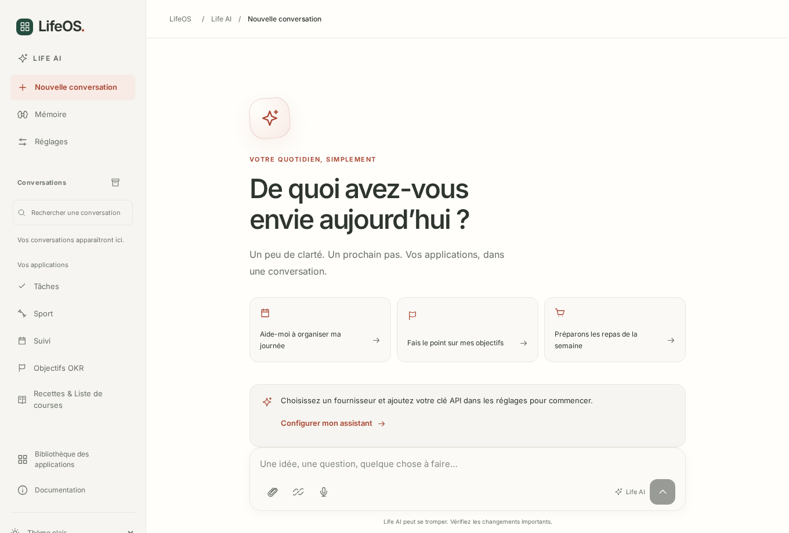

# Life AI

[English guide](en/assistant.md)

**Life AI** est votre application de conversation sur `/ai` : historique, mémoire, documents/images/pages web et dictée. Ouvrez-la depuis le Dashboard ou la bibliothèque. Vous pouvez consulter et modifier les applications activées : Tâches, Sport, Suivi, Objectifs OKR et Recettes & Liste de courses.

La séparation Dashboard/Life AI suit l’[ADR 011](decisions/011-dashboard-life-ai.md). Les preuves de validation et le commit publié figurent dans l’[issue #104](https://github.com/ThibaultLeveau/life.thibault-leveau.com/issues/104).

## Configurer votre fournisseur

Ouvrez **Réglages → Life AI → Fournisseur IA (ou Général)**. Choisissez OpenAI, Anthropic ou Google Gemini, saisissez l’identifiant d’un modèle accessible à votre compte fournisseur et son token API, puis enregistrez. **Tester la connexion** effectue un véritable appel au fournisseur et peut consommer son quota. Le modèle doit accepter les outils et les réponses en streaming utilisés par l’assistant.

Le token est chiffré sur le serveur. L’interface ne relit que son état de configuration et un suffixe masqué. Un champ vide conserve le token ; **Supprimer le token** le retire explicitement. Changer de fournisseur efface le token et le modèle précédents : renseignez ceux du nouveau fournisseur. Une clé serveur manquante ou devenue illisible demande l’intervention de l’administrateur ou une nouvelle saisie ; les applications restent accessibles.

Vos messages, les souvenirs utiles et les données nécessaires aux outils sont transmis au fournisseur choisi. Ses conditions de traitement et sa facturation s’appliquent. L’assistant n’utilise pas votre abonnement à une interface de chat externe à la place de ce token API.

## Demander une lecture ou une modification

Essayez des demandes précises : « Quelles tâches sont prévues cette semaine ? », « Ajoute une tâche Lire vingt minutes demain dans mon espace Personnel », « Montre ma dernière séance », « Fais le point sur mes objectifs » ou « Ajoute les ingrédients de cette recette à ma liste de courses pour quatre personnes ».

Life charge les outils de l’application concernée et consulte les objets avant de les modifier. Les mêmes validations, versions et historiques que dans l’interface s’appliquent. Une application désactivée ne peut plus être lue ou modifiée par l’assistant ; la réactivation conserve ses données. Une demande explicite peut aussi activer ou désactiver une application, modifier la langue ou le thème et gérer les préférences de progression. Life peut consulter les niveaux, séries, historiques de gains et métriques des applications activées.

Les actions simples explicitement demandées peuvent être enregistrées directement. Une proposition, une modification en lot ou une action destructive présente un **aperçu à confirmer**. Les cartes montrent de petites parties des applications : objet concerné, valeurs pertinentes, résultat ou lien vers l’application. Un aperçu n’est pas une modification enregistrée. La confirmation revalide les droits et les versions ; si l’objet a changé, demandez un nouvel aperçu.

## Consultations et détails des cartes

Les lectures intermédiaires sont regroupées sous **Consultations**, replié par défaut sous la réponse. Ouvrez ce volet pour retrouver les objets consultés. Les propositions à confirmer restent visibles, même lorsqu’il y en a plus de trois ; les résultats enregistrés sont distincts des lectures. Les opérations conservent leur ordre et une confirmation remplace son aperçu sans dupliquer l’action. Une carte visible reste affichée après sa confirmation, avec le focus conservé.

Chaque carte propose **Voir tous les détails** : instructions complètes, ingrédients, exercices et valeurs de séries, résultats clés, champs de suivi ou préférences. Le résumé reste court ; **Lire le texte complet** déplie aussi un texte long directement dans la carte, sans zone de défilement imbriquée. Vous pouvez ensuite replier le texte ou les détails. Les listes ne sont plus coupées silencieusement à trois, cinq ou huit éléments. Les références techniques restent accessibles par l’API.

Dans une carte de courses, le titre de la liste reste distinct des articles. Le résumé affiche jusqu’à cinq articles avec leur quantité sur la même ligne quand la place le permet ; seules les lignes d’articles portent un indicateur d’achat. **Voir tous les détails** conserve tous les articles dans une présentation compacte : nom et quantité, état d’achat, quantité dans le panier et rayon. Les modèles utilisent la même présentation condensée, sans indicateur à cocher dans le résumé. Les dates et autres informations du reçu restent consultables. Ces cartes représentent un instantané ; pour cocher les articles, ouvrez l’application depuis le lien de la carte.

Les détails portent sur le résultat effectivement consulté : si une recherche renvoie une page, le nombre de résultats reçus et le total sont indiqués. Le lien vers l’application permet de poursuivre la recherche. Un résultat vide est signalé explicitement. Les cartes d’une application désactivée ou d’une version non reconnue n’exposent pas leurs détails.

Nombres, dates et unités suivent la langue du compte : par exemple **350 g** et **1,25 g** en français, **1.25 g** en anglais. Les zéros décimaux superflus disparaissent ; les petites quantités utiles (jusqu’aux six décimales de Recettes) restent visibles. Ce formatage ne modifie aucune valeur enregistrée. Les consignes du modèle distinguent la concision de sa réponse de l’intégralité des contenus proposés ; une proposition reste à vérifier avant confirmation.

Ces volets fonctionnent avec Entrée/Espace au clavier, les thèmes communs et les écrans de 320 px. Les détails dépliés font partie du défilement normal de la conversation.

## Tableaux dans les messages

Les messages affichent les tableaux Markdown en colonnes avec une ligne d’en-têtes, y compris dans les anciennes conversations. Le gras, le code en ligne et l’alignement des colonnes sont conservés. Sur petit écran, faites défiler un tableau large horizontalement à l’intérieur de sa zone ; au clavier, donnez-lui le focus avec Tab puis utilisez les flèches.

Un tableau nécessite un en-tête et une ligne de séparation correspondante, par exemple :

```text
| Tâche | Détail |
| --- | --- |
| Rédiger mon profil | Parcours et exemples concrets. |
```

Utilisez `\|` pour une barre verticale dans une cellule. Tant que la séparation n’est pas valide pendant une réponse, le texte reste visible tel quel. Les blocs de code conservent leur contenu littéral. Cette mise en forme concerne seulement l’affichage : elle ne crée aucune tâche et ne modifie pas le message enregistré. Le HTML, les images et les liens des messages restent du texte inerte.

## Historique et interruptions

Créez une conversation, retrouvez-la avec la recherche, renommez-la ou archivez-la. L’archive conserve ses messages et permet une restauration. Une conversation archivée doit être restaurée avant un nouveau message. La suppression est définitive pour la conversation et ses reçus ; elle propose séparément d’oublier les souvenirs qui en proviennent.

Après confirmation et réussite de la suppression, vous revenez à l’accueil de l’assistant : la conversation et son brouillon quittent l’écran. Vous pouvez commencer une nouvelle conversation. En cas d’annulation ou d’échec, la conversation reste ouverte.

La réponse apparaît progressivement. **Arrêter** interrompt les étapes suivantes ; les modifications déjà enregistrées restent visibles et ne sont pas annulées. Après une coupure, rechargez la conversation pour voir son état et les reçus enregistrés avant de demander une suite. Une interruption ne rejoue pas automatiquement des écritures. Une seule réponse peut être en cours par compte.

Une réponse peut être partielle si le fournisseur refuse le token, manque de quota, répond trop lentement ou si une validation métier échoue. Un texte de succès sans reçu confirmé ne constitue pas une preuve d’écriture. Les cartes distinguent propositions et résultats ; vous pouvez vérifier l’objet dans son application.

## Comprendre et gérer la mémoire

La mémoire retient des faits durables que vous communiquez : votre nom, votre profession, des projets en cours, des préférences ou un contexte personnel utile. Chaque souvenir issu du chat possède sa conversation, son message et un extrait source daté. Les exemples fictifs, textes d’applications et suppositions ne doivent pas devenir des faits personnels. Les informations sensibles nécessitent une demande explicite de mémorisation ; ne fournissez pas de secrets dans le chat. Le choix des faits dépend du modèle, complété par des filtres conservateurs côté serveur pour les refus et des motifs sensibles FR/EN. Ces filtres ne détectent pas toutes les formulations ni toutes les langues : consultez les souvenirs enregistrés et corrigez-les au besoin.

Ouvrez **Mémoire**, depuis la navigation du chat ou les réglages Life AI, pour consulter, ajouter, corriger ou supprimer un souvenir, ou tout oublier. Vous pouvez désactiver la mémoire dans les réglages IA : les souvenirs conservés ne sont alors plus injectés et aucun nouveau souvenir automatique n’est ajouté. Les souvenirs et l’historique sont indépendants ; supprimer une conversation sans choisir l’oubli conserve ses souvenirs.

Une correction, un oubli ou une bascule de mémoire efface les résumés dérivés et écarte les anciens messages du contexte réutilisé. Les messages restent visibles dans l’historique, mais une ancienne source ne doit pas recréer silencieusement un souvenir oublié. Une réponse déjà en cours est interrompue si sa version de mémoire est devenue obsolète ; renvoyez votre demande avec le contexte utile. Des données déjà envoyées à un fournisseur ne peuvent pas être retirées par une suppression locale.

## Documents, images et pages web

Joignez un fichier avec le bouton dédié, glissez-le dans le champ ou collez une image. **Ajouter une page web** importe une URL explicite ; un lien simplement mentionné dans une phrase ne déclenche pas de téléchargement. Attendez que les sources soient prêtes, puis envoyez votre question, ou les sources seules. Vous pouvez retirer une pièce avant envoi, réessayer un import échoué et retrouver les sources dans l’historique. Les erreurs d’admission conservent le brouillon ; après une coupure incertaine, l’application récupère l’état sans renvoyer automatiquement la demande.

| Source | Prise en charge et limites |
| --- | --- |
| PDF | Texte et pages via un modèle compatible ; 10 Mio et 50 pages maximum |
| PNG, JPEG, WebP | Analyse visuelle ; 5 Mio, côté maximal 8 000 pixels, 40 millions de pixels |
| TXT, Markdown, CSV | Texte UTF-8 ; 10 Mio et 120 000 caractères extraits |
| DOCX, XLSX, PPTX | Extraction du texte et des cellules disponibles ; 10 Mio et 120 000 caractères extraits. Pas d’exécution des formules/macros ni d’analyse des images/graphiques incorporés : exportez en PDF pour préserver le visuel |
| Page publique | HTML ou texte directement accessible par HTTP/HTTPS ; pas de connexion, JavaScript ou exploration automatique des liens |

Un message accepte quatre sources, 20 Mio et 50 pages PDF cumulés. Les fichiers illisibles, chiffrés, trop volumineux ou contenant des structures actives refusées donnent une erreur ; leur contenu n’est pas tronqué silencieusement. Le modèle choisi doit prendre en charge les images/PDF ; les plafonds propres au modèle peuvent être plus bas. Les sources sélectionnées sont envoyées au fournisseur configuré, avec sa facturation et ses conditions de traitement.

Les sources persistent avec la conversation. Les imports non envoyés expirent après 24 heures, avec nettoyage lors des opérations sur les sources ; le quota par défaut est de 200 Mio par compte, contenu extrait compris. Deux imports simultanés, 32 brouillons et 2 000 sources non retirées au maximum limitent l’accumulation. Retirer une source enregistrée efface son contenu et laisse une trace dans le message ; les réponses déjà écrites qui la citent restent dans l’historique. Supprimer la conversation retire aussi ses sources. Cette suppression ne rétracte pas les données déjà reçues par le fournisseur ou contenues dans une ancienne sauvegarde.

Dans une conversation contenant des sources externes, toute modification proposée exige une confirmation, même après retrait de la source. L’extraction automatique de souvenirs y est désactivée ; utilisez **Mémoire** pour enregistrer explicitement un fait. Le contexte récent conserve jusqu’aux dix derniers messages ; les anciens documents restent accessibles par référence, avec un budget de lecture limité ; demandez un document précis lorsque l’historique est long.

## Dicter un texte

Le bouton microphone demande votre autorisation, puis affiche l’enregistrement. Arrêtez pour transcrire, ou annulez pour abandonner. La capture est limitée à deux minutes et 10 Mio. Le texte est ajouté au brouillon sans effacer votre saisie ; relisez-le et corrigez-le avant de cliquer sur Envoyer. La dictée n’envoie jamais un message automatiquement. Un refus du microphone, une interruption ou une erreur fournisseur reste visible ; le champ texte reste utilisable.

Dans les réglages de dictée, réutilisez OpenAI ou Gemini du chat, ou choisissez explicitement un fournisseur et un token distincts. Avec Anthropic pour le chat, configurez OpenAI ou Gemini pour la transcription. Le modèle OpenAI par défaut est `gpt-transcribe` ; Gemini réutilise le modèle choisi. La disponibilité dépend de votre compte et de son quota. L’audio est transmis au fournisseur et demeure transitoire sur LifeOS ; seuls les messages que vous envoyez sont conservés. Le serveur accepte une transcription simultanée et 30 demandes par heure et par compte. La dictée exige HTTPS et un navigateur compatible avec l’enregistrement audio ; aucune reconnaissance vocale propre au navigateur n’est requise.

## Limites et accessibilité

Les sources multimodales sont disponibles selon les limites ci-dessus. Aucune navigation web libre, exécution de code ou connexion automatique à des services tiers. Un tour est limité en durée et en nombre d’appels ; les historiques purement textuels peuvent être résumés, tandis que les conversations avec sources utilisent un contexte récent et des références bornées. Le modèle peut se tromper ou demander une précision. Les cartes sont des composants contrôlés de LifeOS, jamais du code exécuté à partir d’une réponse générée.

Le chat utilise les thèmes clair/sombre/système, les langues FR/EN et la navigation commune. Sur mobile, ouvrez le menu pour retrouver historique et bibliothèque. Tab et Maj+Tab parcourent les commandes, Échap ferme les dialogues ; la préférence système de réduction des animations est respectée. Les données privées disparaissent à la déconnexion ou à l’expiration de session.

Toutes ces opérations disposent de leur [API indépendante](assistant-api.md). Voir aussi les [réglages](settings.md) et les [règles de sauvegarde](sauvegardes.md#migration-0015-assistant).

## Créer plusieurs tâches

Demandez par exemple « Crée un espace Portfolio et prépare ces dix tâches… ». Le coordinateur peut déléguer la création de l’espace, puis transmettre son identifiant confirmé au spécialiste Tâches. Une nouvelle délégation peut réutiliser le même spécialiste pour une autre sous-tâche ; les délégations sont exécutées en séquence dans le processus existant. Pour plusieurs créations, l’assistant privilégie **Importer des tâches** : un lot de 1 à 100 tâches, avec un aperçu complet puis une confirmation. L’aperçu ne crée encore aucune tâche ; la confirmation enregistre tout le lot ou rien. Ne confirmez pas plusieurs propositions identiques.

Les budgets par défaut sont de 96 appels modèle, 200 actions métier et 600 secondes pour une réponse. Chaque spécialiste dispose de 24 échanges maximum et le coordinateur de 16 ; l’administrateur peut réduire les budgets globaux dans la configuration. Ces garde-fous évitent les boucles et les coûts sans borne ; ils ne représentent pas une limite au nombre de tâches stockées. Un fournisseur lent peut encore dépasser le délai. Après interruption, les actions déjà enregistrées sont conservées et ne doivent pas être recréées.

## Dashboard, activation et premier message

Le Dashboard `/` reste une vue d’ensemble. Sa carte de chat accepte jusqu’à 12 000 caractères. **Discuter** ouvre Life AI et envoie une seule fois le texte avec la configuration enregistrée. Une configuration absente ou un rejet avant admission conserve le brouillon ; une modification pendant le chargement annule l’envoi automatique. Après une erreur réseau incertaine, consultez l’historique avant de renvoyer. Un rechargement peut perdre une saisie encore non envoyée : elle n’est pas stockée dans le navigateur.

Les anciens liens `/?conversation=…` restent valides et rejoignent `/ai?conversation=…`. Retour navigateur, changement de langue et déconnexion protègent les brouillons. Un tour en cours empêche la navigation interne. Une désactivation depuis un autre onglet coupe les étapes suivantes ; les actions déjà enregistrées conservent leurs reçus. Réactivez Life AI pour retrouver ses données. Mémoire et dictée se règlent dans **Réglages → Life AI**. Le fournisseur est partagé avec Recettes et reste configurable dans Général même lorsque Life AI est désactivée. Aucun XP n’est attribué pour discuter.

{ loading=lazy }
