# Données et historique

## Relations



[Source Mermaid](assets/diagrams/data.mmd)

| Table | Données et contraintes |
| --- | --- |
| `users` | UUID, identifiant unique normalisé, hash Argon2, thème |
| `login_sessions` | Hash du cookie opaque, utilisateur, hash CSRF, expiration UTC |
| `application_preferences` | Clé composée utilisateur/application, activation booléenne et instant UTC de dernière modification |
| `login_limits` | Clé hachée du compte ou de l'IP, compteur, expiration |
| `workspaces` | Propriétaire, parent facultatif `parent_id`, nom, description, couleur, ordre, dates de création/archivage |
| `sections` | Espace, nom, description, couleur, ordre, visibilité `list/board/both`, archive |
| `task_statuses` | Espace, nom, couleur, ordre et caractère terminé |
| `task_labels` | Étiquettes propres à l'espace ; nom unique dans cet espace, sensible à la casse |
| `tasks` | Espace, section facultative, statut, texte, priorité, échéance, position, version et dates |
| `task_label_links` | Association tâche/étiquette avec espace commun |
| `view_preferences` | Une configuration JSONB validée par espace |
| `agenda_preferences` | Une configuration JSONB validée par compte ; `user_id` clé primaire et étrangère vers `users` |
| `task_events` | Journal de cycle de vie immuable avec contexte historique |

Les clés primaires métier sont des UUID. Des clés étrangères composites imposent que la section, le statut et les étiquettes d'une tâche appartiennent au même espace. Une priorité vaut 1 à 4, une position est positive ou nulle, une version strictement positive. Le serveur garantit au moins un statut ouvert et un terminé par espace ; une bascule de type est refusée si le statut est utilisé, archives comprises.

Les descriptions restent du texte, sans HTML interprété. Les échéances sont des `DATE` calendaires ; les dates de création, mise à jour, résolution, archivage et événements sont des instants avec fuseau, émis en UTC. Le navigateur les présente dans son fuseau et transmet sa date locale pour les filtres « aujourd'hui ».

## Hiérarchie des espaces

`workspaces.parent_id` est nullable et indexé. La migration `0002` laisse les espaces existants à la racine. Une clé étrangère composite `(parent_id, owner_id)` vers `(id, owner_id)` garantit l'existence du parent et le même propriétaire ; une contrainte CHECK interdit l'auto-parentage. Les cycles indirects et les règles d'archive sont validés par le service sous le verrou existant de mutation du propriétaire, y compris pour deux rattachements concurrents. Les écritures SQL d'administration doivent respecter ces règles de service.

L'arbre n'a pas de profondeur métier maximale. Un espace actif a toujours un parent actif ou aucun parent : création/rattachement/restauration exigent un parent actif, et l'archivage est refusé tant qu'un enfant direct est actif. Les enfants archivés restent rattachés et sont restaurés explicitement, parents d'abord. La position globale reste ordonnée parmi les frères ; un changement de parent conserve cette position. Il ne change aucun identifiant, section, statut, préférence, tâche, date de résolution ou événement. L'historique des changements de hiérarchie eux-mêmes n'est pas journalisé.

## Préférences de l’agenda

Après la révision `0002`, la migration `0003_agenda` ajoute uniquement `agenda_preferences`. Une ligne est créée au premier PUT ; sans ligne, les valeurs par défaut s’appliquent. Le serveur valide période, horizon 1–90 jours, inclusion des retards et des tâches terminées. Le propriétaire ne peut pas être choisi par le client. Les écritures suivent la sérialisation des mutations par compte ; le dernier remplacement validé devient la préférence courante.

L’agenda lit les tâches existantes : aucune copie, nouvelle échéance, résolution ou modification d’historique n’est générée. Les contraintes de dates et de cycle de vie restent celles des tâches. La sauvegarde PostgreSQL contient également les préférences, dont la restauration est contrôlée sur données synthétiques.

## Résolutions et réouvertures

| Transition | Effet |
| --- | --- |
| Création ouverte | `created`, `completed_at = null` |
| Création directement terminée | `created` puis `completed` |
| Ouvert → terminé | `completed`, nouvelle date de résolution |
| Terminé → ouvert | `reopened`, `completed_at = null`, anciens événements conservés |
| Ouvert → ouvert ou terminé → terminé | Mouvement sans nouvelle résolution ; date de résolution conservée |
| Répétition de `/complete` ou `/reopen` sur l'état voulu | Aucun événement ni changement de version, si `expected_version` est actuel |
| Archivage/restauration individuels | `archived`/`restored`, état de résolution inchangé |

Les événements contiennent `kind`, `occurred_at`, les identifiants tâche/espace/section/statut, `previous_status_id`, `was_completed`, `is_completed` et `context.before/after`. Le contexte conserve noms et identifiants d'espace, section et statut à l'instant du changement ; il ne copie ni titre, ni description de tâche, ni mot de passe.

Le trigger PostgreSQL `immutable_task_events` interdit UPDATE et DELETE sur les lignes du journal. Le compte d'exploitation reste responsable des sauvegardes et de l'administration ; ce journal n'est pas une preuve cryptographique contre un administrateur de base. Les événements de contexte n'ont pas de clé étrangère vers les anciens statuts, afin de survivre à leur retrait. La tâche conserve son UUID après déplacement.

## Récurrences et occurrences

`0004_recurrence` ajoute à `tasks` un objet JSONB nullable `recurrence` et un entier `recurrence_completed`, initialisé à zéro. Les CHECK imposent un compteur non négatif et, pour une récurrence non nulle, un objet JSON et une échéance non nulle. Le contrat complet (fréquence, sélections calendaires, bornes, fuseau, exceptions) est validé par Pydantic et le service sous le verrou du propriétaire. Une écriture SQL d’administration doit aussi respecter ces règles métier.

La règle contient une ancre `start_date`, un fuseau IANA, une RRULE calendaire, un mode `scheduled/completion`, une fin facultative et des exceptions. `due_date` décrit l’occurrence courante ; elle peut être reportée sans déplacer l’ancre. Une modification de définition recommence le compteur, sans modifier les événements précédents. Le titre API reste littéral ; l’interface appelle d’abord l’analyse de texte quand la reconnaissance est active.

La grammaire française étendue ne modifie pas ce format ni le schéma. Son arbre de clauses, ses diagnostics et le texte avant nettoyage sont transitoires. Les règles déjà enregistrées ne sont jamais analysées à nouveau ; leur ancre, compteur et historique restent inchangés. Le nouveau calcul de première date pour les expressions composées s’applique uniquement à une analyse explicitement demandée.

À chaque transition ouvert → terminé, le serveur enregistre `completed` avec son instant UTC et le contexte de l’occurrence : échéance, règle, compteur, `completed_at` et version, en plus de l’espace/section/statut. Si une autre occurrence existe, il remet la même tâche (même UUID) dans son statut ouvert, met à jour `due_date`, vide `completed_at` puis ajoute `rescheduled` avec la référence `completion_event_id`. Tout se fait dans la même transaction et avec une seule nouvelle version. Un déplacement vers un autre espace choisit un statut ouvert de cet espace pour la prochaine occurrence. Une archive ne génère aucune résolution et conserve les dates/règles/compteurs.

Une seule occurrence courante est matérialisée ; aucun ordonnanceur et aucune duplication de tâche. Les dates en retard intermédiaires sont sautées au prochain achèvement, jamais enregistrées comme résolues. `max_occurrences` compte les résolutions de la définition courante, pas les dates du calendrier. Une fin atteinte laisse la tâche terminée. Une réouverture manuelle permet de retravailler cette dernière occurrence tout en conservant les résolutions antérieures.

L’annulation de la dernière résolution restaure son état ouvert, sa date et son compteur et ajoute `completion_undone` référant à l’événement `completed` annulé. Elle est refusée après toute modification de version intermédiaire. Ce journal compensateur préserve l’immuabilité ; les statistiques nettes doivent exclure les résolutions référencées par ces annulations. Pour les délais par occurrence, `rescheduled` commence le cycle suivant et `completion_undone` reprend le cycle annulé. Les anciens événements, antérieurs à 0004, restent lisibles sans ces champs de contexte supplémentaires.

## Ordre et déplacements

La position d'une tâche définit un ordre commun dans son espace, filtré par section et par statut pour chaque vue. Un déplacement indique un espace, une section, un statut et éventuellement `before_id` dans la section cible. Sans `before_id`, il place la tâche à la fin. Les positions concernées sont normalisées, sans changement des dates de résolution des autres tâches.

Entre espaces, les trois références sont mises à jour atomiquement. Les étiquettes sont reprises par nom exact ; une étiquette homonyme existante garde sa couleur, sinon une nouvelle est créée avec la couleur source. L'ancienne association disparaît, la tâche et son journal restent les mêmes.

Retirer un statut utilisé exige un statut de remplacement du même type ouvert/terminé. Les tâches, y compris archivées, sont réaffectées avec événement `moved`, sans résolution fictive. Retirer une étiquette supprime les associations et le filtre correspondant, sans supprimer les tâches.

## Archives et conservation

Les espaces, sections et tâches ne sont pas supprimés définitivement. L'archivage d'un espace ou d'une section masque ses tâches sans modifier leurs dates individuelles. Pour les sous-espaces, appliquer l'ordre explicite décrit ci-dessus. La restauration rend visibles les tâches actives, mais ne réactive pas celles archivées individuellement. Une tâche archivée ne se modifie qu'après restauration de ses parents, puis de la tâche elle-même.

Les modifications des noms, réglages et associations d'étiquettes ne constituent pas un audit exhaustif de toutes les métadonnées. Le journal est destiné au cycle de vie des tâches ; il ne conserve pas chaque ancien texte. Il n'y a pas encore de purge automatique de l'historique. Toute future suppression définitive doit préciser ses effets sur les statistiques et les sauvegardes.

## Exploitation statistique future

Pour compter les résolutions par jour UTC et espace historique :

```sql
SELECT workspace_id, (occurred_at AT TIME ZONE 'UTC')::date AS jour,
       count(*) AS resolutions, count(DISTINCT task_id) AS taches_distinctes
FROM task_events
WHERE kind = 'completed'
  AND NOT EXISTS (
    SELECT 1 FROM task_events AS undo
    WHERE undo.kind = 'completion_undone'
      AND undo.context->>'completion_event_id' = task_events.id::text
  )
GROUP BY workspace_id, jour
ORDER BY jour;
```

Une tâche terminée deux fois après réouverture produit deux résolutions. Pour un délai par cycle, associer chaque résolution à la création ou réouverture précédente de la tâche ; pour un jour local, convertir explicitement vers le fuseau choisi. Les index couvrent la chronologie par tâche, les résolutions par espace et les filtres usuels. Aucun tableau statistique n'est livré à cette étape.

## Duplication et opérations groupées

La duplication crée une tâche ouverte avec un nouvel UUID, de nouvelles dates de création/modification, version 1, compteur de résolutions nul et un unique événement `created`. La source et ses événements restent inchangés. Les champs métier, étiquettes, échéance et règle sont copiés ; une date courante issue d’une résolution anticipée en mode `completion` reste copiable même avant l’ancre initiale. La copie n’hérite d’aucun événement ni d’aucune date de résolution.

Les lots de 1 à 500 tâches utilisent la sérialisation par propriétaire et la transaction existantes. Toutes les versions sont vérifiées avant les mutations ; ordre, associations et événements sont annulés ensemble en cas d’erreur. La replanification ajoute `updated` et conserve règle/compteur. Le déplacement ajoute `moved` sans changer le type ouvert/terminé ni `completed_at`. Les versions des autres tâches affectées par la normalisation de l’ordre peuvent augmenter, comme pour un déplacement individuel.

Le libellé **Supprimer** de l’interface utilise l’archivage existant (`archived_at` et événement `archived`). Il n’efface aucune donnée et se restaure via PATCH et les archives. La sélection est un état transitoire du navigateur, sans table ni préférence persistante. Aucune migration, contrainte ou procédure de restauration supplémentaire n’est nécessaire ; cette livraison utilisait `0004_recurrence`. La bibliothèque ajoute ensuite `0005_applications`, sans changer ces opérations ; les sauvegardes couvrent copies et événements de lots.

## Activations des applications

La migration `0005_applications` crée uniquement `application_preferences`. Sa clé primaire `(user_id, application_id)` interdit les doublons. `user_id` référence un compte existant ; `application_id` respecte `^[a-z][a-z0-9_]{0,49}$` et 50 caractères maximum ; `enabled` et `updated_at` sont non nuls. Le catalogue est défini par les manifestes livrés : le service refuse un identifiant inconnu. Une écriture SQL administrative doit aussi respecter ce catalogue.

Sans ligne, le défaut du manifeste s’applique : `true` pour Tâches, `false` par défaut pour les futures applications. Le premier PUT crée une ligne même si le choix correspond au défaut. Seule une bascule ultérieure change l’instant UTC ; répéter le même état est idempotent. Les bascules suivent le verrou du compte utilisé par les mutations métier, empêchant qu’une écriture commencée après une désactivation validée contourne ce choix.

La migration ne touche pas les tables et événements métier. Désactivation/réactivation ne modifient aucune tâche, date, version, récurrence, archive ou préférence de vue. Aucun journal historique d’activation ni désinstallation/purge n’est livré : `updated_at` décrit le dernier changement, pas un historique complet. La sauvegarde PostgreSQL contient les préférences explicites ; les défauts sans ligne restent définis par le commit de l’image. Toujours conserver cette image avec son dump.

Le diagramme ci-dessus présente les relations du métier Tâches ; la bibliothèque ajoute la relation un compte → plusieurs préférences d’application décrite ici.

## Sport

Migration additive `0006_sport` après `0005_applications`. `sport_exercises` conserve les exercices personnels (nom, type, muscle, matériel, notes) ; les 680 exercices fournis sont un catalogue versionné dans le code, sans copies privées. `sport_workouts` conserve des entrées ordonnées JSONB, avec identifiant d’exercice, nom/type instantanés, séries et cibles. `sport_settings` conserve le repos par propriétaire. `sport_measurements` conserve date, valeurs JSONB facultatives, notes et archives.

Ces objets privés référencent `users`, avec version positive, dates de création/modification et archivage réversible (sauf réglages sans historique). Un index unique partiel impose un relevé actif par compte/date. Le service valide noms, types, unités, bornes, structure JSON, compte des séries et références d’exercices ; les écritures SQL directes ne constituent pas une API métier. Les exercices fournis utilisent des identifiants stables et ne sont pas modifiables globalement.

`sport_sessions` référence la séance et son propriétaire par clé étrangère composite. Un index unique partiel impose un entraînement actif par propriétaire. La table conserve un instantané JSONB de la séance, les séries réellement validées avec leur date UTC, le début/la fin, l’échéance du repos, l’état (`active`, `completed`, `cancelled`), les notes, la version, la signature de comparaison, les métriques, le score et la session de référence. Le serveur impose l’unicité des couples d’indices et la saisie typée ; la base impose états/dates cohérents, version positive et absence de repos après fin.

Les transitions passent exclusivement par l’API : validation/correction/annulation de série pendant l’état actif, fin si toutes les séries sont validées, ou abandon conservant les séries. Une correction conserve la date de validation ; une annulation suivie d’une nouvelle validation reçoit une nouvelle date. La fin fige l’historique accessible par l’API. Aucun effacement en cascade ni suppression définitive n’est exposé. L’archivage d’un exercice ou d’une séance et la désactivation de Sport n’affectent pas les sessions existantes ni leurs dates.

Les métriques et scores sont calculés et enregistrés dans la même transaction que la fin. La signature porte l’ordre des identifiants, types et nombres de séries ; la référence est la première session terminée de cette même séance/signature. Voir les [formules](sport.md#statistiques-et-score). La base ne mélange pas les unités physiques pour produire le score : le service moyenne des rapports sans unité.
