# Données et historique

## Assistant IA

La migration additive `0015_assistant` crée sept tables privées. `assistant_settings` conserve fournisseur, modèle, ciphertext du token, suffixe masqué, activation/version/coupure de mémoire. `assistant_conversations` conserve titre, archive et résumé daté ; `assistant_messages` conserve contenu, rôle, état, snippets et référence d’exécution. `assistant_runs` possède l’intention unique `(user_id, request_id)`, l’empreinte de requête, la session d’origine, l’état et la version de mémoire. `assistant_run_events` impose l’unicité `(run_id, sequence)`. `assistant_operations` impose `(run_id, step)` et conserve arguments, empreinte, précondition, état et résultat. `assistant_memories` conserve texte, catégorie, sources et dates.

Toutes les lectures sont limitées au propriétaire. Une opération métier et son reçu sont commités ensemble ; les aperçus n’écrivent pas le métier. Un tour interrompu conserve ses succès partiels et ne reprend aucune écriture implicitement. Les états d’exécution sont `running/complete/interrupted/failed` ; ceux d’opération `preview/complete/failed`. Les confirmations expirent après 24 heures et conservent les contrôles de version métier. La désactivation d’une application conserve l’historique IA mais interdit ses nouvelles actions.

Un oubli, une correction ou une bascule de mémoire incrémente `memory_version`, place une coupure de contexte et efface les résumés du compte. Les messages antérieurs restent visibles, mais ne sont plus réinjectés ; les tours utilisant l’ancienne version s’interrompent. Les souvenirs du chat possèdent un extrait exact de leur message source ; un ajout manuel peut ne pas avoir de source. La déduplication compare le contenu sans casse. La limite est de 500 souvenirs par compte, jusqu’à 1 000 caractères chacun ; le contexte reprend au plus 40 souvenirs, classés par correspondance avec la demande et priorité au profil/profession, puis par date de modification.

L’extraction exige une demande explicite pour les catégories autres que `profile`, `profession`, `projects` et `preferences`, ou lorsqu’un motif sensible FR/EN est détecté, même si le modèle indique le contraire. Les refus explicites empêchent l’extraction. Ces gardes conservatrices complètent la classification du modèle ; elles ne constituent pas une détection exhaustive des informations sensibles dans toutes les langues.

Les résumés traitent des groupes JSON de 60 000 caractères au maximum. Un message trop long est découpé en parties ; `summary_until` n’avance qu’après son traitement entier. Chaque groupe complet sauvegarde son résumé dans une transaction courte. Une interruption ou un budget épuisé conserve le dernier résumé complet et les messages non couverts, sans considérer une partie tronquée comme résumée.

Supprimer une conversation supprime ses messages, exécutions, événements et reçus en cascade. Par défaut les souvenirs associés restent avec références de source nulles ; `forget_memories=true` les efface également et invalide le contexte. Les textes métier des applications ne sont pas supprimés par cette opération. Les tokens sont des enveloppes chiffrées authentifiées liant utilisateur et fournisseur ; le dump ne contient pas le trousseau secret. Voir [sauvegarde/restauration](sauvegardes.md#migration-0015-assistant) et [contrats API](assistant-api.md).

## Relations



[Source Mermaid](assets/diagrams/data.mmd)

| Table | Données et contraintes |
| --- | --- |
| `users` | UUID, identifiant unique normalisé, hash Argon2, thème, `locale` non nulle `fr/en` (défaut `fr`) |
| `login_sessions` | Hash du cookie opaque, utilisateur, hash CSRF, expiration UTC |
| `application_preferences` | Clé composée utilisateur/application, activation booléenne et instant UTC de dernière modification |
| `login_limits` | Clé hachée du compte ou de l'IP, compteur, expiration |
| `workspaces` | Propriétaire, parent facultatif `parent_id`, nom, description, couleur, ordre, dates de création/archivage |
| `sections` | Espace, nom, description, couleur, ordre, visibilité `list/board/both`, archive |
| `task_statuses` | Espace, nom, couleur, ordre et caractère terminé |
| `task_labels` | Étiquettes propres à l'espace ; nom unique dans cet espace, sensible à la casse |
| `tasks` | Espace, section facultative, statut, texte, priorité, échéance, position, version et dates |
| `task_label_links` | Association tâche/étiquette avec espace commun |
| `view_preferences` | Une configuration JSONB validée par espace |
| `agenda_preferences` | Une configuration JSONB validée par compte ; `user_id` clé primaire et étrangère vers `users` |
| `task_events` | Journal de cycle de vie immuable avec contexte historique |

Les clés primaires métier sont des UUID. Des clés étrangères composites imposent que la section, le statut et les étiquettes d'une tâche appartiennent au même espace. Une priorité vaut 1 à 4, une position est positive ou nulle, une version strictement positive. Le serveur garantit au moins un statut ouvert et un terminé par espace ; une bascule de type est refusée si le statut est utilisé, archives comprises.

Les descriptions restent du texte, sans HTML interprété. Les échéances sont des `DATE` calendaires ; les dates de création, mise à jour, résolution, archivage et événements sont des instants avec fuseau, émis en UTC. Le navigateur les présente dans son fuseau et transmet sa date locale pour les filtres « aujourd'hui ».

## Hiérarchie des espaces

`workspaces.parent_id` est nullable et indexé. La migration `0002` laisse les espaces existants à la racine. Une clé étrangère composite `(parent_id, owner_id)` vers `(id, owner_id)` garantit l'existence du parent et le même propriétaire ; une contrainte CHECK interdit l'auto-parentage. Les cycles indirects et les règles d'archive sont validés par le service sous le verrou existant de mutation du propriétaire, y compris pour deux rattachements concurrents. Les écritures SQL d'administration doivent respecter ces règles de service.

L'arbre n'a pas de profondeur métier maximale. Un espace actif a toujours un parent actif ou aucun parent : création/rattachement/restauration exigent un parent actif, et l'archivage est refusé tant qu'un enfant direct est actif. Les enfants archivés restent rattachés et sont restaurés explicitement, parents d'abord. La position globale reste ordonnée parmi les frères ; un changement de parent conserve cette position. Il ne change aucun identifiant, section, statut, préférence, tâche, date de résolution ou événement. L'historique des changements de hiérarchie eux-mêmes n'est pas journalisé.

## Préférences de l’agenda

Après la révision `0002`, la migration `0003_agenda` ajoute uniquement `agenda_preferences`. Une ligne est créée au premier PUT ; sans ligne, les valeurs par défaut s’appliquent. Le serveur valide période, horizon 1–90 jours, inclusion des retards et des tâches terminées. Le propriétaire ne peut pas être choisi par le client. Les écritures suivent la sérialisation des mutations par compte ; le dernier remplacement validé devient la préférence courante.

L’agenda lit les tâches existantes : aucune copie, nouvelle échéance, résolution ou modification d’historique n’est générée. Les contraintes de dates et de cycle de vie restent celles des tâches. La sauvegarde PostgreSQL contient également les préférences, dont la restauration est contrôlée sur données synthétiques.

## Résolutions et réouvertures

| Transition | Effet |
| --- | --- |
| Création ouverte | `created`, `completed_at = null` |
| Création directement terminée | `created` puis `completed` |
| Ouvert → terminé | `completed`, nouvelle date de résolution |
| Terminé → ouvert | `reopened`, `completed_at = null`, anciens événements conservés |
| Ouvert → ouvert ou terminé → terminé | Mouvement sans nouvelle résolution ; date de résolution conservée |
| Répétition de `/complete` ou `/reopen` sur l'état voulu | Aucun événement ni changement de version, si `expected_version` est actuel |
| Archivage/restauration individuels | `archived`/`restored`, état de résolution inchangé |

Les événements contiennent `kind`, `occurred_at`, les identifiants tâche/espace/section/statut, `previous_status_id`, `was_completed`, `is_completed` et `context.before/after`. Le contexte conserve noms et identifiants d'espace, section et statut à l'instant du changement ; il ne copie ni titre, ni description de tâche, ni mot de passe.

Le trigger PostgreSQL `immutable_task_events` interdit UPDATE et DELETE sur les lignes du journal. Le compte d'exploitation reste responsable des sauvegardes et de l'administration ; ce journal n'est pas une preuve cryptographique contre un administrateur de base. Les événements de contexte n'ont pas de clé étrangère vers les anciens statuts, afin de survivre à leur retrait. La tâche conserve son UUID après déplacement.

## Récurrences et occurrences

`0004_recurrence` ajoute à `tasks` un objet JSONB nullable `recurrence` et un entier `recurrence_completed`, initialisé à zéro. Les CHECK imposent un compteur non négatif et, pour une récurrence non nulle, un objet JSON et une échéance non nulle. Le contrat complet (fréquence, sélections calendaires, bornes, fuseau, exceptions) est validé par Pydantic et le service sous le verrou du propriétaire. Une écriture SQL d’administration doit aussi respecter ces règles métier.

La règle contient une ancre `start_date`, un fuseau IANA, une RRULE calendaire, un mode `scheduled/completion`, une fin facultative et des exceptions. `due_date` décrit l’occurrence courante ; elle peut être reportée sans déplacer l’ancre. Une modification de définition recommence le compteur, sans modifier les événements précédents. Le titre API reste littéral ; l’interface appelle d’abord l’analyse de texte quand la reconnaissance est active.

La grammaire française étendue ne modifie pas ce format ni le schéma. Son arbre de clauses, ses diagnostics et le texte avant nettoyage sont transitoires. Les règles déjà enregistrées ne sont jamais analysées à nouveau ; leur ancre, compteur et historique restent inchangés. Le nouveau calcul de première date pour les expressions composées s’applique uniquement à une analyse explicitement demandée.

À chaque transition ouvert → terminé, le serveur enregistre `completed` avec son instant UTC et le contexte de l’occurrence : échéance, règle, compteur, `completed_at` et version, en plus de l’espace/section/statut. Si une autre occurrence existe, il remet la même tâche (même UUID) dans son statut ouvert, met à jour `due_date`, vide `completed_at` puis ajoute `rescheduled` avec la référence `completion_event_id`. Tout se fait dans la même transaction et avec une seule nouvelle version. Un déplacement vers un autre espace choisit un statut ouvert de cet espace pour la prochaine occurrence. Une archive ne génère aucune résolution et conserve les dates/règles/compteurs.

Une seule occurrence courante est matérialisée ; aucun ordonnanceur et aucune duplication de tâche. Les dates en retard intermédiaires sont sautées au prochain achèvement, jamais enregistrées comme résolues. `max_occurrences` compte les résolutions de la définition courante, pas les dates du calendrier. Une fin atteinte laisse la tâche terminée. Une réouverture manuelle permet de retravailler cette dernière occurrence tout en conservant les résolutions antérieures.

L’annulation de la dernière résolution restaure son état ouvert, sa date et son compteur et ajoute `completion_undone` référant à l’événement `completed` annulé. Elle est refusée après toute modification de version intermédiaire. Ce journal compensateur préserve l’immuabilité ; les statistiques nettes doivent exclure les résolutions référencées par ces annulations. Pour les délais par occurrence, `rescheduled` commence le cycle suivant et `completion_undone` reprend le cycle annulé. Les anciens événements, antérieurs à 0004, restent lisibles sans ces champs de contexte supplémentaires.

## Ordre et déplacements

La position d'une tâche définit un ordre commun dans son espace, filtré par section et par statut pour chaque vue. Un déplacement indique un espace, une section, un statut et éventuellement `before_id` dans la section cible. Sans `before_id`, il place la tâche à la fin. Les positions concernées sont normalisées, sans changement des dates de résolution des autres tâches.

Entre espaces, les trois références sont mises à jour atomiquement. Les étiquettes sont reprises par nom exact ; une étiquette homonyme existante garde sa couleur, sinon une nouvelle est créée avec la couleur source. L'ancienne association disparaît, la tâche et son journal restent les mêmes.

Retirer un statut utilisé exige un statut de remplacement du même type ouvert/terminé. Les tâches, y compris archivées, sont réaffectées avec événement `moved`, sans résolution fictive. Retirer une étiquette supprime les associations et le filtre correspondant, sans supprimer les tâches.

## Archives et conservation

Les espaces, sections et tâches ne sont pas supprimés définitivement. L'archivage d'un espace ou d'une section masque ses tâches sans modifier leurs dates individuelles. Pour les sous-espaces, appliquer l'ordre explicite décrit ci-dessus. La restauration rend visibles les tâches actives, mais ne réactive pas celles archivées individuellement. Une tâche archivée ne se modifie qu'après restauration de ses parents, puis de la tâche elle-même.

Les modifications des noms, réglages et associations d'étiquettes ne constituent pas un audit exhaustif de toutes les métadonnées. Le journal est destiné au cycle de vie des tâches ; il ne conserve pas chaque ancien texte. Il n'y a pas encore de purge automatique de l'historique. Toute future suppression définitive doit préciser ses effets sur les statistiques et les sauvegardes.

## Exploitation statistique future

Pour compter les résolutions par jour UTC et espace historique :

```sql
SELECT workspace_id, (occurred_at AT TIME ZONE 'UTC')::date AS jour,
       count(*) AS resolutions, count(DISTINCT task_id) AS taches_distinctes
FROM task_events
WHERE kind = 'completed'
  AND NOT EXISTS (
    SELECT 1 FROM task_events AS undo
    WHERE undo.kind = 'completion_undone'
      AND undo.context->>'completion_event_id' = task_events.id::text
  )
GROUP BY workspace_id, jour
ORDER BY jour;
```

Une tâche terminée deux fois après réouverture produit deux résolutions. Pour un délai par cycle, associer chaque résolution à la création ou réouverture précédente de la tâche ; pour un jour local, convertir explicitement vers le fuseau choisi. Les index couvrent la chronologie par tâche, les résolutions par espace et les filtres usuels. Aucun tableau statistique n'est livré à cette étape.

## Duplication et opérations groupées

La duplication crée une tâche ouverte avec un nouvel UUID, de nouvelles dates de création/modification, version 1, compteur de résolutions nul et un unique événement `created`. La source et ses événements restent inchangés. Les champs métier, étiquettes, échéance et règle sont copiés ; une date courante issue d’une résolution anticipée en mode `completion` reste copiable même avant l’ancre initiale. La copie n’hérite d’aucun événement ni d’aucune date de résolution.

Les lots de 1 à 500 tâches utilisent la sérialisation par propriétaire et la transaction existantes. Toutes les versions sont vérifiées avant les mutations ; ordre, associations et événements sont annulés ensemble en cas d’erreur. La replanification ajoute `updated` et conserve règle/compteur. Le déplacement ajoute `moved` sans changer le type ouvert/terminé ni `completed_at`. Les versions des autres tâches affectées par la normalisation de l’ordre peuvent augmenter, comme pour un déplacement individuel.

Le libellé **Supprimer** de l’interface utilise l’archivage existant (`archived_at` et événement `archived`). Il n’efface aucune donnée et se restaure via PATCH et les archives. La sélection est un état transitoire du navigateur, sans table ni préférence persistante. Aucune migration, contrainte ou procédure de restauration supplémentaire n’est nécessaire ; cette livraison utilisait `0004_recurrence`. La bibliothèque ajoute ensuite `0005_applications`, sans changer ces opérations ; les sauvegardes couvrent copies et événements de lots.

## Activations des applications

La migration `0005_applications` crée uniquement `application_preferences`. Sa clé primaire `(user_id, application_id)` interdit les doublons. `user_id` référence un compte existant ; `application_id` respecte `^[a-z][a-z0-9_]{0,49}$` et 50 caractères maximum ; `enabled` et `updated_at` sont non nuls. Le catalogue est défini par les manifestes livrés : le service refuse un identifiant inconnu. Une écriture SQL administrative doit aussi respecter ce catalogue.

Sans ligne, le défaut du manifeste s’applique : `true` pour Tâches, `false` par défaut pour les futures applications. Le premier PUT crée une ligne même si le choix correspond au défaut. Seule une bascule ultérieure change l’instant UTC ; répéter le même état est idempotent. Les bascules suivent le verrou du compte utilisé par les mutations métier, empêchant qu’une écriture commencée après une désactivation validée contourne ce choix.

La migration ne touche pas les tables et événements métier. Désactivation/réactivation ne modifient aucune tâche, date, version, récurrence, archive ou préférence de vue. Aucun journal historique d’activation ni désinstallation/purge n’est livré : `updated_at` décrit le dernier changement, pas un historique complet. La sauvegarde PostgreSQL contient les préférences explicites ; les défauts sans ligne restent définis par le commit de l’image. Toujours conserver cette image avec son dump.

Le diagramme ci-dessus présente les relations du métier Tâches ; la bibliothèque ajoute la relation un compte → plusieurs préférences d’application décrite ici.

## Sport

Migration additive `0006_sport` après `0005_applications`. `sport_exercises` conserve les exercices personnels (nom, type, muscle, matériel, notes) ; les 680 exercices fournis sont un catalogue versionné dans le code, sans copies privées. `sport_workouts` conserve des entrées ordonnées JSONB, avec identifiant d’exercice, nom/type instantanés, séries et cibles. `sport_settings` conserve le repos et les préférences de vue versionnées par propriétaire. `sport_measurements` conserve date, valeurs JSONB facultatives, notes et archives.

Ces objets privés référencent `users`, avec version positive, dates de création/modification et archivage réversible (sauf réglages sans historique). Un index unique partiel impose un relevé actif par compte/date. Le service valide noms, types, unités, bornes, structure JSON, compte des séries et références d’exercices ; les écritures SQL directes ne constituent pas une API métier. Les exercices fournis utilisent des identifiants stables et ne sont pas modifiables globalement.

`sport_sessions` référence le programme et son propriétaire par clé étrangère composite. Un index unique partiel impose un entraînement actif par propriétaire. La table conserve un instantané JSONB du programme, les séries réellement validées avec leur date UTC et les séries non effectuées ajoutées à zéro lors de la fin, le début/la fin, l’échéance du repos, l’état (`active`, `completed`, `cancelled`), les notes, la version, la signature de comparaison, les métriques, le score et la session de référence. Le serveur impose l’unicité des couples d’indices et la saisie typée ; la base impose états/dates cohérents, version positive et absence de repos après fin.

Les nouveaux instantanés `entries` incluent `suggested_values`, une liste de valeurs typées ou `null`, de longueur égale au nombre de séries. Le serveur les copie au démarrage depuis les séries réellement enregistrées de ce propriétaire et programme, par exercice/type/rang d’occurrence et indice de série, en parcourant l’historique terminé ou abandonné du plus récent au plus ancien. Aucun objectif ni résultat historique n’est modifié. Les instantanés antérieurs sans cette clé restent lisibles (liste vide dans l’API). Les propositions ne sont jamais des réalisations ; le score v2 peut les utiliser pour calibrer un champ de référence sans objectif. Seules les séries validées alimentent les prochaines propositions. Cette extension utilise le JSONB existant, sans migration SQL ; elle est incluse dans la sauvegarde et la comparaison de restauration. Voir les [limites de retour à l’ancienne image](sauvegardes.md#propositions-de-series-sport).

Les transitions passent exclusivement par l’API : validation/correction/annulation de série pendant l’état actif, fin à tout moment avec mise à zéro des séries restantes, ou abandon conservant uniquement les séries validées. Une correction conserve la date de validation ; une annulation suivie d’une nouvelle validation reçoit une nouvelle date. La fin fige l’historique accessible par l’API. Aucun effacement en cascade ni suppression définitive n’est exposé. L’archivage d’un exercice ou d’un programme et la désactivation de Sport n’affectent pas les sessions existantes ni leurs dates.

Les nouvelles séries non effectuées portent `skipped: true`, toutes les mesures de leur type à zéro et `completed_at` égal à la date de fin. Ce marqueur manque dans les résultats historiques et vaut alors `false` à la lecture. Les bornes des entrées utilisateur restent inchangées ; le contrat des résultats autorise aussi zéro pour les répétitions, la durée, la distance et les calories. La fin conserve les résultats et dates déjà validés, arrête le repos et incrémente la version une fois dans la même transaction. Les séries `skipped` restent dans l’historique, mais sont exclues du compteur de séries réalisées et des propositions suivantes. Aucune migration SQL ni réécriture des données existantes ; voir [sauvegarde et compatibilité](sauvegardes.md#fin-de-seance-sport-incomplete).

Les métriques et scores v2 sont enregistrés dans la transaction de fin, même pour une séance partielle/vide. La signature porte identifiants, types, ordre et nombres de séries. `metrics[].scoring` ajoute un objet optionnel JSONB (version 2, références par série et leur provenance, compteurs et somme des rapports) ; `score_details` est un résumé API dérivé de ces valeurs persistées, sans écriture à la lecture. Les anciennes métriques sans `scoring` restent valides. Les références connues sont propagées depuis la dernière séance v2 antérieure du même propriétaire/programme/signature ; les champs inconnus sont complétés avec les objectifs, propositions ou réalisations de l’instantané courant. `baseline_id` désigne la racine de cette famille v2, distincte de l’ancienne formule. Les séries omises valent zéro sans servir de référence.

L’opération explicite `POST /scores/backfill` remplit uniquement les scores nuls des séances terminées du propriétaire, dans l’ordre fin/id, en réutilisant le même calcul. Elle conserve scores déjà numériques, métriques brutes, résultats, dates, notes, versions et progression ; seule cette réparation peut enrichir le score d’un historique terminé. Elle est transactionnelle, idempotente et sérialisée par le verrou commun du compte. Aucune migration SQL ni réécriture automatique des sessions. Voir [formules](sport.md#statistiques-et-score), [API](sport-api.md#reparer-les-scores-manquants) et [compatibilité](sauvegardes.md#score-sport-v2).

### Dates de compétition Sport

La migration additive `0007_hyrox`, après `0006_sport`, ajoute `competition_date DATE NULL` à `sport_workouts` et `sport_sessions`. Les lignes antérieures reçoivent `NULL`, sans déduction du titre ni réécriture de l’historique. La date sans fuseau est facultative et validée par le contrat API (ISO, années 0001–9999). Le nom détermine uniquement l’habillage visuel ; renommer ne force pas l’effacement de la date.

Le programme garde sa date lors d’un archivage ou d’une désactivation. `service.start` la copie avec le nom dans la séance ; mises à jour ultérieures du programme, validations de séries et fin de séance ne la changent pas. Elle n’intervient ni dans les scores, ni dans la signature de comparaison, ni dans le repos. La sauvegarde SQL des tables Sport conserve programmes et instantanés. Le downgrade refuse toute date non nulle dans l’une ou l’autre table afin de prévenir une perte silencieuse.

## Langue et textes fournis

La migration `0008_locale` ajoute la préférence de compte sans modifier les contenus existants. Les écritures partielles de préférences conservent les champs absents. Les 680 exercices Sport restent des ressources embarquées ; leurs identifiants, types et codes de facettes sont indépendants de leurs libellés FR/EN. Une réponse peut présenter un nom traduit sans réécrire `sport_workouts.entries`, `sport_sessions.entries` ou `metrics`, ni changer score, signature, dates ou référence. Les UUID personnels ne sont jamais localisés, même en cas d’homonymie. Les statuts personnalisables déjà en base restent leurs textes historiques. Voir [Internationalisation](internationalisation.md#donnees-et-exploitation).

## Données de Suivi

La migration additive `0009_tracking`, après `0008_locale`, crée :

| Table | Contenu et invariants |
| --- | --- |
| `tracking_trackers` | Propriétaire, définition JSONB, ordre, version positive, création et archive |
| `tracking_definitions` | Définition complète par révision, date d’effet et activation ; historique immuable |
| `tracking_entries` | Une saisie par suivi/début de période, propriétaire cohérent par clé étrangère composée, définition/valeurs/sources JSONB |
| `tracking_entry_revisions` | Instantané complet par version, date d’enregistrement ; historique immuable |
| `tracking_settings` | Fuseau IANA propre au compte |

Une entrée est `draft` ou `complete` ; seule une entrée complète possède `completed_at`. Les transitions, corrections et réouvertures sont atomiques et utilisent `expected_version`. La base protège les versions positives, types JSONB, bornes de périodes, unicité et propriétaires ; des triggers interdisent UPDATE/DELETE des deux historiques. L’API valide les champs, unités, objectifs et jours applicables.

Les définitions sont datées : une période non saisie utilise la révision applicable à son début (ou au premier jour du suivi si la période commence avant). Les anciennes saisies utilisent toujours leur propre définition. L’archivage/restauration ajoute une révision, sans réécrire les périodes enregistrées. Désactiver l’application ne touche aucune table métier.

Les sources conservent requête, fuseau, bornes, résultat, unité, état et date d’observation. Les valeurs proviennent du serveur. Une actualisation crée une correction explicite ; une source désactivée laisse ses instantanés accessibles. Les points et badges sont dérivés des entrées actuelles, pas d’un journal de récompenses susceptible de doubler. Il n’existe pas de suppression définitive. [API](tracking-api.md), [calculs](tracking.md), [restauration](sauvegardes.md#migration-0009-suivi).

## Données de progression

L’[ADR 006](decisions/006-progression-applications.md) et la migration additive `0010_progression` introduisent quatre tables du socle :

- `progression_activity` : première confirmation par propriétaire/application/clé métier, instant UTC, date locale figée, XP, compteurs et dimensions capturés. La clé unique empêche toute double attribution ; les XP sont strictement positifs et les documents JSON sont des objets.
- `progression_rewards` : journal append-only des gains d’activité et des bonus de quêtes. Une clé unique par propriétaire/application/source garantit l’attribution unique. Le montant est positif ; type `activity` ou `quest`. Les instants d’activité et d’enregistrement ainsi que le marqueur d’import sont conservés.
- `progression_settings` : fuseau, jours d’utilisation par application (`usage_days` dans le JSONB existant), indicateurs historiques de week-end et intervalles globaux de vacances ; version positive pour le contrôle optimiste. La validation serveur impose fuseau IANA, applications connues, 1–7 jours distincts par calendrier (entiers stricts 0=lundi à 6=dimanche), booléens stricts, dates inclusives 2000–2100, jusqu’à 100 intervalles ordonnés sans chevauchement.
- `progression_imports` : marqueur immuable d’une reprise réussie par compte/application. L’activité, les récompenses et ce marqueur sont validés dans une transaction, sous le verrou utilisateur.

Toutes les tables référencent `users`. Les triggers interdisent UPDATE/DELETE sur activités, récompenses et marqueurs. Les dates d’activité ne bougent pas si le fuseau change. Les compteurs proviennent des premières confirmations ; les corrections, réouvertures et archives ne les modifient pas. Les titres/niveaux sont calculés depuis la somme du journal ; aucun total mutable parallèle. Les quêtes acquises sont représentées par leur ligne de récompense.

Les mutations HTTP partagent le verrou de propriétaire existant. Les identifiants de source sont `task:<uuid>:once`, `task:<uuid>:<échéance>`, `session:<uuid>` et `entry:<uuid>`. Le traitement métier et l’attribution partagent la transaction : une erreur ou un conflit n’ajoute aucun gain. Les lectures et historiques filtrent systématiquement le propriétaire. La désactivation préserve ces quatre tables.

Les quêtes et règles sont du code métier fourni par les manifestes, sans code externe. Les agrégations parcourent les activités par lots de 1 000 et ne coupent pas arbitrairement un historique ancien ; le journal et le mur sont paginés. Le coût des résumés et des nouvelles attributions dépend du volume historique : mesurer avant d’introduire une matérialisation ou un ordonnanceur. Le calcul des séries couvre tous les jours depuis la première activité, avec grâce pour aujourd’hui et neutralisation sans incrément des jours non choisis et des vacances. Les calendriers explicites priment sur les anciens indicateurs de week-end ; leur absence conserve le comportement livré auparavant. Les changements recalculent l’historique des séries sans modifier les dates, XP et quêtes déjà acquis. Aucun changement SQL ni migration de données : les anciens documents JSON restent lisibles. Voir la [compatibilité des images](sauvegardes.md#calendriers-de-progression-par-application).

La reprise lit chaque métier par son fournisseur propre. Elle importe uniquement les événements vérifiables : résolutions non annulées lors de l’import, séances terminées avec séries effectuées, saisies actuellement confirmées. L’ancien montant Suivi 10–30 XP est conservé. Une priorité absente d’un ancien événement n’est pas reconstruite. Les quêtes atteintes sont datées de l’import. Voir [exploitation](deploiement.md#livraison-de-la-progression).

## Données OKR

La migration `0011_okr` ajoute `okr_objectives`, `okr_events` et `okr_settings`, sans modifier les tables existantes. Les objectifs possèdent propriétaire, version, domaine, horizon, parent nullable, titre/raison/résultat attendu/première action, dates prévues, résultats clés JSONB, statut/position et dates UTC. Le trimestre prévu dérive du début ; la clôture conserve son trimestre calculé dans le fuseau OKR. Une modification du fuseau ne réaffecte pas l’histoire.

Les clés étrangères composées `(parent_id, owner_id)` et `(objective_id, owner_id)` interdisent les références à un autre propriétaire. Les contraintes SQL protègent domaines/horizons/statuts, versions/positions, détails progressifs, dates cohérentes, limite d’un mois trimestriel, type et taille du tableau de résultats et cohérence statut/date/trimestre de clôture. Les contrats serveur vérifient aussi liens à l’horizon supérieur, cibles distinctes, nombres finis, UUID uniques et limites. Aucun cycle n’est possible avec des parents de rang strictement supérieur.

Chaque événement conserve l’instant UTC, le trimestre et un instantané complet de l’objectif, avec détail de résultat/notes si applicable. Un trigger refuse UPDATE/DELETE de `okr_events`. Création, édition, check-in, première atteinte d’un résultat, déplacement, clôture, réouverture, archive et restauration sont tracés. Une réouverture conserve les anciens instantanés ; leur indicateur utilise la version métier, y compris en cas d’horodatages égaux. La première clôture et la première atteinte par résultat servent de faits de métriques et progression ; les clôtures répétées restent visibles dans les rétrospectives sans multiplier les gains.

Toutes les écritures utilisent le verrou propriétaire et la transaction commune. `expected_version` protège objectif et réglages ; un déplacement incrémente aussi la version des voisins dont l’ordre change. Archive, restauration et désactivation ne détruisent ni liens, ni dates, ni gains. Pas de suppression définitive. Les trois tables et le journal commun de progression doivent être sauvegardés/restaurés ensemble ; voir [procédure](sauvegardes.md#migration-0011-okr).

## Données Recettes et courses

La migration `0012_recipes` crée `recipes_ingredients`, `recipes_recipes`, `recipes_recipe_items`, `recipes_lists`, `recipes_list_items` et `recipes_events`. Les ingrédients fournis ont un propriétaire nul et une clé stable unique ; leurs 301 identifiants UUID et noms FR/EN sont figés dans `migrations/data/0012_ingredients.json`. Les ingrédients personnels ont un propriétaire, aucun identifiant fourni et un nom normalisé unique par compte. Le nom personnel est préservé dans les deux langues.

Les recettes et listes portent propriétaire, version positive, dates de création/modification et archive. Les listes ont un type `list` ou `template` ; seul le premier accepte une date de fin. Chaque ligne possède une clé étrangère composite vers son parent et son propriétaire, ainsi qu’une référence d’ingrédient. Un trigger interdit les ingrédients privés d’un autre propriétaire. `(parent_id, ingredient_id, unit)` est unique. La migration `0013_recipe_units` élargit les trois colonnes `unit` à `VARCHAR(4)` et leurs contraintes à `g/mg/l/ml/tsp/tbsp/u`, sans modifier les données ni les instantanés. Les unités restent distinctes sans conversion. Les quantités sont en `NUMERIC(18,6)`, positives et plafonnées à un milliard ; l’acheté reste entre zéro et le total. L’ordre de saisie est conservé par position ; le mode magasin groupe les lignes par rayon sans changer cet ordre.

Le verrou propriétaire commun et `expected_version` protègent les mutations concurrentes. La recette source exige aussi sa version lors de l’import. Le calcul et les écritures sont atomiques ; une erreur ne laisse ni liste partielle ni XP. La fin requiert une liste non vide entièrement achetée. Une copie conserve quantités/ingrédients et réinitialise dates de fin, archive et acheté. Une désactivation ne touche aucune table métier.

Les événements conservent instant UTC et instantané complet ; un trigger interdit UPDATE/DELETE. Les références composites interdisent un parent d’un autre propriétaire. Les clés de première récompense sont uniques par propriétaire : recette, liste terminée, modèle non vide ou couple liste/recette importé. Les autres événements ont une clé nulle. Métriques et progression utilisent ces faits sans lire un autre métier ; corrections/réouvertures conservent les premiers succès. Les instantanés gardent la langue du moment, les lectures courantes localisent le catalogue. [Contrats et limites](recipes-api.md), [sauvegarde](sauvegardes.md#migration-0012-recettes-et-courses).

## Migration 0014 — finition Sport

`0014_sport_ux`, après `0013_recipe_units`, ajoute `sport_settings.version` (entier positif, défaut 1), `views` (objet JSONB, défaut `{}`), et `context` à `sport_workouts`/`sport_sessions` (contrainte `auto/standard/hyrox`, défaut `auto`). Les six clés de vue sont validées par le contrat API ; les absences héritent des défauts documentés. `sport_sessions.preparation_notes` est un texte vide pour l’histoire existante. Les nouvelles séances figent les notes réelles et le contexte au démarrage, sans changer signature, cibles, séries, dates ni scores.

Les listes calculent `last_used_at` depuis les séances, sans stockage supplémentaire. La duplication crée un nouveau programme, sans déplacer ni copier d’historique. Le bilan `awarded_xp` est une information de la réponse de clôture dérivée de l’écriture du journal de progression, pas une colonne ni un second compteur. L’API de progression reste la source durable des points. Les archives/désactivations conservent toutes les nouvelles préférences et données.

La migration et ses contraintes sont testées sur PostgreSQL avec données antérieures, conservation, downgrade sans données nouvelles et refus de perte. Voir [sauvegarde et retour arrière](sauvegardes.md#migration-0014-finition-sport).

## Sources et dictée de l’assistant

`assistant_sources` conserve propriétaire, identifiant, nom/type réel, empreinte SHA-256, taille, binaire `BYTEA` et texte extrait, URL finale éventuelle, nombre de pages, dates de création/retrait et références de conversation/message. Binaire et extrait sont chargés à la demande. Une réservation non liée compte immédiatement 10 Mio ; seules les sources finalisées sont attachables. L’admission et les quotas sont sérialisés par propriétaire. Le fichier et l’extrait comptent dans le quota de 200 Mio configurable ; 2 imports actifs, 32 brouillons et 2 000 sources non retirées bornent aussi le nombre.

Transitions : réservation → source prête non liée → attachée à un message → contenu retiré. Une erreur supprime la réservation ; les réservations abandonnées expirent après cinq minutes et les sources non envoyées après 24 heures, avec purge opportuniste lors des opérations de sources. Les sources attachées n’expirent pas. Un retrait conserve métadonnées/empreinte mais efface binaire et extrait ; la suppression de conversation/compte cascade. Les contraintes SQL imposent taille positive, type connu, pages positives, paire conversation/message cohérente et absence de contenu après retrait. L’API revalide propriétaire, conversation, état et quotas ; une source ne peut pas être transférée à un autre message.

`assistant_conversations.external_context` reste vrai après toute utilisation de source, même retirée : les confirmations restent obligatoires et la mémoire automatique désactivée. Les réponses textuelles déjà générées peuvent citer une source supprimée ; supprimer la conversation est nécessaire pour retirer aussi cet historique. Les souvenirs existants restent indépendants.

`assistant_transcription_settings` conserve uniquement préférence de fournisseur/modèle, credential chiffré distinct éventuel, suffixe masqué, choix de réutilisation du chat, bail temporaire et compteur horaire. Aucun audio ni résultat de transcription n’y est stocké. Le texte ne devient persistant que lorsqu’un utilisateur l’envoie comme message. Le bail sérialise les uploads/transcriptions et expire après incident ; une restauration le supprime. La rotation du trousseau rechiffre atomiquement les credentials chat et dictée du compte nommé.
