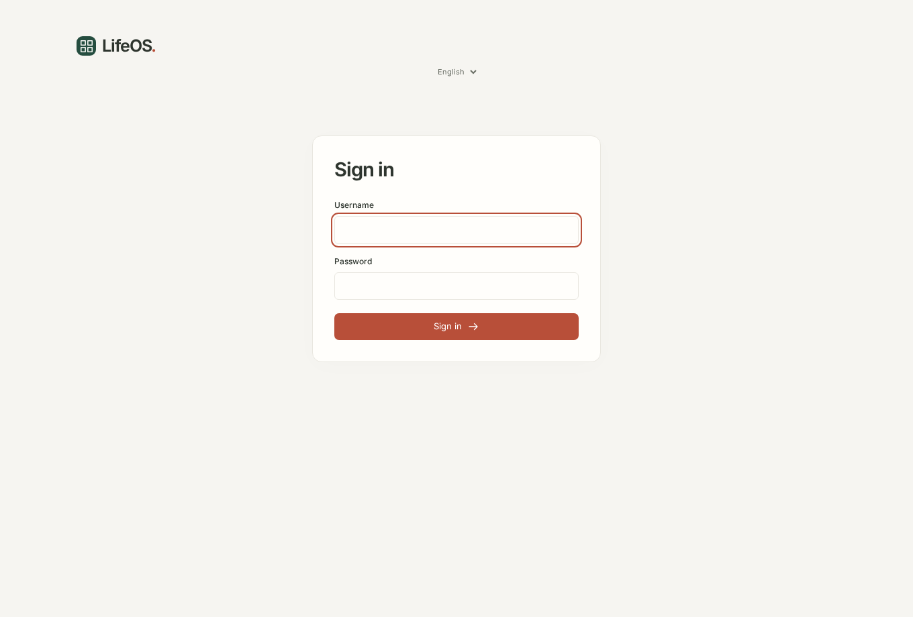
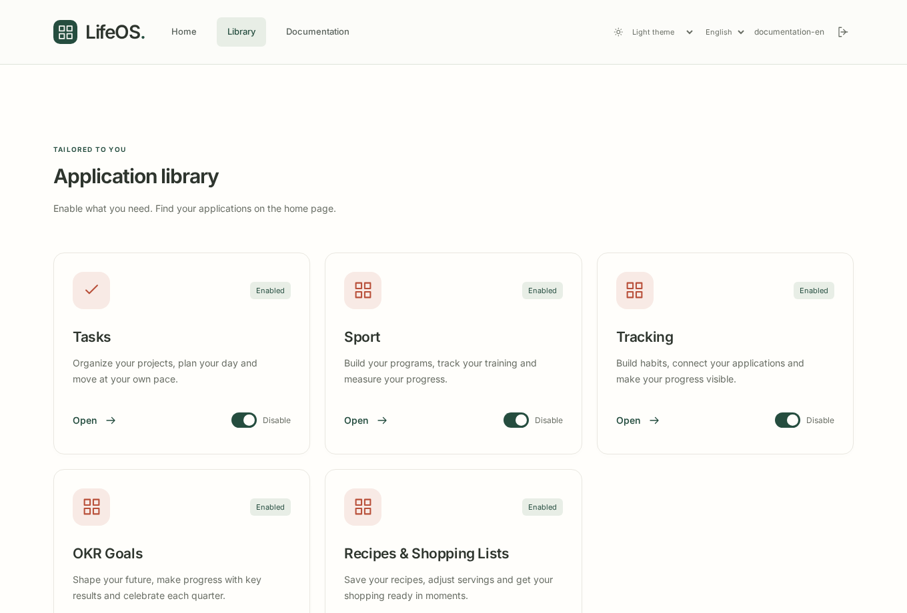
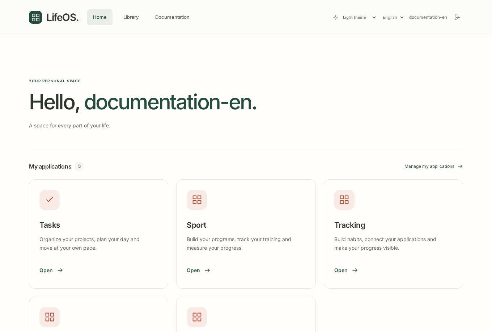
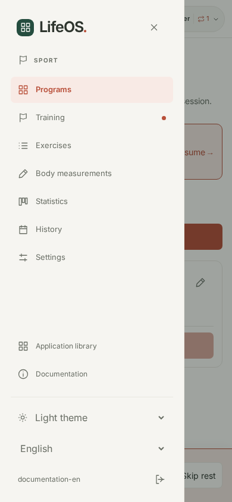

# Your LifeOS applications

After signing in, **Home** shows the applications enabled for your account. Choose **Open** on a card to use an application.

## Sign in

1. Open LifeOS and enter the username and password supplied by your administrator. Public sign-up is not available.
2. Choose the form language if needed, then **Sign in**. Your saved account language applies after login.
3. If you forget your password, ask your administrator to reset it; this signs out existing sessions.
4. Use **Sign out** in the footer when leaving a shared device. An expired session asks you to sign in again.

{ loading=lazy }

## Choose applications

1. Open **Library** in navigation or **Manage my applications** from Home.
2. Use the **Enable / Disable** switch on an application’s card. It also works with Tab and Space.
3. Return Home to see your saved selection.

The selection belongs to your account. It survives reloads and sign-out and is available on other devices. A network error is shown without pretending that a change was saved.

Disabling an application preserves **all its data**, including archives, dates, preferences and history. It removes the application from Home and blocks its business API routes. A direct link offers to open the library. Enable it again to access the same data. Disabling does not archive or complete tasks, cancel training or reset dates.

When every application is disabled, Home offers to explore the library. Sign-in, appearance, language and the library remain available. An open tab refreshes the application list when it returns to the foreground; a disabled application’s rejected request also offers a return to the library. Changes are not pushed instantly between devices.

{ loading=lazy }

*Library: enable an application before opening it.*

## Available applications

**Tasks** is enabled by default, including for existing accounts. It provides [workspaces, an upcoming agenda, lists, boards and recurrence](taches.md).

**Sport** is available and disabled by default. Enable it for [exercises, programs, training, body measurements and statistics](sport.md).

Household chores and plants are future ideas, not available applications. New applications appear in the library when released and start disabled unless a documented migration requires otherwise.

## Account, language and appearance

All applications share one session and the **system / light / dark** appearance setting. The account menu also contains **Language** and **Sign out**. On mobile, open navigation to reach it. Language and appearance are independent, persistent account preferences.

**English** translates the interface and supplied exercise catalogue. Your personal text stays unchanged, including customizable labels originally created in French. Newly created Tasks workspaces receive initial statuses in the language currently selected. After signing out, the sign-in page returns to the browser’s language; signing back in restores your account preference.

An expired session returns to sign-in and removes private views. HTML pages contain no private records; the API loads them only after authentication and activation checks. All preferences and application activation are also available through the [versioned API](api.md).

{ loading=lazy }

*Personal Home: open enabled applications.*

## Shared navigation

Tasks, Sport, Tracking, OKR Goals and Recipes share the same top bar and sidebar. The breadcrumb identifies the application and current view. On mobile, **Open navigation** shows the same links and footer; **Escape** or **Close navigation** closes the menu.

The footer contains, in order, the **Application library**, **Documentation** for the current application and language, the **light / dark / system** theme, **Language**, then the user and **Sign out**. Theme and language are saved to the account through the API. Business archives and settings remain among each application's navigation links.

**Tracking** is available and disabled by default. It provides custom habits, goals, Tasks/Sport data sources, guided entries, a month/year calendar, statistics and rewards. [Tracking guide](tracking.md). Disabling a source blocks new integration reads while preserving saved snapshots.

{ loading=lazy }

*Mobile navigation: library, documentation and account preferences.*

## OKR Goals available

**OKR Goals** starts disabled. Enable it to define personal/professional horizons, measure key results, work through a quarterly board and revisit past accomplishments. Quarterly plans fit within one month. Tracking discovers its metrics and 60 quests through the shared providers. [OKR guide](okr.md).

## Recipes and shopping available

**Recipes & Shopping Lists** starts disabled. Save recipes, scale servings, choose from 301 bilingual ingredients or your private catalogue, combine quantities and reuse templates or previous lists. The shopping mode, four Tracking metrics and 60 quests are included. [Guide](recipes.md).

## Use documentation and keyboard controls

An application’s **Documentation** link opens only its guide in your account language. **All documentation** lets you choose another guide; **English / Français** opens the equivalent translated page without changing your account. Search stays within the current guide and language.

Use Tab/Shift+Tab to move between controls, Enter or Space to activate them, and Escape to close menus/dialogs. On mobile, open navigation to reach all links. Affected unsaved forms ask before leaving. See the [progression guide](progression.md) for levels, quests, usage days and vacations.
