# Architecture

## Overview {#vue-densemble}

[ADR 011](decisions/011-dashboard-life-ai.md), approved in issue #104, separates Dashboard `/` from the activatable Life AI application `/ai`. `apps/life_ai` owns conversations, history, memory, sources, dictation, orchestration and receipts. `platform/assistant` retains capability/snippet contracts, LifeOS capabilities, providers, encryption, shared configuration and structured generation used by Recipes. PostgreSQL and existing tables stay unchanged; no new service, framework or storage.

The coordinator calls only relevant specialists: five domain specialists and a `lifeos` specialist for the platform. Manifests expose 119 domain capabilities; `platform/assistant/common.py` supplies 11 capabilities for library/activation, preferences, progression and integrations. Every application exposing capabilities owns `assistant.py` and supplies `ActionProvider` through its manifest; capabilities reuse the domain's schemas, ownership, versions, events and progression. The platform discovers injected contracts without importing applications. Snippets use application-owned React renderers loaded through the frontend registry, with versioned structured data and no generated executable code.

Message admission releases the owner lock before calling a provider. Each action opens a short transaction, rechecks session/activation/version and records the mutation and receipt together. Previews simulate the action in a rolled-back savepoint; confirmation executes the saved proposal with version checks. Conversation history, summaries and memories remain distinct. See [Assistant API](assistant-api.md), [data](donnees.md#assistant-ia) and [configuration](configuration.md).

Life retains the FastAPI / React / MkDocs monorepo. One Uvicorn process serves the API, compiled frontend and documentation. PostgreSQL 17 is the only added data service, under [ADR 002](decisions/002-gestion-taches.md).

[Mermaid source](../assets/diagrams/en/production.mmd)

Caddy terminates TLS and forwards to `life-web:8000` on `multisite_proxy`. The web service also joins the private Compose `database` network. PostgreSQL never joins the proxy network or publishes a host port; `postgres_data` persists its data. The application role owns its database without cluster-administration privileges.

Only `web` also joins the non-internal Compose `egress` bridge (`life_egress` in production), providing provider hostname resolution and outbound HTTPS for the assistant. `database` and the existing `multisite_proxy` network remain internal; no host port or additional service is introduced. AI adapters fix provider hosts; the ADR 009 public-page reader separately validates its destinations. The bridge itself does not filter traffic by domain.

In development, Vite, FastAPI and MkDocs have separate servers; Vite’s proxy keeps one origin. `compose.dev.yaml` provides a local PostgreSQL instance independent of production.

Application organization follows [ADR 003](decisions/003-applications-lifeos.md). Explicit registries assemble applications; the platform does not depend on business domains.

## Responsibilities {#responsabilites}

| Folder | Responsibility |
| --- | --- |
| `core/` | Settings, logging, engine and SQL sessions |
| `platform/auth/` | Login/authorization contracts, models and services |
| `apps/<id>/` | Each application’s manifest, routes, contracts, models and services |
| `apps/registry.py` | Explicit composition of available applications |
| `platform/applications/` | Manifest contract, catalogue, activation and access guard |
| `api/router.py` | `/api/v1`, platform routes and activation guard on each business router |
| `web/` | Controlled static-file delivery |
| `migrations/` | Immutable, versioned schema changes |
| `frontend/src/app/` | Shared session, explicit routing and enabled-app loading |
| `frontend/src/apps/<id>/` | Business page, components, types, styles and API |
| `frontend/src/components/layout/` | Home navigation |
| `frontend/src/platform/` | Session, theme, HTTP/CSRF transport and library |
| `frontend/src/shared/` | Reusable icons, accessible dialogs and styles |
| `frontend/src/styles/` | Global tokens and styles |
| `docs/` | Public documentation without personal data |
| `infrastructure/` | Caddy integration and PostgreSQL role initialization |
| `scripts/` | Explicit tests, publication, backup and restore |

Business services use SQLAlchemy directly: no generic repository layer, message queue or additional microservice. Request dependencies share one SQL session. Owner mutations are serialized and tasks use version numbers. See [Backend](backend.md) and [Data](donnees.md).

## Business flow {#flux-metier}

1. The browser creates an API session and receives an opaque HttpOnly cookie.
2. Reads check session, application activation and owner. Writes also check origin and CSRF.
3. The router calls the service: validation, mutation and events share one PostgreSQL transaction.
4. Tasks immediately renders transient in-memory intentions and saves through existing APIs in the background. Server responses confirm or restore values; indirect effects trigger reconciliation. View, theme and language preferences always use the API.

React stores no parallel business database in localStorage. Input fields and dialog state are transient. Task mutations require `expected_version` and return 409 if another write changed the task.

## HTTP and builds {#http-et-compilation}

`/`, `/applications`, `/settings` and manifest paths (`/tasks`, `/sport`, `/tracking`, `/okr`, `/recipes`, `/ai`) are the only React HTML routes. Assets live under `/assets/`, API under `/api/v1`, Swagger under `/api/docs` and MkDocs under `/documentation/`. Unknown paths remain 404. Frontend API URLs are relative; rendering has no separate network service.

[Build Mermaid source](../assets/diagrams/en/build.mmd)

The runtime includes application Python dependencies, CLI, migrations and compiled files. Node, Vite, Playwright and MkDocs do not run in production. The runtime user is unprivileged and its filesystem read-only.

uv/npm lockfiles are versioned. Images carry the full source SHA, although base-image tags can change between rebuilds. Retain the deployed image and database backup. An older image never reverses a migration.

## Chosen limits {#limites-choisies}

This is a personal application: no workspace sharing, public registration, SSO, real-time synchronization or offline synchronization. Sport provides internal statistics; Tracking consumes Task events and Sport results through injected metric providers. No screen time is collected. Search uses SQL substring matching and the frontend loads every task in a view; large volumes would require measured pagination/indexing improvements.

Recurrence stays inside `apps/tasks`: `recurrence.py` validates/calculates dates using python-dateutil; `scheduling.py` parses account-language French or English. Completion advances the task in the existing transaction without a scheduler or additional service. The frontend requests parsing/preview from the API and retains only temporary drafts.

French parsing delegates vocabulary/numbers to `scheduling_language.py` and clause parsing/composition to `scheduling_grammar.py`. These internal Tasks helpers compile to the existing `Recurrence` contract; there is no new persistent format, dependency or external interpretation service.

The [initial ADR](decisions/001-architecture-initiale.md) remains unchanged. Structural changes require the repository’s explicit-approval process.

## Activation and boundaries {#activation-et-frontieres}

Composition injects the backend registry into `app.state.applications`. Platform services receive definitions without importing applications. The frontend registry maps the same identifiers to lazy Pages; API responses supply names, descriptions, paths and states. No business imports cross application boundaries.

`platform/auth/SessionProvider` owns session and theme. `platform/applications/ApplicationProvider` loads activation and refreshes on return to the foreground. The shell unmounts Pages on disable, expiry or sign-out. The server guard in `api/router.py` remains authoritative, including direct requests. Shared components do not require Tasks CSS.

See [contracts/invariants](donnees.md#activations-des-applications), [API](api.md#bibliotheque-et-activation) and [adding an application](evolution.md).

## Approved internationalization {#internationalisation-approuvee}

[ADR 004](decisions/004-internationalisation.md) adds account language and i18next/react-i18next. `platform/i18n/` initializes the engine; `shared/locales` owns common text and each application its resources. `core/i18n.py` provides request context without importing business domains; domains load their own messages. Localized metadata remains in backend manifests. Sport separates identifiers/text and localizes responses without rewriting snapshots. `scheduling_english.py` joins the existing grammar. See [Internationalization](internationalisation.md).

## Integrations and Tracking {#integrations-et-suivi}

[ADR 005](decisions/005-integrations-tracking.md), approved on 16 November 2026, adds optional manifest `metrics`. `platform/integrations/` owns neutral contracts, periods, discovery, validation and activation checks. Implementations stay in `apps/tasks/integrations.py` and `apps/sport/integrations.py`. The injected registry is the sole composition point. Domains never read one another’s tables. Private options/evaluations require source activation and ownership; discovery includes only metadata public to the signed-in account.

`apps/tracking` owns definitions, revisions, periods, values, snapshots and history. Its service computes scores, XP and calendar from that data. Sources are explicitly refreshable snapshots, without background calculation or another service. Global migration `0009_tracking` adds five tables and protects histories from updates/deletion.

Tasks, Sport and Tracking compose `shared/ui/ApplicationNavigation` with their navigation, account menu and actions. The component depends on no application/session service. Tracking uses shared transport and `platform/useApiResource` to cancel or ignore stale reads. See [integrations](integrations.md), [data](donnees.md#donnees-de-suivi) and [API](tracking-api.md). Reusable metrics HTTP/types live in `frontend/src/platform/integrations/`; configuration/input components belong to Tracking.

## Shared progression {#progression-commune}

[ADR 006](decisions/006-progression-applications.md), approved on 16 November 2026 in issue #58, adds `platform/progression`: shared level/streak engine, preferences and PostgreSQL journal. Manifests carry optional `progression` providers. Each application owns its catalogue and converts only its own data to activities. The registry remains the only composition point. Confirmations record facts/rewards in the business transaction; HTTP reads have no side effects. Historical backfill explicitly targets a named account.

Frontend `platform/progression` supplies API client, settings and the badge injected into `ApplicationTopbar`’s neutral `status` slot. `shared` still depends on neither platform nor applications. Tracking composes the wall/journal; other badges work independently of its activation. Ownership, CSRF, activation and stale-response protection remain. Per-application usage days extend existing JSONB preferences/calculations without changing provider contracts or boundaries. See [API](api.md#progression-par-application), [data](donnees.md#donnees-de-progression) and [guide](progression.md).

## OKR Goals {#objectifs-okr}

`apps/okr` adds objectives, key results and quarterly history under ADR 003. Its `integrations.py`/`progression.py` follow ADRs 005/006. Both registries are the only composition points; there is no new infrastructure or boundary change. Additive migration `0011_okr` adds three tables. Key results/snapshots stay JSONB in PostgreSQL; only drafts are transient in React. See [guide](okr.md), [API](okr-api.md), [data](donnees.md#donnees-okr).

## Recipes and shopping {#recettes-et-courses}

`apps/recipes` follows ADRs 003–006 with no new cross-cutting contract: manifest, business logic, metrics and progression providers compose through existing registries. `0012_recipes` adds six tables for supplied/private ingredients, recipes/items, lists/templates/items and events. The bilingual 301-ingredient catalogue is fixed in migration data. PostgreSQL stores quantities as `NUMERIC(18,6)`; services calculate with `Decimal`. No browser business storage. Web import uses the private services and AI provider defined by [ADR 010](decisions/010-import-web-recettes.md), preserving domain boundaries. [Guide](recipes.md), [API](recipes-api.md).

Shopping lists and templates also accept free items through `0017_shopping_free_items`, with a personal name and optional catalogue reference. This stays within the existing `apps/recipes` models, schemas and services, with no new storage or cross-application contract change; recipes retain structured ingredients.

## Separate documentation guides

The eight FR/EN guides share the existing MkDocs build and static server. `mkdocs.yml` assigns pages to guides; `scripts/documentation.py` supplies navigation, previous/next links and search indexes scoped to each guide and language. The language link opens the equivalent page; an explicit link returns to the directory. Existing source paths and URLs remain stable, with technical translations under `docs/en/`. No service, storage or business boundary changes.

## General settings

[ADR 007](decisions/007-reglages-generaux.md), approved in issue #76, extends the frontend manifest with an optional `Settings` panel. The shell composes `/settings` from the existing registry and server catalogue. Business forms stay in their applications; shared preferences stay in their existing modules. Panels report drafts/pending writes and business panels mount only for enabled applications. No additional table, API or infrastructure. See the [guide](settings.md).

## Multimodal sources and dictation

[ADR 009](decisions/009-sources-assistant.md), approved in issue #89, introduced sources now owned by `apps/life_ai`, with private PostgreSQL sources, typed provider blocks, bounded extraction and transient transcription. No new service, object storage or vector database. The web reader only adds HTTP/HTTPS connections to explicitly imported public pages, validating DNS/IPs and redirects and connecting to a verified address while retaining the TLS hostname. AI adapters keep fixed hosts.

PDF/image/XML parsing and web reading run in disposable processes limited by CPU, memory and time; no external HTML executes. Admission reserves quota before reading, releases SQL during I/O, then revalidates session and owner. Direct instructions remain separate from sources: persistent `external_context` forces mutation previews and disables automatic memory, including follow-ups. No persistent external summary; recent context and ID-based source reading remain bounded. See [data](donnees.md), [API](assistant-api.md) and [backups](sauvegardes.md#migration-0016-sources-and-dictation).

[ADR 010](decisions/010-import-web-recettes.md) adds private recipe browser/proxy services. Business rules stay in `apps/recipes`, reusable typed generation in `platform/assistant/structured.py`. Internal networks, ephemeral sessions and atomic saving bound this approved extension.

## Dashboard and Life AI activation

The shell supplies `ApplicationPageProps`: registry modules, an optional launch (`id`, `applicationId`, `text`) and a consumption callback. `platform/navigation.ts` handles same-document URL changes and back-navigation guards; `history.state` contains only a position. Replacing session/language also unmounts the intent. Old `/?conversation=…` links redirect. All Life AI routes, including source/dictation subrouters, use the central activation check and revalidate long operations. Migration `0020_life_ai` enables existing accounts while preserving explicit preferences; new accounts default to disabled. Optional progression/capability contracts remain absent for conversation controls, without artificial badges or quests.
