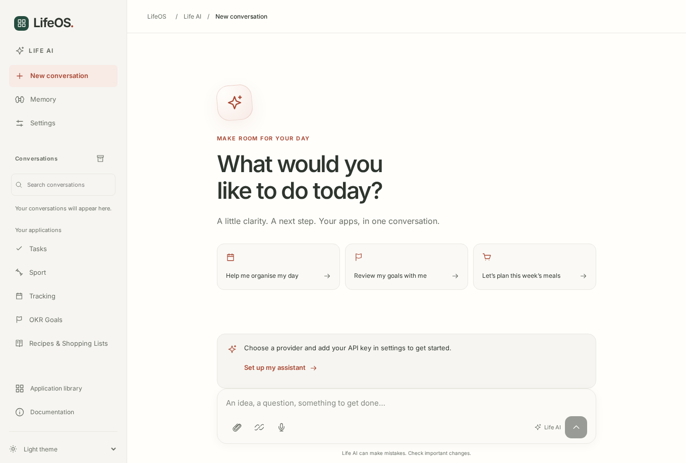

# Life AI

[Guide français](../assistant.md)

**Life AI** is your conversation application at `/ai`: history, memory, documents/images/web pages and dictation. Open it from Dashboard or the library. Inspect and change enabled applications: Tasks, Sport, Tracking, OKR Goals and Recipes & Shopping Lists.

Dashboard/Life AI separation follows [ADR 011](decisions/011-dashboard-life-ai.md). Validation evidence and the published commit are recorded in [issue #104](https://github.com/ThibaultLeveau/life.thibault-leveau.com/issues/104).

## Configure a provider

Open **Settings → Life AI → AI provider (or General)**. Choose OpenAI, Anthropic or Google Gemini, enter the identifier of a model available to your provider account and its API token, then save. **Test connection** makes a real provider request and may consume quota. The model must support the assistant's tools and streaming responses.

The server encrypts the token. The interface only retrieves its configuration status and a masked suffix. Leaving the field blank preserves the token; **Remove token** explicitly deletes it. Changing provider clears the previous token and model: enter the new provider's credentials. A missing or unreadable server key requires administrator intervention or a replacement token; other applications remain accessible.

Your messages, useful memories and data needed by tools are sent to the chosen provider. Its processing terms and billing apply. A subscription to an external chat interface does not replace this API token.

## Read and change your data

Try precise requests: “Which tasks are due this week?”, “Add Read for twenty minutes tomorrow in my Personal workspace”, “Show my last training session”, “Review my goals” or “Add this recipe's ingredients to my shopping list for four people”.

Life loads the relevant application's tools and reads objects before changing them. The same validation, versions and history as the application interface apply. A disabled application cannot be read or changed by the assistant; re-enabling preserves its data. An explicit request can also enable or disable an application, change language or theme and manage progression preferences. Life can read levels, streaks, reward history and metrics from enabled applications.

Explicitly requested simple changes may be saved directly. Suggestions, bulk changes and destructive actions show a **preview requiring confirmation**. Cards bring small application views into the conversation: the affected object, useful values, a result or an application link. A preview is not a saved change. Confirmation rechecks permissions and versions; if the object changed, request a new preview.

## Consultations and card details

Intermediate reads are grouped under **Consultations**, collapsed beneath the answer by default. Expand it to inspect the consulted objects. Every proposal awaiting confirmation remains visible, even when there are more than three; saved changes remain distinct from reads. Receipts keep their order and confirming a proposal replaces its preview without duplicating the action. A visible card stays on screen after confirmation and retains focus.

Each card offers **View all details**: complete instructions, ingredients, exercises and set values, key results, tracking fields or preferences. The summary stays short; **Read full text** also expands long text directly in the card, without an inner scrollbar. Both controls can be collapsed again. Lists are no longer silently cut to three, five or eight items. Technical references remain available through the API.

In a shopping card, the list title stays separate from its items. The summary shows up to five items with their quantity on the same line when space allows; only item rows have a purchase indicator. **View all details** keeps every item in a compact layout: name and quantity, purchase status, quantity in the basket and category. Templates use the same condensed layout, without purchase indicators in the summary. Dates and other receipt information remain available. These cards are snapshots; to check off items, open the application using the card link.

Details cover the actual consulted result. When a search returns a page, the number received and the total are shown; the application link lets you continue browsing. Empty results have an explicit message. Disabled applications and unsupported card versions do not reveal their details.

Numbers, dates and units follow the account language: for example **350 g** and **1.25 g** in English, **1,25 g** in French. Redundant trailing zeroes disappear while useful small quantities (up to Recipes’ six decimal places) remain visible. Formatting does not change saved values. Model instructions distinguish concise answers from complete proposed record content; review a proposal before confirming it.

These controls support Enter/Space, shared themes and 320 px screens. Expanded details scroll with the conversation.

## Tables in messages

Messages display Markdown tables as columns with a header row, including in saved conversations. Bold text, inline code and column alignment are preserved. On small screens, swipe horizontally inside a wide table; with a keyboard, focus the table using Tab and scroll with the arrow keys.

A table needs a header and a matching separator row, for example:

```text
| Task | Details |
| --- | --- |
| Write my profile | Career milestones and concrete examples. |
```

Use `\|` for a literal pipe inside a cell. Until a valid separator arrives during a response, the text remains visible as written. Code blocks keep their literal contents. This formatting changes only the display: it does not create tasks or modify the saved message. HTML, images and links in messages remain inert text.

## History and interruptions

Create a conversation, find it with search, rename it or archive it. Archiving preserves messages and supports restoration. Restore an archived conversation before sending another message. Deleting permanently removes the conversation and its receipts; separately choose whether to forget its sourced memories.

After deletion is confirmed and succeeds, you return to the assistant home: the conversation and its draft leave the screen. You can start a new conversation. Cancelling or a failed deletion keeps the conversation open.

Responses appear progressively. **Stop** prevents further steps; changes already committed remain visible and are not undone. After disconnection, reload the conversation to inspect its status and saved receipts before asking to continue. An interruption never automatically repeats writes. Only one response can run per account at a time.

A reply may be partial when credentials, quota, provider timeouts or business validation prevent completion. Success text without a confirmed receipt is not proof of a saved change. Cards distinguish proposals from results, and you can verify the object in its application.

## Understand and manage memory

Memory retains durable facts you communicate: your name, profession, active projects, preferences or useful personal context. A memory extracted from chat has a source conversation, message and dated excerpt. Fictional examples, application text and assumptions must not become personal facts. Sensitive facts require an explicit request to remember them; do not provide secrets in chat. Fact selection depends on the model, with conservative server checks for refusals and sensitive FR/EN patterns. These checks do not detect every wording or language: review saved memories and correct them when needed.

Open **Memory**, from chat navigation or Life AI settings, to inspect, add, correct or remove a memory, or forget everything. Disable memory in AI settings to stop injecting saved memories and automatically adding new ones. Memories and conversation history are separate; deleting a conversation without choosing to forget preserves its memories.

Corrections, forgetting and memory toggles clear derived summaries and exclude older messages from reused context. Messages remain visible in history, but an old source must not silently recreate a forgotten memory. A running reply is interrupted if its memory version becomes outdated; send your request again with useful context. Local deletion cannot retract data already sent to a provider.

## Documents, images and web pages

Attach a file, drop it into the composer or paste an image. **Add a web page** imports an explicit URL; mentioning a link in a sentence does not download it. Wait until sources are ready, then send a question or the sources alone. Remove a draft attachment, retry failed imports and find sources again in history. Admission failures preserve the draft; uncertain network failures recover saved state without automatically resending.

| Source | Support and limits |
| --- | --- |
| PDF | Text and pages through a compatible model; up to 10 MiB and 50 pages |
| PNG, JPEG, WebP | Visual analysis; 5 MiB, maximum side 8,000 pixels, 40 million pixels |
| TXT, Markdown, CSV | UTF-8 text; 10 MiB and 120,000 extracted characters |
| DOCX, XLSX, PPTX | Extracted text and available cell values; 10 MiB and 120,000 characters. No formula/macro execution or embedded image/chart analysis: export to PDF to retain visuals |
| Public page | Directly accessible HTTP/HTTPS HTML or text; no login, JavaScript or automatic link crawling |

A message accepts four sources, 20 MiB and 50 PDF pages combined. Unreadable, encrypted, oversized or unsupported active structures produce errors instead of silent truncation. The selected model must support image/PDF inputs and may impose lower limits. Selected sources are sent to the configured provider under its processing and billing terms.

Sources persist with the conversation. Unsent imports expire after 24 hours and are cleaned during source operations; the default quota is 200 MiB per account including extracted content. Two simultaneous imports, 32 drafts and 2,000 non-removed sources bound accumulation. Removing a saved source erases its content but leaves a message receipt; existing replies quoting it remain in history. Deleting the conversation also deletes its sources. Local deletion cannot retract data already received by a provider or stored in an older backup.

Every proposed mutation in a conversation containing external sources requires confirmation, including after removal. Automatic memory extraction is disabled there; use **Memory** to explicitly save a fact. Recent context includes up to ten messages; older documents remain accessible by reference within reading budgets; name the document you need in a long conversation.

## Dictate text

The microphone button requests permission and shows recording status. Stop to transcribe or cancel to discard. Capture is limited to two minutes and 10 MiB. Text is added to your draft without replacing typed content; review and edit before Send. Dictation never automatically sends a message. Microphone refusal, interruption and provider failures remain visible; typing is still available.

In dictation settings, reuse the chat’s OpenAI or Gemini provider or explicitly configure a separate provider and token. Anthropic chat requires OpenAI or Gemini for transcription. OpenAI defaults to `gpt-transcribe`; Gemini reuses the selected model. Availability depends on your account and quota. Audio is sent to the provider and remains transient on LifeOS; only messages you send are saved. The server allows one concurrent transcription and 30 requests per hour per account. Dictation requires HTTPS and audio-recording support; it does not require browser-specific speech recognition.

## Limits and accessibility

Multimodal sources follow the limits above. No unrestricted browsing, code execution or automatic third-party login. Turns have duration and call limits; text-only histories may be summarized, while conversations containing sources use recent context and bounded references. Models can make mistakes or ask for clarification. Cards are controlled LifeOS components, never generated code executed from a response.

Chat uses light/dark/system themes, FR/EN languages and shared navigation. On mobile, open navigation for history and the library. Tab and Shift+Tab move between controls, Escape closes dialogs, and system reduced-motion preferences apply. Signing out or session expiration removes private data from the interface.

All operations have an [independent API](assistant-api.md). See [settings](settings.md) and [backup rules](sauvegardes.md#migration-0015-assistant).

## Creating multiple tasks

For example, ask “Create a Portfolio workspace and prepare these ten tasks…”. The coordinator can delegate workspace creation, then pass its confirmed identifier to the Tasks specialist. Separate subtasks can start fresh instances of the same specialist; delegations run sequentially in the existing process. For multiple creations, the assistant prefers **Import tasks**: 1–100 tasks with a complete preview and confirmation. A preview creates no tasks; confirmation saves the entire batch or nothing. Do not confirm duplicate proposals.

Default budgets are 96 model calls, 200 business actions and 600 seconds per response. Each specialist has at most 24 exchanges, and the coordinator 16; administrators can lower the global budgets in configuration. These guardrails prevent loops and unbounded costs; they do not limit the number of stored tasks. A slow provider can still exceed the deadline. After interruption, committed actions remain saved and must not be recreated.

## Dashboard, activation and first message

Dashboard `/` remains an overview. Its chat card accepts up to 12,000 characters. **Let’s talk** opens Life AI and sends the text once using saved configuration. Missing configuration or rejection before admission preserves the draft; editing while settings load cancels automatic sending. After an uncertain network error, inspect history before resending. Reloading may lose an unsent draft: it is not stored in the browser.

Old `/?conversation=…` links still work and open `/ai?conversation=…`. Browser back, language changes and logout protect drafts. Active runs block internal navigation. Deactivation from another tab stops subsequent steps; committed actions keep their receipts. Re-enable Life AI to recover its data. Configure memory and dictation under **Settings → Life AI**. The provider is shared with Recipes and remains configurable in General while Life AI is disabled. Chatting awards no XP.

{ loading=lazy }
