# Data and history

## AI assistant {#assistant-ia}

Additive migration `0015_assistant` creates seven private tables. `assistant_settings` stores provider, model, encrypted token, masked suffix and memory enablement/version/cutoff. `assistant_conversations` stores title, archive state and dated summary; `assistant_messages` stores content, role, status, snippets and run reference. `assistant_runs` has unique intention `(user_id, request_id)`, request fingerprint, original session, status and memory version. `assistant_run_events` enforces unique `(run_id, sequence)`. `assistant_operations` enforces `(run_id, step)` and retains arguments, fingerprint, precondition, status and result. `assistant_memories` holds content, category, sources and dates.

All reads are owner-scoped. Business writes and their receipts commit together; previews leave business data unchanged. Interrupted turns retain partial successes and never implicitly resume writes. Run states are `running/complete/interrupted/failed`; operation states are `preview/complete/failed`. Confirmations expire after 24 hours and retain business version checks. Disabling an application preserves assistant history but blocks new business actions.

Forgetting, correcting or toggling memory increments `memory_version`, sets a context cutoff and clears account summaries. Older messages stay visible but are not reinjected; turns using the old version stop. Chat memories have an exact source excerpt; manually added memories may have no source. Deduplication compares case-insensitive content. Accounts can retain 500 memories of up to 1,000 characters; context includes at most 40 memories, ranked by query relevance and profile/profession priority, then by update time.

Extraction requires an explicit request for categories other than `profile`, `profession`, `projects` and `preferences`, or when a sensitive FR/EN pattern is detected, even if the model says otherwise. Explicit refusals prevent extraction. These conservative checks supplement model classification; they do not provide exhaustive sensitive-data detection in every language.

Summaries process JSON batches of at most 60,000 characters. Oversized messages are split into parts; `summary_until` advances only after the whole message is processed. Each completed batch saves its summary in a short transaction. Interruption or exhausted budgets preserve the last completed summary and uncovered messages without treating truncated input as summarized.

Deleting a conversation cascades to messages, runs, events and receipts. By default memories survive with null source references; `forget_memories=true` also deletes them and invalidates context. Application business objects are unaffected. Tokens are authenticated encrypted envelopes binding user and provider; the secret keyring is excluded from dumps. See [backup/restore](sauvegardes.md#migration-0015-assistant) and [API contracts](assistant-api.md).

## Relationships {#relations}



[Mermaid source](../assets/diagrams/en/data.mmd)

| Table | Data and constraints |
| --- | --- |
| users | UUID, normalized unique username, Argon2 hash, theme, non-null fr/en locale defaulting to fr |
| login_sessions | Opaque cookie hash, user, CSRF hash, UTC expiry |
| application_preferences | Composite user/application key, boolean activation and last-change UTC time |
| login_limits | Hashed account/IP key, count, expiry |
| workspaces | Owner, optional parent_id, name, description, color, order, creation/archive dates |
| sections | Workspace, name/description/color/order, list/board/both visibility, archive |
| task_statuses | Workspace, name/color/order and completion type |
| task_labels | Workspace-local labels with case-sensitive unique name |
| tasks | Workspace, optional section, status, text, priority, due date, position, version/dates |
| task_label_links | Task/label association constrained to a shared workspace |
| view_preferences | One validated JSONB configuration per workspace |
| agenda_preferences | One validated JSONB configuration per account; user_id primary/foreign key |
| task_events | Immutable lifecycle journal with historical context |

Business primary keys are UUIDs. Composite foreign keys require task section/status/labels to share its workspace. Priority is 1–4, position nonnegative, version positive. The server guarantees at least one open/completed status per workspace; changing an in-use status’s type is rejected, archives included.

Descriptions are plain text. Due dates are calendar DATEs; creation/update/completion/archive/event dates are timezone-aware UTC instants. Browsers render instants locally and supply local today for filters.

## Workspace hierarchy {#hierarchie-des-espaces}

Nullable, indexed workspaces.parent_id was added by migration 0002, leaving existing workspaces at root. Composite `(parent_id,owner_id)` → `(id,owner_id)` ensures parent existence/same owner; CHECK prevents self-parenting. Services prevent indirect cycles and enforce archive rules under the owner mutation lock, including simultaneous moves. Administrative SQL must honor these service invariants.

There is no business depth limit. Active workspaces have active parents or no parent. Creation/reparenting/restoration require active parents; archiving refuses active direct children. Archived children keep their parent and restore explicitly, parents first. Global position defines sibling order; reparenting preserves it. No IDs, sections, statuses, preferences, tasks, completion dates or events change. Hierarchy changes themselves have no journal.

## Agenda preferences {#preferences-de-lagenda}

After 0002, additive 0003_agenda adds only agenda_preferences. First PUT creates a row; missing rows use defaults. The server validates period, 1–90-day horizon and overdue/completed inclusion. Clients cannot choose owner. Shared account-write serialization makes the last valid replacement current.

Agenda reads existing tasks without copies, new due dates, completions or historical changes. Task lifecycle constraints remain. PostgreSQL backup includes preferences, verified through synthetic restore.

## Completion and reopening {#resolutions-et-reouvertures}

| Transition | Effect |
| --- | --- |
| Create open | created, completed_at null |
| Create completed | created then completed |
| Open → completed | completed, new completion instant |
| Completed → open | reopened, completed_at null; old events retained |
| Open → open or completed → completed | Movement without another completion; completion date retained |
| Repeat complete/reopen in requested state | No event/version change with current expected_version |
| Individual archive/restore | archived/restored; completion state unchanged |

Events include kind, occurred_at, task/workspace/section/status IDs, previous_status_id, was_completed, is_completed and context.before/after. Context preserves event-time names/IDs of workspace/section/status, never task title/description/password.

PostgreSQL immutable_task_events blocks ordinary UPDATE/DELETE. Operators remain responsible for backups/administration; this is not cryptographic evidence against database administrators. Context IDs have no foreign key to former statuses so history survives removal. Tasks keep UUIDs through moves.

## Recurrences and occurrences {#recurrences-et-occurrences}

0004_recurrence adds nullable recurrence JSONB and recurrence_completed initialized to zero. CHECKs require nonnegative count and, for a non-null recurrence, a JSON object and non-null due date. Pydantic/services validate the full frequency/calendar/bounds/timezone/exceptions contract under owner lock. Administrative SQL must honor business rules too.

Rules contain start_date anchor, IANA timezone, calendar RRULE, scheduled/completion mode, optional ending and exceptions. Due date identifies the current occurrence and may move without changing the anchor. Definition changes reset the count without rewriting events. API titles remain literal; the interface explicitly parses enabled recognition.

Extended French grammar leaves format/schema unchanged. Clause trees, diagnostics and pre-cleanup text are transient. Stored rules are never reparsed; anchors/count/history remain. New first-date alignment applies only to explicitly requested parsing.

Each open → completed transition records a completed event with UTC time and occurrence context: due date, rule, count, completion time/version and workspace/section/status. If another occurrence exists, the same UUID reopens, receives the next due date, clears completed_at and adds rescheduled referencing completion_event_id. One transaction and one version increment cover both. Cross-workspace completion chooses an open destination status for the next occurrence. Archives create no completion and preserve dates/rules/count.

Only the current occurrence is materialized; no scheduler or duplicated task. Intermediate overdue dates are skipped on next completion without false completions. max_occurrences counts actual completions of the current definition, not calendar dates. Reaching the end leaves the task completed. Manual reopening allows work on that final occurrence while retaining old completions.

Undo of the latest completion restores open state/date/count and adds completion_undone referencing the completed event. Any intervening version change prevents undo. This compensating journal preserves immutability; net statistics exclude undone completions. For occurrence delays, rescheduled begins the next cycle and completion_undone resumes the undone cycle. Pre-0004 events remain readable without the extra context.

## Ordering and movement {#ordre-et-deplacements}

Task position defines workspace-wide order, filtered by section/status in each view. Move specifies workspace, section, status and optional before_id in the destination section; omission appends. Affected positions normalize without changing other completion dates.

Cross-workspace references change atomically. Labels transfer by exact name: existing names retain destination colors; otherwise create with source color. Old links disappear; task/journal remain.

Removing an in-use status requires a same-type replacement. Active/archived tasks are reassigned with moved events without artificial completions. Removing a label clears associations/relevant filter, not tasks.

## Archives and preservation {#archives-et-conservation}

Workspaces, sections and tasks are never permanently deleted. Parent archive hides tasks without altering individual dates. Follow child-first archive/parent-first restore for subworkspaces. Restore reveals active tasks but does not restore individually archived ones. Editing an archived task requires restoring parents then task.

Metadata edits and label associations do not form a complete audit of every text. The journal covers task lifecycle, not all prior content. No automatic history purge exists. Future permanent deletion must specify statistics/backup effects.

## Future statistical use {#exploitation-statistique-future}

Count completions by UTC day and historical workspace:

```sql
SELECT workspace_id, (occurred_at AT TIME ZONE 'UTC')::date AS day,
       count(*) AS completions, count(DISTINCT task_id) AS distinct_tasks
FROM task_events
WHERE kind = 'completed'
  AND NOT EXISTS (
    SELECT 1 FROM task_events AS undo
    WHERE undo.kind = 'completion_undone'
      AND undo.context->>'completion_event_id' = task_events.id::text
  )
GROUP BY workspace_id, day
ORDER BY day;
```

Completing twice after reopening yields two completions. Per-cycle delays pair completion with preceding creation/reopening; local-day reporting explicitly converts to the chosen timezone. Indexes cover task chronology, workspace completions and usual filters. No dedicated Tasks statistics dashboard is delivered.

## Duplication and bulk actions {#duplication-et-operations-groupees}

Duplicates are open with new UUID/creation/update dates, version 1, zero recurrence completions and one created event. Source/events stay unchanged. Business fields, labels, due date/rule copy, including completion-mode dates preceding the initial anchor after early completion. Copies inherit no completion event/date.

Batches of 1–500 use existing owner serialization/transaction. Validate all versions before mutation; order, associations and events roll back together. Rescheduling adds updated and preserves rule/count. Movement adds moved while preserving open/completed type and completion date. Normalization can increment other tasks’ versions.

The UI’s Delete means existing archival, not erasure; PATCH and Archives restore it. Selection is transient browser state with no table/preference. This delivery used 0004_recurrence without extra schema/restore requirements; later 0005_applications adds the library without changing bulk behavior. Backups cover copies and bulk events.

## Application activation {#activations-des-applications}

0005_applications adds only application_preferences. Composite `(user_id,application_id)` primary key prevents duplicates; user references an existing account, ID matches `^[a-z][a-z0-9_]{0,49}$`, enabled/updated_at are non-null. Shipped manifests define the catalogue; services reject unknown IDs, and administrative SQL must respect it.

Missing rows use manifest defaults (true Tasks, false new applications). First PUT creates a row even for the default; later actual changes update UTC time, repeated state is idempotent. Toggles use the same owner lock as business mutations, so a write beginning after validated disable cannot bypass it.

No business tables/events change. Disable/re-enable preserves task dates, versions, recurrence, archives and views. No activation audit, uninstall or purge exists; updated_at is latest change only. Dumps retain explicit preferences; implicit defaults depend on image commit, so keep image and dump together. The diagram above covers Tasks relationships; library adds one user → multiple application preferences.

## Sport {#sport}

Additive 0006_sport follows 0005_applications. sport_exercises holds personal name/type/muscle/equipment/notes; 680 supplied exercises remain versioned code resources without private copies. sport_workouts stores ordered JSONB entries with exercise ID, snapshot name/type, sets/targets. sport_settings stores per-owner rest, version and view preferences. sport_measurements stores calendar date, optional JSONB values, notes/archives.

Private objects reference users, have positive versions, creation/update dates and reversible archives (settings have no history). A partial unique index permits one active measurement per owner/date. Services validate names/types/units/bounds/JSON/set counts/exercise ownership; direct SQL is not a business API. Supplied stable IDs cannot be globally modified.

sport_sessions uses a composite program/owner foreign key; a partial unique index allows one active session per owner. It stores program snapshot, performed set results/UTC dates, skipped zero results added at finish, start/end/rest dates, active/completed/cancelled status, notes/version, comparison signature, metrics, score and baseline. Services enforce unique index pairs/typed entry; SQL enforces coherent status/dates, positive version and no rest after finish.

New entry snapshots contain suggested_values, typed/null entries matching set count. At start, the server searches newest-to-oldest ended/cancelled history for this owner/program, matching exercise/type/duplicate rank/set index. Targets/history never change. Older snapshots without the field remain readable as an empty list. Suggestions are never accomplishments; v2 can use them to calibrate reference fields without targets. Only performed sets feed later suggestions. Existing JSONB supports this without SQL migration; dump/restore comparisons include it. See [older-image limits](sauvegardes.md#propositions-de-series-sport).

Transitions occur through API: confirm/correct/undo while active; finish anytime with zeroes for remaining sets; or cancel retaining performed sets only. Corrections preserve confirmation dates; undo then reconfirm creates a new date. Finish freezes API history. No cascading erasure or permanent deletion. Exercise/program archive and disabled Sport preserve sessions/dates.

Skipped results carry skipped true, zero applicable measures and completed_at equal to finish. Missing historical markers read as false. User-input bounds stay strict; output accepts zero repetitions/duration/distance/calories. Finish preserves previous results/dates, stops rest and increments version once atomically. Skipped results stay in history but not performed-set counts/suggestions. No SQL migration or rewrite; see [compatibility](sauvegardes.md#fin-de-seance-sport-incomplete).

V2 metrics/scores save in the completion transaction, including partial/empty sessions. Signature covers IDs, types, order and set counts. `metrics[].scoring` adds an optional JSONB object (version 2, per-set references/sources, counts and effort-ratio sum); `score_details` is an API summary derived from these saved values without writes on reads. Older metrics without `scoring` remain valid. Known references propagate from the latest earlier v2 session of the same owner/program/signature; unknown fields use the current snapshot’s targets, suggestions or performed values. `baseline_id` identifies that v2 family root, distinct from the previous formula. Skipped sets contribute zero without becoming references.

Explicit `POST /scores/backfill` fills only this owner’s missing completed-session scores, in finish/id order. It preserves existing numeric scores, raw metrics, results, dates, notes, versions and progression; only this repair may enrich a completed history’s score. It is atomic, idempotent and serialized by the shared account lock. No SQL migration or automatic session rewrite. See [formulas](sport.md#statistics-and-score), [API](sport-api.md#reparer-les-scores-manquants) and [compatibility](sauvegardes.md#score-sport-v2).

### Competition dates {#dates-de-competition-sport}

0007_hyrox adds nullable DATE competition_date to programs/sessions. Earlier rows become null without name inference/history rewrite. API accepts optional ISO years 0001–9999. Name affects only branding; renaming does not clear stored date.

Dates survive archives/disable. Starting copies date/name into the session; later program edits, sets and finish do not change it. Date affects neither score/signature/rest. Sport dumps preserve both. Downgrade refuses any non-null date in either table.

## Language and supplied text {#langue-et-textes-fournis}

0008_locale adds account language without rewriting content. Partial preferences retain absent fields. Supplied Sport IDs/types/facet codes are independent of FR/EN labels. Responses translate names without rewriting workout/session entries or metrics, or changing scores/signatures/dates/baselines. Personal UUIDs never localize, including same-name exercises. Existing editable statuses retain historical text. See [internationalization](internationalisation.md#donnees-et-exploitation).

## Tracking data {#donnees-de-suivi}

Additive 0009_tracking follows 0008_locale:

| Table | Content/invariants |
| --- | --- |
| tracking_trackers | Owner, JSONB definition, order, positive version, creation/archive |
| tracking_definitions | Complete revision, effective date/activation; immutable |
| tracking_entries | Unique tracker/period start, composite owner FK, JSONB definition/values/sources |
| tracking_entry_revisions | Complete version snapshot and recording date; immutable |
| tracking_settings | Account IANA timezone |

Entries are draft/complete; only complete has completed_at. Atomic corrections/reopen use expected_version. SQL protects positive versions, JSON types, period bounds, uniqueness/ownership; triggers prohibit UPDATE/DELETE of histories. API validates fields/units/goals/applicable days.

Dated definitions govern unentered periods at their start (or first tracker day if period starts earlier). Existing entries always retain their definition. Archive/restore adds a revision without rewriting recorded periods. Disabling changes no business table.

Sources retain query, timezone, bounds, result/unit/state and observed time. Server computes values; refresh is explicit correction. Disabled sources leave snapshots readable. Legacy points/badges derive from current entries; the newer progression journal below is separate and permanent. No permanent deletion. [API](tracking-api.md), [calculations](tracking.md), [restore](sauvegardes.md#migration-0009-suivi).

## Progression data {#donnees-de-progression}

[ADR 006](decisions/006-progression-applications.md) and additive 0010_progression add:

- progression_activity: first owner/app/business-key confirmation, UTC instant, fixed local day, positive XP and captured JSON counters/dimensions. Unique keys prevent duplicates.
- progression_rewards: append-only activity/quest reward journal; unique owner/app/source, positive XP, activity/recording times and import marker.
- progression_settings: timezone, per-app usage_days in existing JSONB, historical weekend flags, global vacations and positive optimistic version. Validate IANA timezone, known apps, 1–7 distinct strict integer weekdays 0–6, strict booleans, inclusive dates 2000–2100 and at most 100 ordered nonoverlapping intervals.
- progression_imports: immutable successful account/app backfill marker. Activities/rewards/marker commit together under user lock.

All reference users. Triggers block activity/reward/import UPDATE/DELETE. Timezone changes do not move saved activity dates. First-confirmation counters survive corrections/reopen/archive. Levels/titles derive from journal sums without a parallel mutable total; earned quests have reward rows.

HTTP mutations share the owner lock. Source keys include task UUID once/due-date occurrence, session UUID and entry UUID. Business action and reward share a transaction, so errors/conflicts award nothing. Reads/history always filter owner. Disabling preserves all four tables.

Manifest-supplied business code defines quests/rules; no external code. Aggregations traverse activity in batches of 1,000 without truncating old history; journal/wall paginate. Summary/award cost depends on historical size: measure before adding materialization/scheduling. Streak calculations span days since first activity, give today grace, and neutralize unscheduled/vacation days without increment. Explicit calendars override old weekend flags; absent maps retain previous behavior. Rule changes recalculate streak history without rewriting dates/XP/quests. No SQL/data migration; old JSON remains readable. See [image compatibility](sauvegardes.md#calendriers-de-progression-par-application).

Backfill reads each domain through its provider, importing verifiable non-undone task completions, finished sessions with performed sets and currently confirmed entries. Legacy Tracking 10–30 XP is retained. Missing historical priority is not inferred. Quest unlocks use import date. See [operations](deploiement.md#livraison-de-la-progression).

## OKR data {#donnees-okr}

0011_okr adds okr_objectives/events/settings without modifying existing tables. Objectives own version, domain/horizon, nullable parent, title/why/outcome/first action, planned dates, JSONB results, status/position and UTC dates. Planned quarter derives from start; completion stores the quarter computed in OKR timezone. Timezone edits never reassign history.

Composite parent/owner and objective/owner foreign keys prevent foreign-owner links. SQL protects enums, versions/positions, progressive details, coherent dates, one-month quarterly limit, result array type/size and completion status/date/quarter consistency. Contracts additionally enforce strictly higher parent horizon, distinct targets, finite numbers, unique UUIDs and quotas. Strictly higher rank prevents cycles.

Immutable events retain UTC instant, quarter, complete objective snapshot and applicable result/note detail. Creation, edit, check-in, first attainment, move, complete/reopen/archive/restore are recorded. Reopening retains snapshots; reopened indicators use business version even when timestamps match. First objective/result successes drive metrics/progression; repeat completions remain in retrospectives without extra rewards.

Owner lock/shared transaction protects all writes; expected_version guards objectives/settings. Moves increment changed neighbors. Archive/restore/disable preserve links/dates/rewards. No permanent deletion. Back up all three tables with shared progression. [Restore](sauvegardes.md#migration-0011-okr).

## Recipes and shopping data {#donnees-recettes-et-courses}

0012_recipes adds recipes_ingredients/recipes/recipe_items/lists/list_items/events. Supplied ingredients have null owner and unique stable key; 301 UUIDs and FR/EN names are fixed in migrations/data/0012_ingredients.json. Personal ingredients have owner, no supplied key and unique normalized account name; their text stays unchanged in both languages.

Recipes/lists have owner, positive version, creation/update/archive dates. Lists are list/template; only list accepts completion. Item composite FKs reference parent/owner; an ingredient FK plus trigger forbids other owners’ private ingredients. Parent/ingredient/unit tuples are unique. 0013_recipe_units widens three unit columns to VARCHAR(4), with g/mg/l/ml/tsp/tbsp/u checks, without rewriting data/snapshots. Units remain distinct. NUMERIC(18,6) quantities are positive and capped at a billion; purchased stays between zero and total. Position preserves input order; shopping groups by aisle without changing it.

Shared owner lock/expected_version protects writes; imports also require recipe version. Calculation/writes are atomic, leaving no partial list or XP after errors. Completion requires a nonempty fully purchased list. Copy retains quantities/ingredients and clears purchases/completion/archive. Disabling leaves business tables untouched.

Events preserve UTC time/full snapshot and block UPDATE/DELETE. Composite references prevent foreign owners. First-reward keys are owner-unique for recipe, completed list, nonempty template and list/recipe import pair; other event keys are null. Metrics/progression use these facts without other-domain table reads. Corrections/reopen retain first successes. Snapshots preserve event language; current reads localize catalogue. [Contracts](recipes-api.md), [backup](sauvegardes.md#migration-0012-recettes-et-courses).


## Migration 0014: Sport UX {#migration-0014-finition-sport}

`0014_sport_ux` follows `0013_recipe_units`. It adds positive `sport_settings.version` (default 1), `views` (JSONB object, default `{}`), and `context` to sport_workouts/sport_sessions (auto/standard/hyrox constraint, default auto). The API validates six view keys; absent keys inherit documented defaults. Existing sport_sessions receive empty preparation_notes. New sessions freeze real preparation notes and context at start, preserving signature, targets, sets, dates and scores.

Lists compute last_used_at from sessions without extra storage. Duplication creates a program without moving/copying history. Completion-only awarded_xp derives from the progression journal write, not another column or counter. The progression API remains the permanent source of XP. Archiving/disabling preserves all new preferences and data.

PostgreSQL tests cover existing data, preservation, lossless downgrade without new data and refusal of data loss. See [backup and rollback](sauvegardes.md#migration-0014-finition-sport).

## Assistant sources and dictation

`assistant_sources` stores owner, identifier, real name/type, SHA-256 digest, size, `BYTEA` content and extracted text, optional final URL, page count, creation/removal dates and conversation/message references. Binary/text load on demand. An unbound reservation immediately counts 10 MiB; only finalized sources can bind. Owner locks serialize admission and quotas. File and extracted content count toward the configurable 200 MiB quota; 2 active imports, 32 drafts and 2,000 non-removed sources also bound counts.

Lifecycle: reservation → ready unbound source → message attachment → removed content. Errors delete reservations; abandoned reservations expire after five minutes and unsent sources after 24 hours, cleaned opportunistically during source operations. Bound sources do not expire. Removal retains metadata/checksum but erases binary/text; conversation/account deletion cascades. SQL constrains positive size/pages, known kind, paired message/conversation references and absent content after removal. The API revalidates owner, conversation, state and quotas; sources cannot transfer to a different message.

`assistant_conversations.external_context` remains true after any source use, including removal: confirmation remains mandatory and automatic memory stays disabled. Existing generated replies may quote removed sources; delete the conversation to also remove that history. Existing memories remain independent.

`assistant_transcription_settings` only stores provider/model preference, optional separate encrypted credential, masked suffix, chat-reuse choice, transient lease and hourly counter. Neither audio nor transcripts are stored. Text becomes persistent only when sent as a message. The lease serializes uploads/transcriptions and expires after a crash; restoration clears it. Keyring rotation atomically re-encrypts chat and dictation credentials for the named account.
