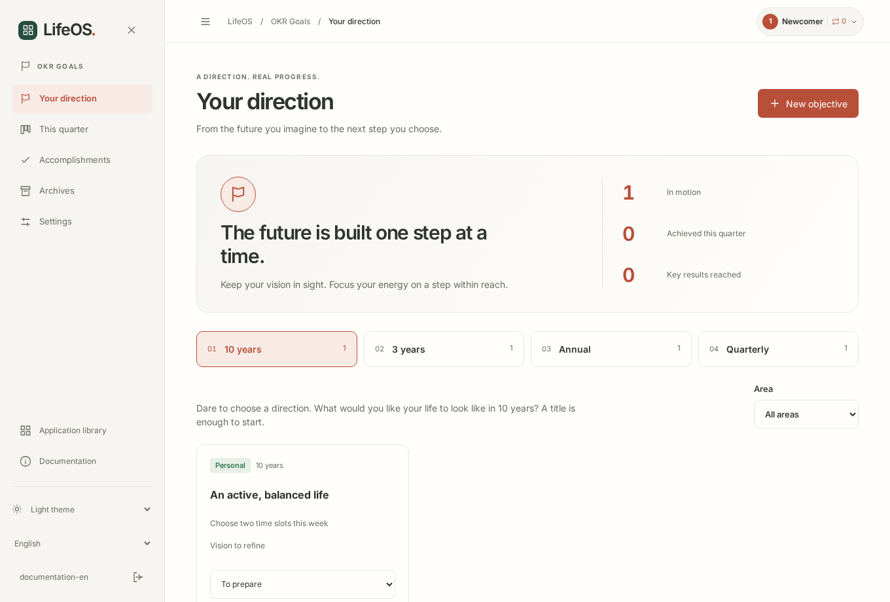
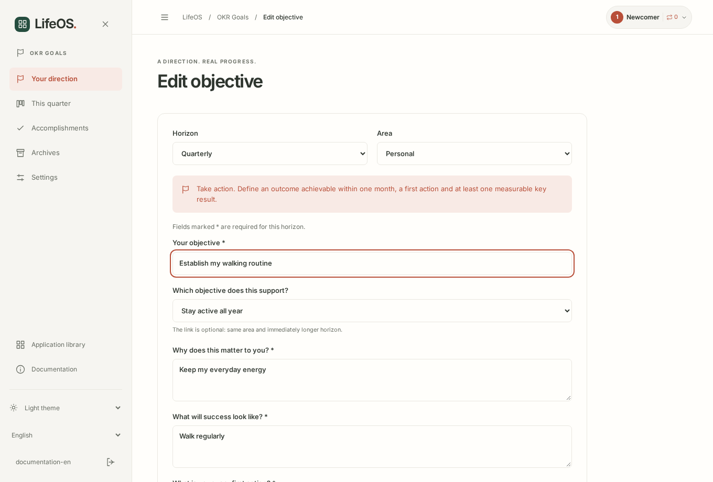
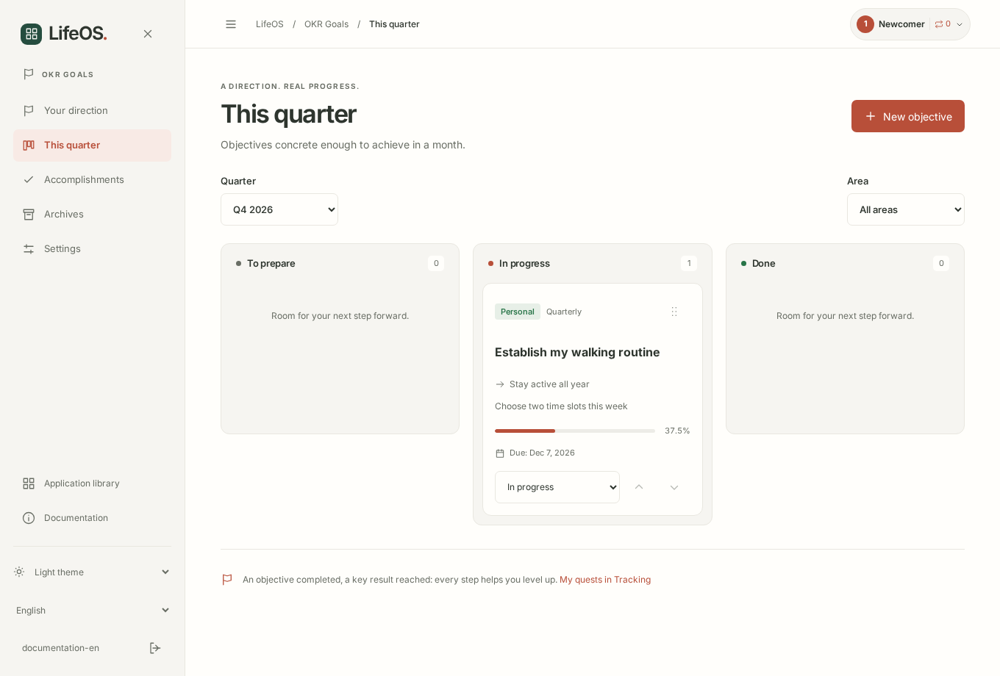
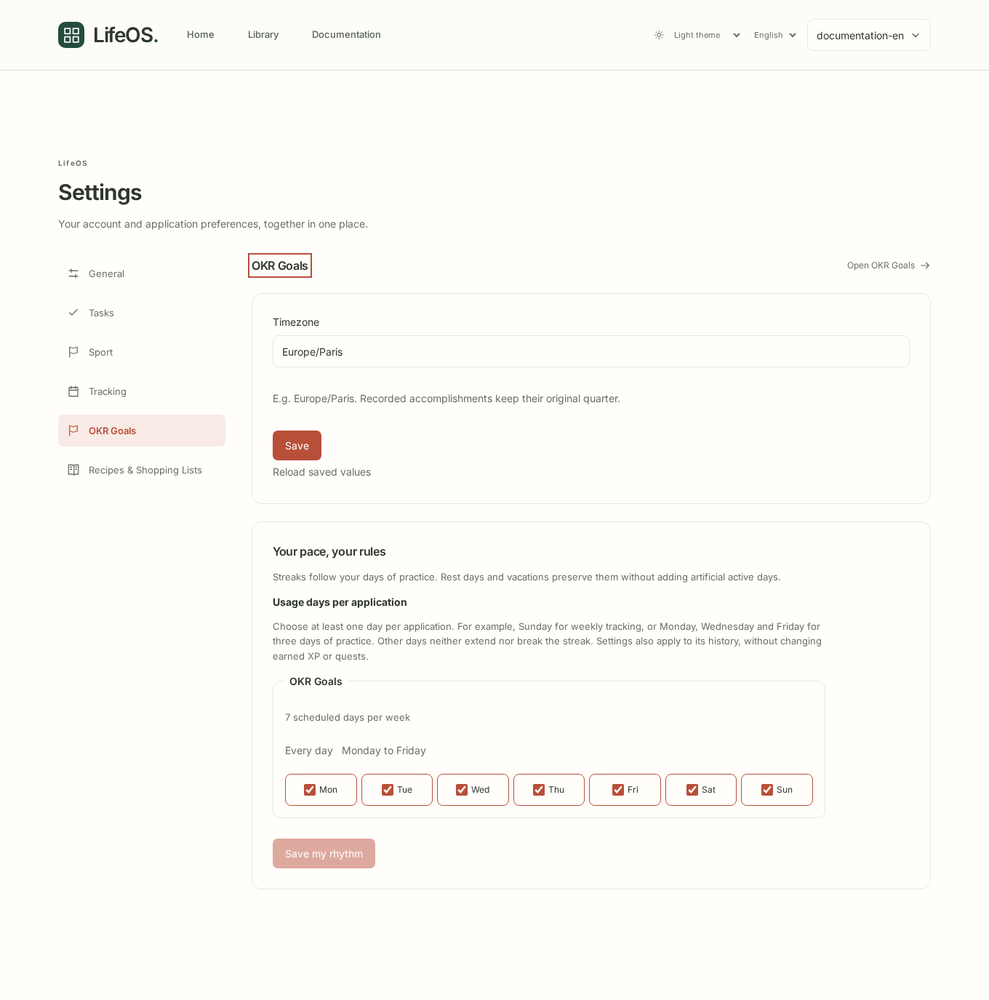

# OKR Goals

Enable **OKR Goals** in the [application library](applications.md), then open `/okr`. Bring personal and professional goals into one direction, from a distant vision to a concrete next step. Personal content is never translated automatically.

## Four horizons, increasing clarity

| Horizon | Required details |
| --- | --- |
| 10 years | A title; a broad direction is enough |
| 3 years | A title and why it matters |
| Annual | The above and an expected outcome |
| Quarterly | The above, a first action, two dates and at least one measurable key result |

Choose **Personal** or **Professional**. Optionally link to a goal in the same area at the immediately longer horizon: 10 years → 3 years → annual → quarterly. Existing links to archived parents remain visible; restore a parent before linking another goal to it. Move child goals before changing their parent's area or horizon.

A quarterly goal must be achievable **within one month**, not three months. A plan starting November 16 can end no later than December 15. Starting January 31 means February 27, or February 28 in a leap year: the next month is clamped to its last day, then one day is subtracted. Shorter plans are welcome. The start date defines the planned quarter; a plan may cross a quarter boundary. Other horizons allow optional dates supplied as a pair.

{ loading=lazy }

*Horizons: connect a long-term direction to nearer goals.*

## Key results and check-ins

Each goal supports up to 12 key results with a title, starting value, target, current value and optional unit. A target must differ from the starting value. Use a lower target to measure a reduction, or 0 → 1 for a binary result.

Progress is `(current − start) / (target − start)`, clamped to 0–100%. Objective progress is the equally weighted mean. A vision without key results stays at 0% until explicitly completed.

Open a card and choose **Check in** to record a value and an optional learning note. **History** preserves previous values, targets, edits and notes. Results may be added, edited or removed while the objective is open; previous snapshots survive. Reaching 100% never completes an objective automatically.

{ loading=lazy }

*Editor: define the expected outcome and key results.*

## Quarterly board

**This quarter** shows quarterly goals in **To prepare**, **In progress** and **Done**. Filter by area and quarter. Open goals from earlier quarters carry forward with their original quarter. Completed cards appear in their actual completion quarter.

Drag a card's handle to a column or before another card. Status selectors and up/down buttons provide equivalent keyboard and mobile controls. Order persists per horizon and status across areas and quarters. Columns stack on narrow screens.

**Complete objective** requires every key result to have reached its target. Completing a goal at any horizon records it in the current quarter, calculated on the server in the OKR timezone. Planned dates do not determine the accomplishment quarter.

{ loading=lazy }

*Quarterly plan: move objectives as work progresses.*

## Accomplishments and lifecycle

**Accomplishments** lets you revisit the current quarter or any quarter with accomplishments. Each completion preserves its title, area, horizon, expected outcome and key results at that moment.

Reopen a goal to continue working on it. The earlier record remains marked **Reopened since**. Completing it again creates a new snapshot in the actual quarter, without another reward for the same objective. Tracking's first-success counters still count it once.

Archiving sets a goal aside without completing it. Restore it from **Archives**. Dates, links, values, history and rewards survive archiving and disabling/re-enabling the application. There is no permanent deletion.

## Tracking and quests

[Tracking](tracking.md) can use **Completed objectives**, **Key results reached** and **Key result check-ins**, with area, horizon or objective filters. Area and horizon come from event snapshots, so later edits do not rewrite past metrics. Archived goals remain counted. Disabling OKR blocks new evaluations while preserving Tracking's previously confirmed snapshots.

OKR includes **60 quests**, ten titles and levels up to 100 through [shared progression](progression.md). A first objective completion earns **100 XP** and the first time each key result reaches its target earns **15 XP**, including values entered in the editor. Quest families cover completed objectives, key results, personal goals, professional goals, active days and streaks. Only first successes produce active days; edits and repeated completions do not multiply rewards. Corrections do not subtract earned XP.

The topbar badge works without Tracking. When Tracking is enabled, **My quests in Tracking** opens the OKR quest wall. Shared progression settings control streak timezones, usage days and vacations independently of the OKR business timezone. Guidance and quests are built into the application; no external AI service processes your goals.

## Settings and limits

The default OKR timezone is `Europe/Paris`. Changing it affects future events and keeps existing accomplishment quarters intact. View filters are temporary. Theme and language use the shared account preferences API. Unsaved drafts are protected when navigating, changing language or signing out.

Limits: 5,000 objectives per account including archives, 12 key results per objective, titles up to 200 characters, finite numeric values between −10¹² and 10¹², dates from 2000 through 2100. History and accomplishments are paginated in groups of 30. A concurrent update returns a conflict; reload before applying your changes again. Network errors offer retry controls in the affected content.

All operations also use the [versioned API](okr-api.md), including ownership checks and identical validation.

Preferences are grouped in [General settings](settings.md). An application’s Settings control opens its section; the progression timezone and vacations are under General, and usage days are in each application section.

{ loading=lazy }

*Open Settings to adjust this application’s preferences and usage days.*
