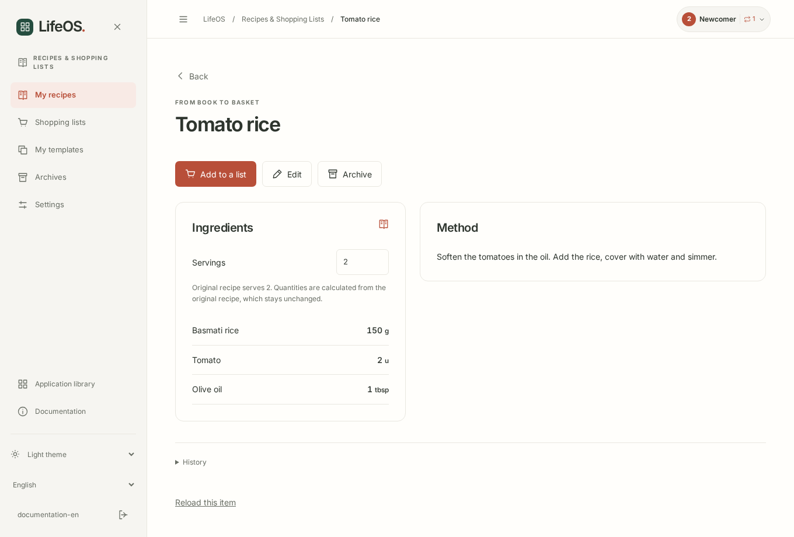
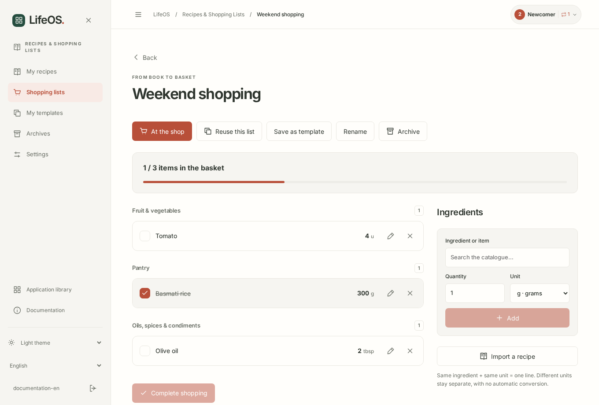
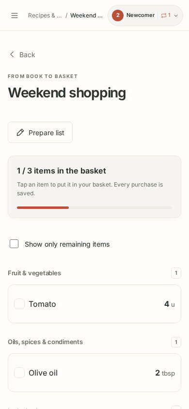
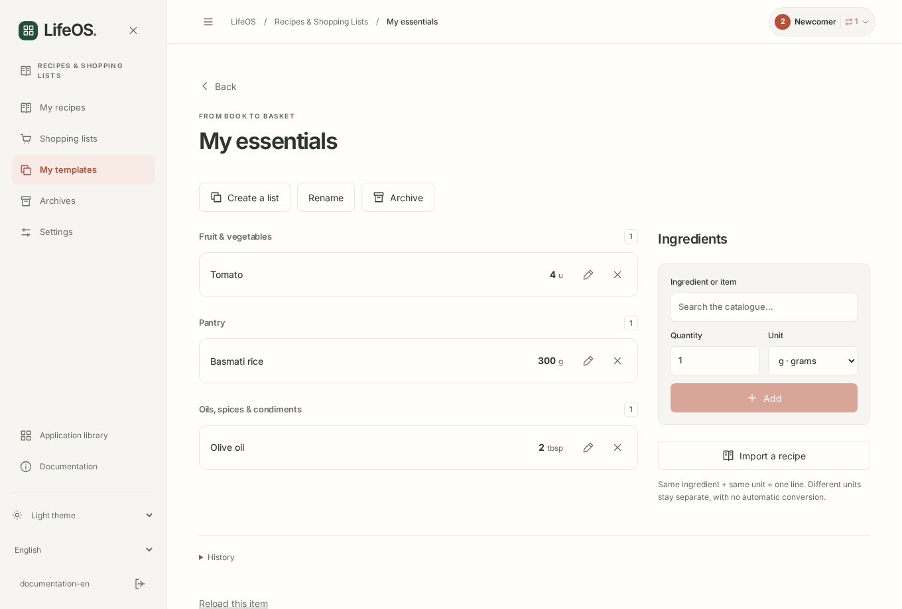
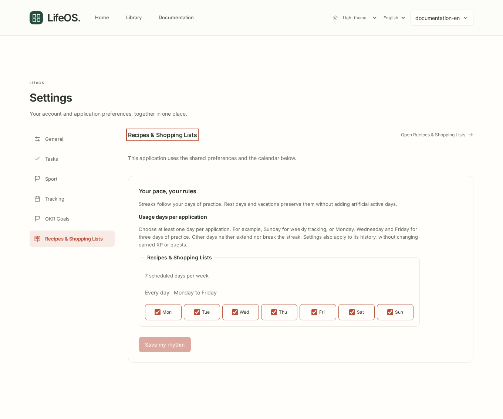

# Recipes & Shopping Lists

[Guide français](../recipes.md) · [API reference](recipes-api.md)

Enable **Recipes & Shopping Lists** in the LifeOS library and open `/recipes`. It uses your shared session, language, theme and navigation. It starts disabled; disabling it preserves every record, date and reward.

## Save and scale a recipe

Choose **My recipes → New recipe**. Enter a name, the original serving count, ingredient quantities and units, then the method. Add each ingredient before saving; **Cancel** inside the ingredient picker clears just that pending addition.

Open a saved recipe and change **Servings** to scale its quantities without changing the original. For example, 125.1 g for two becomes 187.65 g for three. Shopping imports use the same server calculation. Item quantities may be fractional, such as half a lemon; pieces are not automatically rounded up.

**Edit** changes the reference recipe. In the editor, the serving count describes the quantities you enter; use the detail view for proportional scaling. At least one ingredient is required. **Archive** preserves the recipe and its history; **Restore** makes it available again.

{ loading=lazy }

*Recipe: adjust servings, then add ingredients to a list.*

## Ingredients in both languages

The supplied database contains **301 ingredients and everyday items** across produce, chilled/dairy, proteins, pantry, seasonings, drinks, frozen and household/toiletries. Their displayed names follow your account language. Search accepts French or English and ignores case and accents.

Search and select an ingredient, then enter a quantity and unit: **g** for grams, **mg** for milligrams, **l** for litres, **ml** for millilitres, **tsp** for teaspoons, **tbsp** for tablespoons and **u** for individual items. The default unit is a suggestion; you can change it. Enter 250 ml or 0.5 tsp directly, and 1,000 g for 1 kg.

For an unknown name, **Create “…” in my catalogue** creates a private ingredient with your chosen unit and selects it. Personal names stay unchanged in both languages and are invisible to other users. An exact existing French or English name reuses the same identity. Search does not automatically merge synonyms or singular/plural names: choose an existing ingredient to combine its quantities correctly.

## Prepare a shopping list

Choose **Shopping lists → New list**. Add items manually or **Import a recipe**, choose the recipe and serving count. You can also start from a recipe using **Add to a list**. Search and pagination reach older recipes and lists.

Imports add quantities. Two imports of 200 g combine into one 400 g row. Only the same ingredient identity and unit combine; different units remain separate, including g/mg and l/ml. There is no automatic conversion, including for spoons. Repeating an import deliberately adds another portion; replaying the same stale version is rejected.

You can rename a list, edit quantities, remove items, archive and restore. A completed list stays read-only until reopened. Removed items remain in its history.

{ loading=lazy }

*Shopping list: add items and import recipe quantities.*

## At the shop

**At the shop** shows large touch targets grouped by aisle, a basket counter and purchased items separately. Tap a row, or use Tab and Space, to check it. **Show only remaining items** hides purchases. Every change is saved through the API and survives reloads.

Quick additions remain available. If you bought 200 g and add another 50 g, the row asks for the remaining **50 g**, with the previous purchase and 250 g total shown underneath. Checking buys the whole remainder; unchecking resets that row's purchased quantity to zero. Lowering the total caps the purchased quantity at the new total.

**Complete shopping** becomes available when every item in a non-empty list is checked. Reopening does not clear purchases. **Reuse this list** creates a new list with fresh checkboxes and no completion date.

A network connection is required. Failed saves are shown as errors, not successful purchases. If another device changes the list, use **Reload this item** to retrieve its latest version. Offline use and live synchronization are not provided.

{ loading=lazy }

*Mobile shopping mode: check purchases and show only remaining items.*

## Templates and previous lists

Build a template manually from **My templates → New template**, or choose **Save as template** on an existing list. Ingredients and recipe imports work the same way. **Create a list** copies a template with no checked purchases.

**Reuse this list** also works on previous or archived lists. Copies are independent and never change their source. Templates have no purchase state or completion date. Recipes, templates and lists use the same ingredient identities.

{ loading=lazy }

*Template: prepare essentials and create a fresh independent list.*

## Tracking and rewards

The shared badge shows your level, title, streak and nearby quests. **Tracking → Achievements** includes **60 Recipes quests**: recipes saved, lists completed, distinct list/recipe imports, non-empty templates, active days and streaks, with ten milestones per family.

First confirmations earn 25 XP per recipe, 50 XP per fully purchased list, 5 XP per list/recipe import pair and 15 XP per non-empty template. Editing, rechecking, reopening, repeated imports into the same list, archiving and re-enabling never multiply rewards. Separate recipes, templates and lists have independent identities. Quest bonuses, usage-day schedules and holidays use the existing progression settings. The badge works even when Tracking is disabled.

Four historical metrics are available to Tracking: recipes saved, shopping lists completed, recipes used for shopping and templates prepared. They count first actions in the requested period and timezone, including archives. Disabling Recipes blocks new evaluations while preserving saved Tracking snapshots.

## Limits and preservation

Per account: 2,000 recipes, 2,000 lists/templates and 3,000 personal ingredients. A recipe accepts 200 lines and a list 300 distinct ingredient/unit pairs. Positive quantities have up to six decimals, capped at 1,000,000,000; servings are integers from 1 to 1,000. Out-of-range calculations are rejected without partial imports. Dates use UTC.

Sharing, photos, prices, nutrition, meal planning and permanent recipe/list/template deletion are not included. Drafts are protected when leaving, changing language or signing out. All persistent actions have a versioned API. See [API examples](recipes-api.md) and [backup/restore](sauvegardes.md#migration-0012-recettes-et-courses).

Preferences are grouped in [General settings](settings.md). An application’s Settings control opens its section; the progression timezone and vacations are under General, and usage days are in each application section.

{ loading=lazy }

*Open Settings to adjust this application’s preferences and usage days.*
