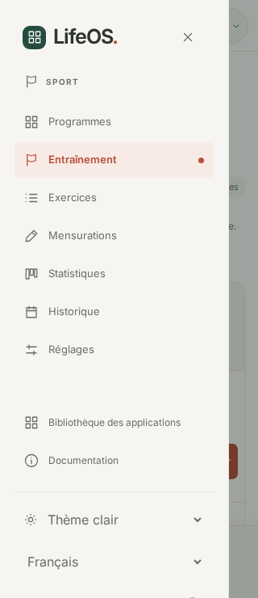
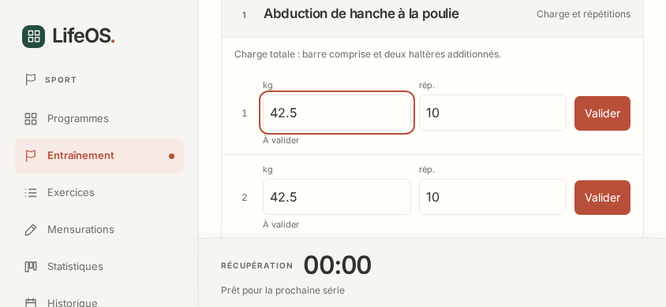

# Sport interface review — 17 November 2026

This is the English translation of the [historical French review](../revue-sport-2026-11-17.md), attached to issue #71. It describes commit `ecab6ac94a64a11f79722bd43b819cb116505ed8`, audited on 17 November 2026 (Europe/Paris). **The 39 improvements below are proposals, not delivered features or architectural approval.** Later releases may have changed the observed behavior.

The [Sport UX delivery](sport-ux-livraison.md) documents the follow-up; observations and measurements below remain those of the audited version.

## Scope and evidence

The review combined code reading, browser exploration, measurements and existing regression tests:

- 196 states: seven sections × seven widths (320, 390, 768, 800, 801, 1,024 and 1,440 px) × French/English × light/dark.
- 28 empty states at 320/1,440 px, French/light and English/dark, plus system-theme checks.
- 56 axe 4.14.0 analyses and an open mobile menu; separate touch exploration at 844 × 390, simulated keyboard, 1.2-second network latency, 503 errors, conflicts, navigation, reverted edits and closing during writes.
- Synthetic data: eight active and one archived program, including a twelve-exercise program; 33 historical sessions, six measurements at irregular dates and one active session. The 680 catalogue entries were not individually reviewed.

Historical validation: `make check` (129 Python files); `make test` (693 passed, existing Starlette/httpx deprecation, explicit PYTHONPATH); Chromium 156/Playwright 1.64.1 (55 scenarios: Sport 9, programs 10, HYROX 6, navigation 8, internationalisation 7, progression 4, applications 4, mobile 7); WebKit 27.2 (25 Sport/program/HYROX scenarios using software rendering). These are **results recorded during that review**, not results of the documentation release.

No overflow or JavaScript error was found in the 196-state matrix; this does not establish that actions are conveniently placed. Active navigation text had contrast 4.24:1 (`#b84f39` on `#f8eae5`, 13 px), below 4.5:1 in fourteen desktop states and the mobile menu: the only axe violation found. System theme switched backgrounds correctly (`rgb(255, 254, 251)` / `rgb(26, 32, 29)`). Menu animation was 180 ms, reduced to 0.01 ms with reduced motion; set confirmation had no dedicated animation.

Missing Chromium libraries and WebKit EGL initialization were resolved before testing. A library scenario was rerun with a fresh account; this was not a product defect. Physical iPhone/Android, screen readers, battery/background notifications, sunlight readability, Firefox, low-end mobile performance and a complete security audit were outside scope.

See the [recorded measurements](../assets/reviews/sport-2026-11-17/mesures.json) and the original review's eight screenshots. Historical screenshots retain their original interface language.

## Findings and proposed acceptance criteria

P1 means high priority, P2 normal priority, P3 refinement. A reproduction is distinguished from a proposal based on code or visual inspection.

| # | Priority / evidence | Observation and proposed change |
| --- | --- | --- |
| 01 | P1, reproduced | Escape loses exercise/measurement drafts; changing rest from 90 to 180 then navigating also loses it. Guard close, navigation, language and logout; cancelling departure must preserve the draft. |
| 02 | P1, reproduced | Closing an exercise save during 1.2 s latency creates the server object but leaves the list stale. Track pending writes, prevent ambiguous dismissal and reconcile the result; announce success and create exactly one object. Check measurements and session finish too. |
| 03 | P1, reproduced | Enter on a set disables its fieldset and moves focus to BODY; history pagination also loses focus. Restore a stable, logical focus after writes and navigation. |
| 04 | P1, reproduced | A real two-client program conflict preserves the draft but offers no reconciliation; retry uses the stale version. Expose the saved version, allow copying/reapplying the draft, and test resolution across forms. |
| 05 | P1, measured | Active navigation contrast is 4.24:1. Adjust shared tokens to reach at least 4.5:1 in every application and theme. |
| 06 | P1, requested proposal | Programs use a grid and Exercises a list, without a saved layout preference. Offer genuinely distinct List/Grid layouts with API persistence, responsive behavior and preserved search/order/actions/scroll. |
| 07 | P1, measured | At 1,440 px, all eight cards become 884 px tall because one has twelve exercises and `grid-auto-rows: 1fr` stretches every row. Bound previews/notes, expose “+ N”, and align within rows; test 1/3/12/50 exercises. |
| 08 | P2, reproduced | Catalogue search/type disappear after visiting History and are absent from the URL. Preserve filters, pagination, chart selection and useful scroll through navigation/URL state; clear private state on logout. |
| 09 | P1, reproduced | Typing every 150 ms sends five requests; with 1.2 s latency the forty-item list disappears and page height falls from 4,904 to 1,000 px. Debounce, retain previous results, ignore stale responses and reserve skeletons for initial loading. |
| 10 | P2, reproduced | Editing 40 → 41 → 40 still leaves a dirty set and disables Finish. Compare normalized values against the saved reference; distinguish suggestions from performed sets. |
| 11 | P2, reproduced | In UTC+14, the form proposes 18 November while the server still uses 17 November and rejects a future date. Define a consistent date policy and test UTC−12, UTC, Paris and UTC+14 boundaries without rewriting old dates. |
| 12 | P2, reproduced | A spaces-only name produces a generic error without a field message or `aria-invalid`. Associate errors with fields, focus an error summary when appropriate, retain input and cover bounds/date/conflict errors in both languages. |
| 13 | P2, code/visual | Programs lack search, sorting and duplication. Add API-backed search/sort (name, updated, last used) and copying with a new name and no copied history/score; consider favorites later. |
| 14 | P2, reproduced | The program picker shows twenty of 680 exercises with no next page; selecting closes it and loses the query. Add pagination and multiple/continued addition while preserving order, 50/300 limits and duplicate rules. |
| 15 | P2, measured | At 320 × 844, a twelve-exercise HYROX editor places the first set 1,514 px down and Save 5,829 px down. Compact branding, collapse secondary content and keep actions reachable with keyboard/rest visible; offer direct movement without recreating the common shell. |
| 16 | P2, code/visual | Exercise/measurement archives lack undo/status feedback; program archive is deep in the editor. Announce changes, provide API-backed undo and explain references; a failed archive leaves the item active. |
| 17 | P2, code/visual | There is no personal-only active filter; muscle/equipment API filters are absent from the UI. Filter the full catalogue rather than the current forty rows, summarize/clear filters, and add an origin API filter if needed, including the picker. |
| 18 | P2, code/visual | Customize opens “New exercise” without clearly explaining the copy. Make personal-copy behavior explicit; show useful type, muscle, equipment and notes context and program actions without invented advice/media. |
| 19 | P1, measured | HYROX set fields are below a 320 × 844 screen; a classic session's first field starts at 505 px on 390 px width. Prioritize the next set, compact branding and provide clear section navigation/collapse without intrusive automatic scrolling. |
| 20 | P2, code | Preparation notes are absent from session snapshots; finish notes have a different purpose. Preserve preparation notes separately through a compatible API snapshot, with no retroactive history changes. |
| 21 | P2, measured | A roughly 90 px rest bar remains on every tab even at zero, without a resume link. Distinguish compact ready/resting states, offer Resume and keep controls usable with zoom, keyboard and landscape. |
| 22 | P3, proposal | Rest settings are remote and only Skip is available. Consider 60/90/120 presets, explain zero and optional API-backed ±15 adjustments. Sound/vibration must be opt-in and physically tested; do not assume background notifications. |
| 23 | P2, code/visual | Finish returns directly to History without a summary. Show useful confirmed sets/skips, duration, volume/distance, score and server-earned XP, with detail/program links and an announced immediate result. |
| 24 | P2, reproduced | A 34-session history has no program/state/date search and mixes active sessions. Add global API filters and grouping with stable pagination; cancelled sessions remain excluded from statistics. |
| 25 | P2, reproduced | History details have no URL and close on reload; competition date, duration and state are incomplete. Support direct links, back/previous/next and immutable HYROX/timestamp/state/note context. |
| 26 | P2, code/visual | All measurement fields form a long editor even for weight alone. Prioritize frequently used measures and group others, keeping Save accessible and preserving hidden fields during PUT. |
| 27 | P3, proposal | Measurement comparison cards omit deltas. Offer a compact table with neutral numerical changes and chart links; do not equate weight gain/loss with good/bad. Respect archive rules. |
| 28 | P2, reproduced | Reversed dates cause a global error and clear data; choices reset. Offer 30-day/three-month/year/custom periods, validate locally, retain prior data and preserve the API/URL selection. |
| 29 | P2, measured | Measurements on 1 March, 15 April, 1 June, 1 September, 1 November and 17 November are spaced equally at 84.6 px. Use proportional time or explicitly label an observation axis, distinguishing same-day points. |
| 30 | P2, code/visual | SVG titles do not provide individual keyboard/touch access, although value tables help. Add selectable points with date/value/unit tooltips, useful targets, Escape and sensible focus while retaining tables. |
| 31 | P2, code/visual | Exercise formulas say “points” and numbered baselines lack context, including repeated occurrences. Show meaningful metrics/units/dates/structure labels and explain aggregation without changing historical scores. |
| 32 | P2, inspected | Twenty-eight empty states rely on text links and show archives to new users. Tailor Create/Start/Measure/Widen/Clear actions to each state without fake data. |
| 33 | P2, measured | At 320 px, breadcrumb and progression badge truncate section names. Prioritize the current view, reduce secondary badge content and preserve full accessible names across applications, long levels and languages. |
| 34 | P2, measured | Touch landscape at 844 × 390 restores a 252 px desktop sidebar while an 88 px rest bar consumes height. Adapt shared navigation to short touch screens as well as the 800 px width threshold, testing rotation, focus, footer and keyboard. |
| 35 | P2, measured | Metadata reaches 11 px, the LifeOS breadcrumb is 38 × 18 and desktop rest controls about 41.5 px. Improve hierarchy, 12–14 px metadata, 16 px touch fields and 44 px targets; test 200% zoom and real devices. These measurements alone are not a WCAG verdict. |
| 36 | P3, proposal | Several concepts reuse an icon without category clues. Refine the existing icon system with clear text names; do not rely on color or change common tokens/branding inconsistently. |
| 37 | P2, code/visual | HYROX is inferred from the name; the resume logo takes about half the banner. Bound branding in cards/editor/training, make the context/date discoverable, and preserve dates through renaming; an explicit type would need an API decision. |
| 38 | P2, code/visual | Menu motion works, but other state changes are abrupt. Add brief purposeful confirmation/detail/row/layout/finish transitions using opacity/transform, respecting reduced motion and adding no delay. |
| 39 | P2, reproduced | Clearing rest converts `Number("")` to zero and disables rest. Keep a transient string, validate on save, explain intentional zero and offer presets; consider explicit min:s conversion for exercise durations without silent changes. |

{ width="320" }

## Proposed List / Grid specification

Place a named List/Grid control in the content toolbar alongside search/sort, using pressed buttons or radios with visible focus and accessible names. Begin with Programs, then informative exercise cards without empty image placeholders. History remains chronological; Measurements may benefit from a table.

Without a saved choice, prefer a list at narrow widths and a grid when multiple comfortable cards fit. An explicit choice wins; a grid at 320 px remains one readable column. Verify 768/800/801/1,024 px boundaries. List rows show name, HYROX context, exercise/set counts, last use where available and Start/Resume/Edit actions, stacking metadata on mobile with 44 px targets. Grid previews are bounded, with a few exercises, “+ N” and visible actions; full details are available without starting a session.

Switching preserves search, sorting, archives, pagination and the visible item, including long lists and active sessions. Extend **existing Sport settings** through GET/PUT with validated `list`/`grid`, explicit defaults and, if useful, per-section/per-width preferences. Specify URL precedence and partial writes: current clients writing `rest_seconds` must not erase new preferences, and layout clients must not reset rest. Preserve account isolation and activation retention; no business localStorage.

Implementation remains in `apps/sport`, with an additive global migration if needed and documented backup, rollback and concurrency behavior. Acceptance includes FR/EN, light/dark/system, keyboard/touch, 0/1/8/50 programs, long titles, classic/HYROX, archives, failed saves, reload, two accounts/devices and disable/reactivate. Measure how many programs are visible before scrolling in each layout.

## Motion and finishing

Suggested starting durations require phone verification: hover/focus/press 100–160 ms; confirmed set 120–180 ms; stable layout transition 150–200 ms (direct switching for large lists); panel/collapse 160–200 ms. Focus must remain immediately visible, targets must not shift under a finger, and animation must neither delay nor duplicate writes.

Archive only after success, with an announced undo; failures preserve the item and restoration returns useful focus/position. Finish immediately shows server-derived results without forced confetti or sound. Reduced motion removes movement and shortens transitions while preserving text/checkmarks/state. Loading retains structure and typing/scroll stability under 1.2 s latency, reordered responses and 503 errors.

LifeOS remains the primary brand. Sport/HYROX identity belongs in content and must leave session controls/results prominent. Shared color, navigation, sizing and footer changes must be verified across applications.

## Examined controls

Repeated row buttons were assessed as component families. Executed journeys and code inspection are distinct; absent functionality cannot be described as tested.

| Surface | Examined controls / related findings |
| --- | --- |
| Access | Activate/deactivate, open, disabled direct access, reactivate; API denial and retention. |
| Shared navigation | Seven sections, menu/backdrop/Escape/Tab/Shift+Tab/skip link/resizing; 03, 33–35. Main is inert, but rest is a sibling: real screen-reader background testing remains necessary. |
| Footer | Library, locale-specific guide, themes, language, logout; 01. |
| Progression | Badge, outside click/Escape, quests, Tracking wall when enabled, retry; 23, 33. Sport progression works without Tracking. |
| Programs | New/Edit/Start/Resume, existing-session disabled actions, archives/restore; 06, 07, 13, 16, 37. |
| Editor | Back/Cancel/Save/Archive, accepted/refused departure, browser history and real conflict; 01, 04, 15. |
| Program exercises | Picker/search/type, ten target types, series counts, move/remove/bounds, twenty-result limit; 14, 15, 18. |
| HYROX | Rename detection, absent/future/today/past/cleared date, save/resume/archive; 19, 25, 37. |
| Catalogue | Accented/unaccented search, type, active/archive, previous/next, no results; 08, 09, 17. |
| Exercise form | New/Customize/Edit, names/muscle/equipment/notes/type, Save/Escape, invalid/503; 01, 02, 12, 18. |
| Exercise lifecycle | Archive/restore and referenced archived/type-changed exercises; 16. |
| Sets | Input/Validate/Correct/Undo/Cancel/Enter/conflict/refresh/reload across ten types; 03, 10, 19. |
| Rest | Countdown, persisted deadline, Skip, section changes, mobile and simulated keyboard; 21, 22. |
| Finish | Finish/close, feedback/save, remaining sets at zero, abandon/confirm; 20, 23. |
| History | Rows/detail/Escape/pagination and active/completed/cancelled states, 34-session touch test; 03, 24, 25. |
| Measurements | New/date/all fields/notes/edit/save/archive/restore/empty form, 6 → 5 → 6 records and timezone; 01, 11, 12, 26, 27. |
| Statistics | From/To, metric/exercise/program/baseline, values table/score help/empty/error, irregular dates; 28–32. |
| Settings | Rest/bounds/save/success/guide, clearing and leaving a draft; 01, 22, 39. |
| Cross-cutting | Loading/retry/slow network/errors/stale responses/expiry/logout/external activation; 02, 04, 09, 12. |
| Missing features | List/Grid, program search/sort/copy, multi-add, history filters, alarm and finish summary were inspected as proposals only. |

## Suggested implementation order

1. Reliability: 01–05, 09–12 and 39, with regression tests that fail on current reproductions.
2. Layout choice: 06–08 and 13–18, starting with bounded program previews, preserving API/preferences.
3. Immediately usable sessions: 19–25, particularly visible controls, compact rest, notes and summary; test one-handed phone use.
4. Reading/navigation: 26–35, including quick measurements, history, explicit charts, onboarding and shared adaptations.
5. Polish: 36–38 and optional parts of 22/27 after the structure is stable.

Existing module boundaries, migrations, API contracts and backup rules still apply. A new shared responsibility, service, infrastructure or structural library requires explicit architectural approval; this review does not grant it.

## Acceptance work for future changes

Add behavior tests for 01–04 and 08–12, checking UI and API with two contexts for conflicts. Assert action position/visibility, scroll continuity and focus: overflow alone misses 884 px cards and actions several screens down. Cover layout preferences, languages/themes/widths, long/empty/archived data and failed writes. Use focused visual comparisons of shared chrome and stable content, avoiding fragile timer snapshots. Analyze open menus, dialogs, errors and disabled states as well as resting pages.

Physically test iPhone and Android decimal entry, keyboard, rotation, foreground return, rest, safe areas and one-handed use, plus screen reader and intentional zoom. Existing simulations are not substitutes.

## Design references and source code

The repository's 44 px target is stricter than WCAG 2.2 AA's 24 × 24 px minimum with exceptions; a 38 × 18 target alone does not establish a WCAG failure. See [W3C Target Size](https://www.w3.org/WAI/WCAG22/Understanding/target-size-minimum.html), [Contrast Minimum](https://www.w3.org/WAI/WCAG22/Understanding/contrast-minimum.html) (4.5:1 ordinary text) and [Reflow](https://www.w3.org/WAI/WCAG22/Understanding/reflow.html) (320 px).

The [audited source tree](https://github.com/ThibaultLeveau/life.thibault-leveau.com/tree/ecab6ac94a64a11f79722bd43b819cb116505ed8) fixes the evidence to that revision: Sport `Page.tsx`, `Workouts.tsx`, `ProgramEditor.tsx`, `Exercises.tsx`, `Training.tsx`, `Measurements.tsx`, `Statistics.tsx`, `Settings.tsx`, `common.tsx`, `styles.css`, `HyroxBrand.tsx`; backend Sport `router.py`/`service.py`; shared `ApplicationNavigation.tsx`/`ui.css`; platform `ProgressionBadge.tsx` and `api.ts`. The French original retains individual file links.
