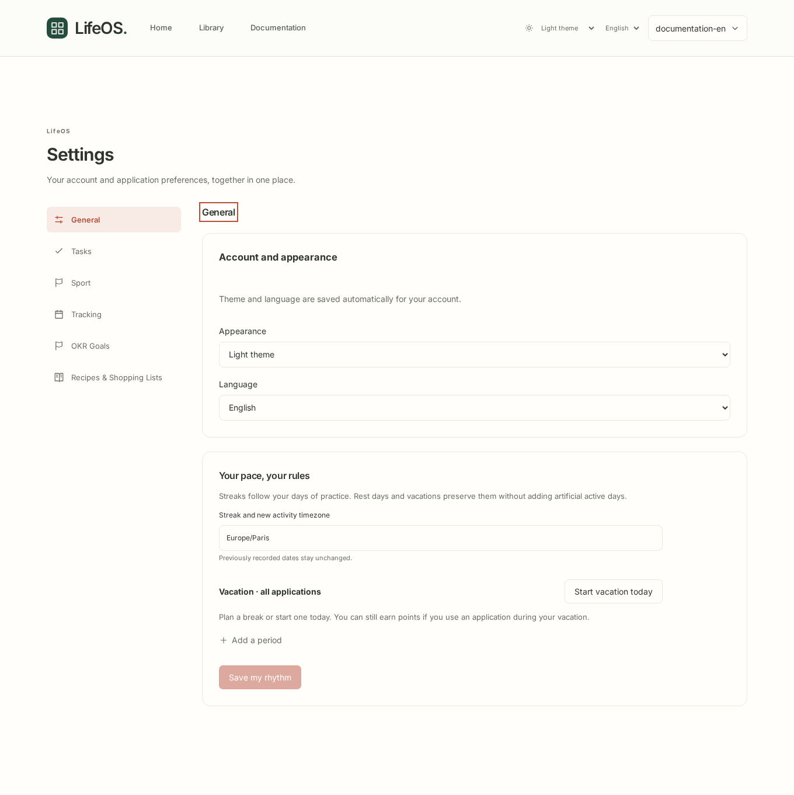
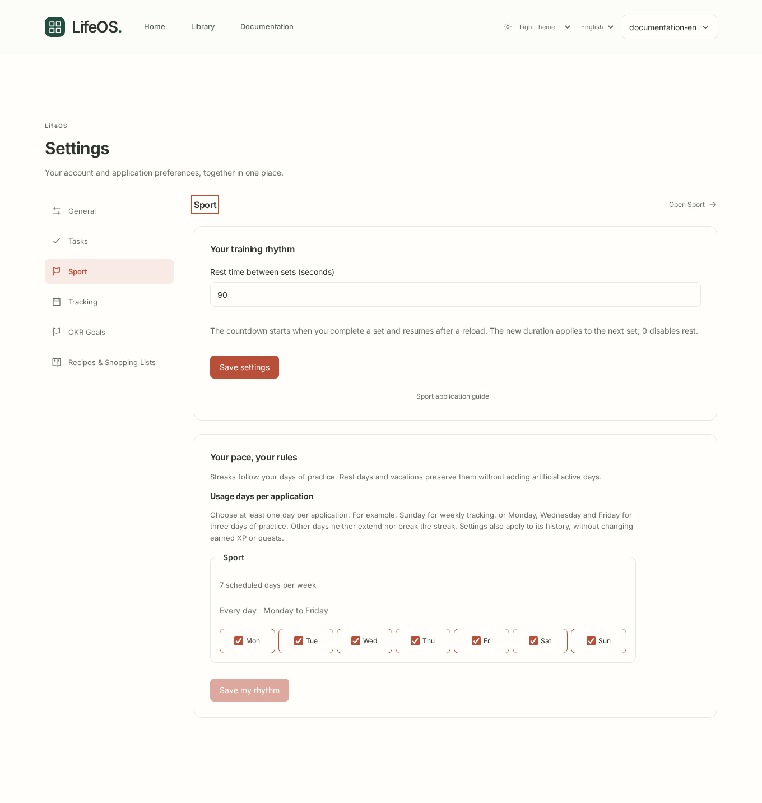

# General settings

[Guide français](../settings.md)

From Home or the library, click your name in the top right corner and choose **Settings** or **Sign out**. The menu supports Enter, arrow keys, Home/End and Escape. Each application’s **Settings** control opens its own section of the shared page. Older addresses such as `/sport?tab=settings` still work.

## General

**System / light / dark** appearance and **French / English** language save immediately to your account. System appearance follows your device; personal content is never translated.

The **progression calendar** contains its own IANA timezone and shared vacation periods. Choose **Save my rhythm** to keep changes. Vacation days do not break a streak or create activity and do not remove earned rewards. These settings remain accessible when Tracking is disabled.

{ loading=lazy }

*General settings: account appearance, language, progression timezone and vacations.*

## Application sections

| Section | Available settings |
| --- | --- |
| Tasks | Choose Upcoming or a workspace. Upcoming includes period, 1–90 day horizon, overdue/completed visibility, search, workspace, priority and label. Workspace views include list/board, density, sorting, status and due-date filters. Configure workspace opens its name, description, parent, colour, sections, columns, labels and archives. |
| Sport | Rest between sets, from 0 to 3,600 seconds. |
| Tracking | Timezone for occurrences and the calendar. |
| OKR Goals | Timezone for horizons and periods. |
| Recipes and shopping | Usage calendar; portions, ingredients, recipes and lists are configured on their own items. |

Every application has **usage days**, with at least one selected day and shortcuts for every day or weekdays. Save each form separately. Switching sections with unsaved changes asks for confirmation. Internal navigation, language changes and sign-out wait for pending saves. Closing or reloading the browser with unsaved work triggers its own warning.

Tasks preferences are the same preferences used in Upcoming and workspace views. Lists still hide completed tasks until explicitly shown during the current visit. Workspace structure remains contextual.

## Disabled applications and errors

All catalogue applications remain listed. Disabled applications show their status and a library link; their business forms are not loaded. Their data and preferences are preserved, and their usage days remain configurable. Re-enable an application to recover its business preferences.

Failed reads offer **Try again**. Failed saves retain your input and show an error. OKR/progression version conflicts never silently overwrite newer data: **Reload saved values** discards the draft after confirmation. Other settings retain their existing last-write-wins behaviour. Sign-out and expired sessions unmount private data.

## API and storage

The page reuses existing versioned APIs: `/preferences`, `/progression/settings`, `/agenda/view`, `/workspaces/{id}/view`, `/sport/settings`, `/tracking/settings` and `/okr/settings`, all under `/api/v1`, with GET and PUT. Account preference updates accept partial fields; progression and OKR updates require `expected_version`. See [API examples](api.md).

Writes require the existing session, allowed origin and CSRF token. Business settings enforce application activation and ownership. PostgreSQL backups already preserve these preferences. No new tables, migration, browser business storage or deployment service are required; see [backup and restore](sauvegardes.md).

{ loading=lazy }

*Sport settings: rest between sets and usage days.*
