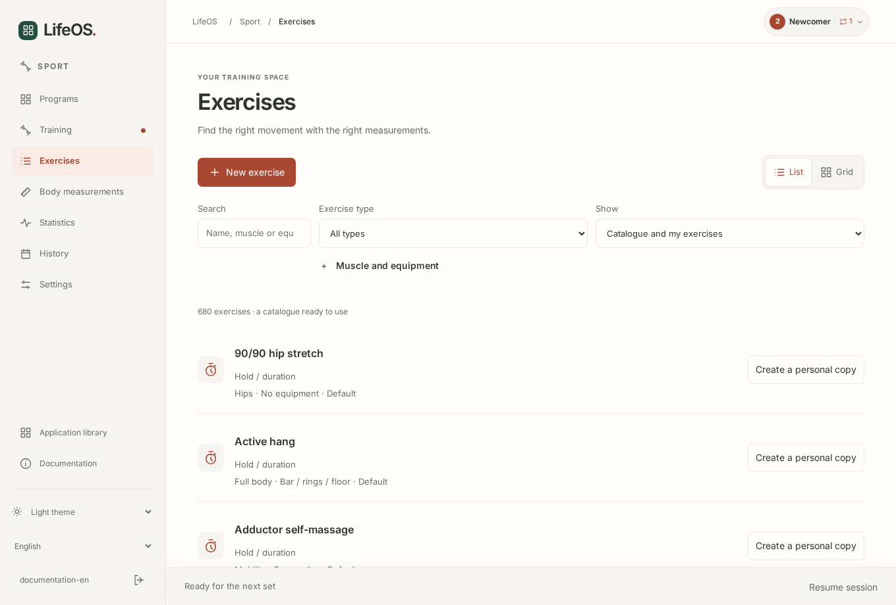
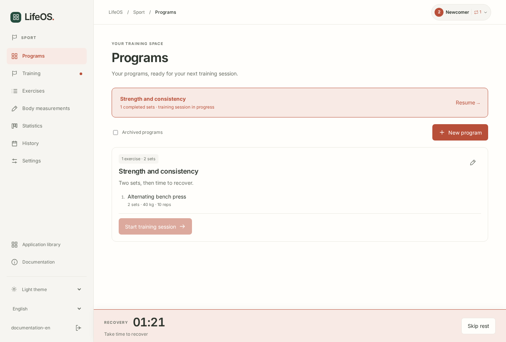
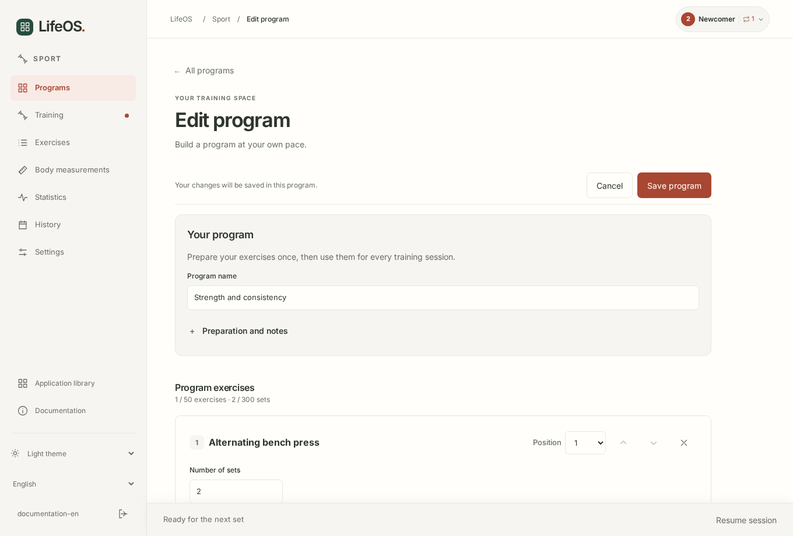
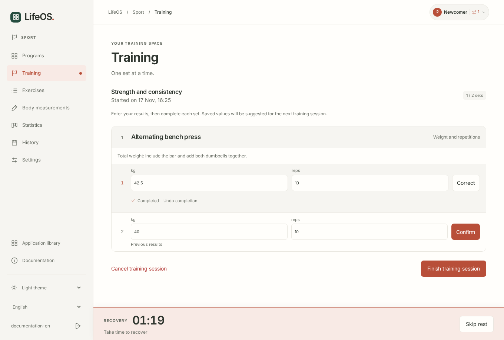
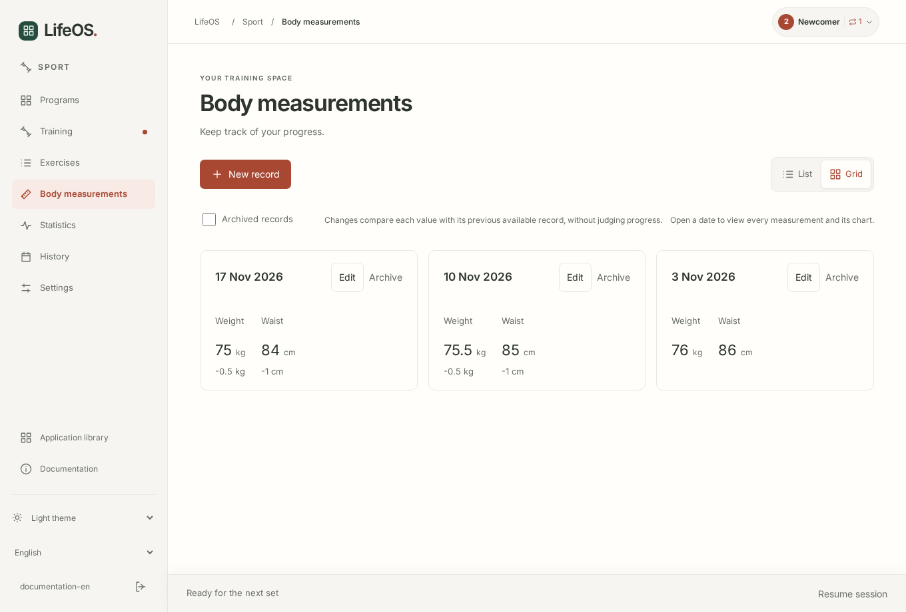
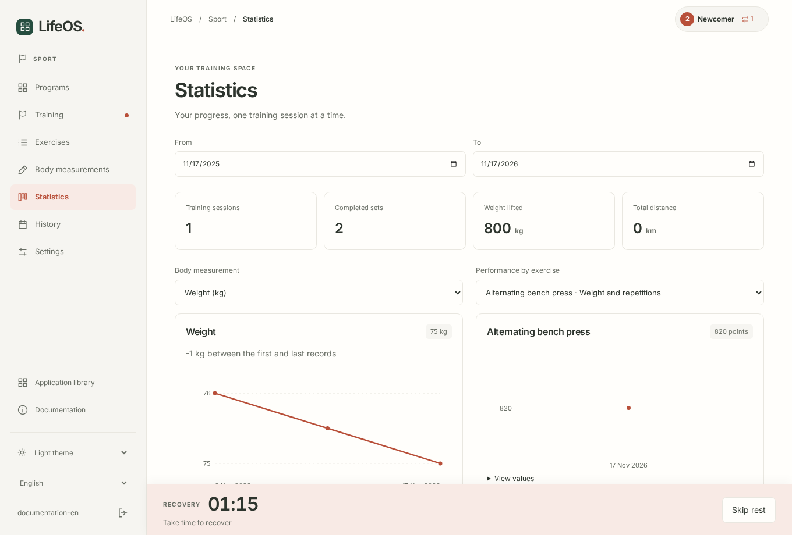
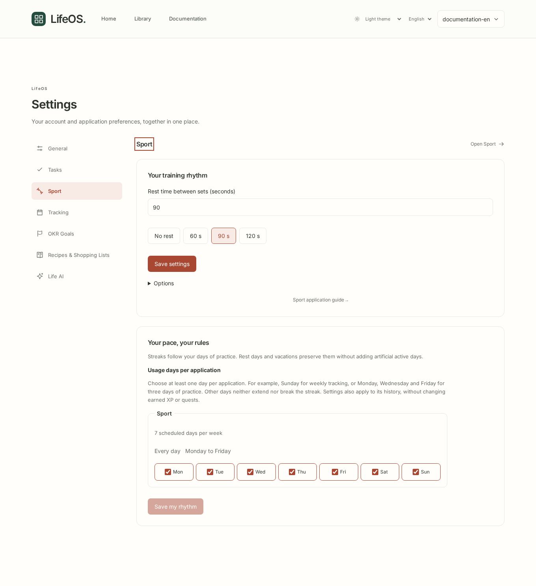

# Sport

Navigation shares its design with Tasks. The top bar contains the breadcrumb, mobile menu button and shared progression badge. The footer contains the library, Sport documentation, theme, language and user/sign-out controls, including on mobile. See [shared navigation](applications.md#shared-navigation).

Enable **Sport** in the [LifeOS library](applications.md), then open it. Sport shares your session, language and appearance. Its sidebar contains programs, training, exercises, body measurements, statistics, history and settings. On mobile, **Open navigation** exposes the same destinations; focus starts on **Close navigation**, and closing the menu returns focus to its trigger.

## Default and personal exercises

The catalogue supplies **680 default exercises**, available in English and French, covering strength, bodyweight, cardio, gymnastics, carries, mobility, stretching and timed movements. Search by name, muscle or equipment, with or without accents, then filter by input type. Search uses the current language. There is nothing to import and no external account to connect.

Supplied exercises are marked **Default**. Their names, notes, aliases, muscles and equipment follow your language, including when shown inside programs and training history. Their stable identities never change.

**New exercise** creates a **Personal** exercise. **Create a personal copy** copies a default exercise into a personal one in the language currently displayed. You can edit its name, type, equipment and notes without changing the shared catalogue. Personal text is never translated automatically, even when a name matches a default exercise. Personal exercises can be archived and restored.

| Input type | Measurements per set | Examples |
| --- | --- | --- |
| Weight and repetitions | kg and reps | Bench press, squat, deadlift |
| Bodyweight / repetitions | reps | Push-ups, burpees, pull-ups |
| Assisted repetitions | assistance in kg and reps | Assisted pull-ups or dips |
| Hold / duration | seconds | Plank, wall sit, stretching |
| Distance and duration | metres and seconds | Running, cycling, swimming, rowing |
| Weight and distance | kg and metres | Farmer carry, sled, weighted walk |
| Weight and duration | kg and seconds | Farmer hold, weighted plank |
| Timed repetitions | reps and seconds | Timed burpees, skipping |
| Distance only | metres | Long jump, handstand walk |
| Machine energy and duration | displayed kcal and seconds | Air bike, rower, SkiErg |

Types describe measurements, not a closed list of sports. A movement can have variants with different input types. Calories are the machine’s displayed value; no physiological estimate is calculated. The server rejects fields that do not belong to the selected type. Enter **total weight**, including the bar and both dumbbells. For a band without measurable assistance, use repetitions and describe the resistance in notes.

{ loading=lazy }

*Catalogue: find an exercise and choose its type.*

## Programs and training

In **Programs**, choose **New program**, name it and add exercises. Each exercise accepts 1–30 sets; a program accepts at most 50 exercises and 300 sets. Targets per set are optional. Arrow buttons reorder entries and the remove button removes an entry from the draft.

Grid cards preview up to three exercises and align actions within each row; a long program does not expand every row. List view is more compact. Click a name for a full preview or the pencil to edit. Archive is available on cards and in the editor. An editor draft requires confirmation before it is discarded. Errors preserve the draft; archiving keeps exercises, notes, style, competition date and history. Undo the archive message or use **Archived programs → Restore** later.

Creation and editing open a dedicated page. **All programs** or **Cancel** returns to the list; leaving a modified draft requires confirmation, including changing language. Browser back/forward navigation is supported. `/sport?tab=workouts&program=new` opens creation, `program=<uuid>` opens an existing program and `archived=true` preserves the return to archived programs.

**Add an exercise** opens the inline catalogue and focuses search. Choosing an exercise focuses its set count. Entries and values stay together during reordering. Limits are shown explicitly. **Save program** calls the API; network errors and conflicts leave the fields intact for correction. Drafts are temporary and are lost after confirmed reload or session expiry.

**Start training session** creates a snapshot of exercises, types and targets. Only one session can be active per account. **Resume** or **Training** returns to it. Saved programs and active sessions survive reloads and language changes.

1. Enter the result in the visible fields for each set, then choose **Complete set** or press Enter in a field. Fields and units match the exercise type. A check mark and “x / y sets” indicate progress.
2. Rest starts automatically. Set its duration in **Settings**, from 0 to 3,600 seconds; the default is 90. A changed duration applies to the next completed set.
3. The recovery timer stays at the bottom while a training session is active, including when scrolling or switching Sport tabs. It uses a server deadline and remains correct after reload or returning from the background. **Skip rest** ends it. There is no system notification or audible alarm.
4. Edit a completed set and choose **Correct set** to keep its original completion time without restarting rest. **Undo completion** removes its recorded result and stops rest while keeping the values on screen. **Discard entry** restores saved or suggested values.
5. **Finish training session** is available even if fatigue prevents you from completing every set, including when none has been confirmed. Confirmation explains that unconfirmed sets will be saved with **0 reps**, or zero for their other measurements (weight, assistance, duration, distance, calories). Confirmed results and timestamps are preserved and rest ends. History labels zero-filled sets **Not performed**. You can add notes. **Cancel training session** preserves only confirmed sets in history and excludes the session from statistics and scoring.

The last recorded results are suggested next time, **set by set**, for the same program and exercise type. Suggestions do not complete sets and remain editable. Recorded results from cancelled sessions also count as suggestions; undone sets and sets automatically saved with zero values at completion do not erase earlier results or become suggestions. Empty sessions do not hide the last recorded values.

Matching uses exercise identity and type even after reordering. Repeated occurrences of one exercise track their own results by occurrence order. New programs or changed types start without past results. Without a historical value, the last completed preceding set in the current session is used, then the program target. Targets remain unchanged. Suggestions are fixed when training starts and survive reloads and disable/enable cycles.

Unsaved field edits remain pending until completion or correction. Errors and refresh do not erase them. Leaving asks for confirmation; confirmed reload or sign-out loses pending entries. Finish requires saving or discarding them first. After a training error, **Refresh training session** appears in the content. It retrieves server results while preserving edited fields for reconciliation after a conflict.

Finished or cancelled sessions are immutable. Editing or archiving the source program does not change them. A personal exercise must be active to start another session; if its type changed, remove and re-add it in the program to configure new targets. Obsolete versions fail explicitly instead of overwriting saved results.

{ loading=lazy }

*Programs: open, edit or start your next session.*

{ loading=lazy }

*Editor: set program exercises, sets and targets.*

{ loading=lazy }

*Training: enter and confirm each set; the next retains suggested values.*

## Body measurements

Add a dated record with weight, body fat, neck, shoulders, chest, waist, hips, left/right arms, thighs or calves. One value is enough. Each account can have one active record per date; future dates are rejected using the server’s UTC day. Edit to complete or correct a record. Archiving removes it from charts and is reversible. Restoration is rejected if another active record already uses that date.

{ loading=lazy }

*Body measurements: save a dated measurement and follow changes.*

## Statistics and score

**Statistics** shows completed sessions, including incomplete ones, actually performed sets (excluding unperformed sets), actual lifted volume (kg × reps) and total distance. Choose a period, body measurement, exercise and program baseline. Charts include an accessible data table. The horizontal axis follows observations in chronological order; spacing represents elapsed time. Tap points or use Tab and arrow/Home/End keys to inspect values; Escape dismisses the reading. The period includes both endpoint dates, uses UTC training dates, defaults to one year and is limited to ten years.

The first completed session of a program with a positive performance for every exercise scores **100** and becomes the baseline. Later sessions compare each exercise’s current performance with that baseline and average the ratios × 100, giving every exercise equal weight. Scores of 120 or 80 represent an average increase or decrease of 20% according to those measurements. The score does not assess health, technique or perceived difficulty.

| Type | Compared performance |
| --- | --- |
| Weight and repetitions | sum of `(weight + 1) × reps` |
| Repetitions | total reps |
| Assistance | sum of `reps / (assistance + 1)` |
| Duration | total duration |
| Distance and duration | total distance / total duration, m/s |
| Weight and distance | sum of `(weight + 1) × distance` |
| Weight and duration | sum of `(weight + 1) × duration` |
| Timed repetitions | total reps / total duration × 60 |
| Distance only | total distance |
| Energy and duration | total displayed energy / total duration × 60 |

The `+ 1` supports zero weight or assistance; these comparison points differ from actual lifted volume. Higher speed over a shorter distance may increase the cardio score, so also check distance. Longer stretching duration does not imply better health results.

An entirely unperformed exercise has zero performance, including speed metrics with zero duration. Until a valid baseline exists, a session containing such an exercise has no score (shown as “—”), while remaining in history and statistics. Once the baseline exists, unperformed exercises contribute zero and an entirely unperformed session scores 0. Skipped sets add no reps, volume or distance; speed metrics still compare the measurements actually performed. Earlier scores remain unchanged.

Only sessions of the same program with identical exercise IDs, types, order and numbers of sets share a baseline. Changing targets preserves the comparison family; changing structure creates another. Scores and metrics are saved at completion and are not recalculated retroactively. Language changes only how default exercise names and units are presented, never results or baseline identity.

{ loading=lazy }

*Statistics: review completed sessions, volume and comparable scores.*

## Retention and limits

Disabling Sport keeps programs, personal exercises, sets, rest deadlines, history, settings and measurements. Enabling it restores access; elapsed rest appears finished. Archiving is reversible and no permanent deletion is offered. Records remain private to your account.

The catalogue is packaged with the application, without images, videos, coaching or external runtime requests. All business data goes through the API; there is no browser business-data store, offline mode or instant synchronization between devices. Exercise and session lists are paginated; programs and measurements load in full. A ten-year statistics request may be large for an extensive history.

The supplied catalogue is a versioned editorial selection based on common movement terminology and the public free-exercise-db nomenclature consulted on 14 November 2026. Its instruction texts and images were not imported. See the [provenance record](../sport.md#catalogue-et-provenance), [Sport API](sport-api.md) and [backups](sauvegardes.md), maintained in French.

## Preparing for HYROX

With the automatic program style, a title containing **Hyrox**, regardless of case, activates the monochrome logo, track pattern and competition countdown in the program list, editor, exercise picker and active training, including the recovery bar. Black and white styling stays within cards and bounded surfaces; the page background and spaces between cards retain the usual theme. Other LifeOS controls remain the same.

**Date of your next HYROX** is optional. Before the date the banner shows **D−…**, on the date **RACE DAY**, and afterwards **AFTER THE RACE**. Without a date it shows **ON THE WAY**. Use **Clear competition date** and save to remove it. Past dates are accepted. The countdown compares civil dates in your browser’s timezone, refreshes every 30 seconds and when the tab returns to the foreground, and has no alarm.

In Automatic style, removing “Hyrox” from the title hides the branding but preserves the date. A session snapshots its name and competition date when it starts; later program edits do not change an active or historical session. Archiving, language changes and disabling/re-enabling Sport preserve dates. The logo is packaged locally; it does not indicate an official partnership. See the [provenance record](../sport.md#preparer-un-hyrox).

## Progress and quests

The top-right badge shows your level, title and streak. Open it for nearby quests; the full wall and journal are in Tracking → Achievements. [Points, 60 quests and streak rules](progression.md).

## Views, navigation and quick actions

Programs, Exercises and Body measurements offer **List / Grid**. Preferences are stored through the API per account and section, separately for screens up to 800 px and wider screens. Narrow screens start with lists; wide screens use cards for programs and measurements and a list for exercises. Switching views keeps filters and the visible record. Search, filters, pagination and chart choices stay in the URL; returning to a section restores its scroll position.

Program cards preview at most three exercises. Their title opens a full preview; the pencil edits. Search by name, sort by name/update/last session, duplicate or archive from the list. Duplicates preserve targets and preparation, without copying sessions or scores. **Undo archive** restores an item immediately; archive views also support later restoration. Archiving an exercise used by active programs shows those programs first.

The exercise catalogue supports personal/supplied/archived, muscle and equipment filters. Search waits for a short typing pause while retaining previous results. An exercise detail can add it to a program draft. The editor offers direct position selection, a compact preparation section and save actions that remain available while scrolling. Its paginated picker supports a selection across pages; individual additions focus the new set count, while batch additions keep the picker open. Repeated additions require an explicit action.

**Next set**, the session outline and collapsible exercises help navigate long sessions. Preparation notes and program style are frozen at session start. Rest presets (0/60/90/120 seconds) affect the next completed set; −15/+15 adjusts an active rest deadline. The idle rest bar becomes compact and offers **Resume session** outside training. An empty setting is distinct from zero. Durations remain explicit seconds; no implicit minutes:seconds conversion, sound, vibration or background alarm is provided. Real-device validation is required before introducing those options.

After finishing, the summary shows performed/skipped sets, duration, volume, distance, score and session XP actually recorded by the server, excluding quest bonuses. Current total XP and level come from the progression API. History groups by month and filters by search, program, status and dates. Session details have an address and newer/older navigation within the active filters.

Measurement entry starts with weight and body fat. Other measurements remain stored when their section is collapsed. The server supplies today’s UTC date. Neutral differences compare each value with its previous available record; clicking a metric opens its chart. Statistics offers 30-day, three-month and current-year presets plus an applied custom period; invalid input retains previous results. Units, exercise occurrences and baseline dates are explicit.

Exercise, program, measurement, finish and settings drafts are protected on close, navigation, language changes and sign-out. Closing is blocked during a save. Field errors identify the input. Version conflicts offer a comparison, explicit reload or draft preservation; programs and exercises can become a copy. No drafts are stored in the browser. **Program style** selects automatic, standard or HYROX, independently of the name. Motion reduction disables the short confirmation and opening animations. The shared menu also covers coarse-pointer landscape screens up to 1024 × 500 px.

Preferences are grouped in [General settings](settings.md). An application’s Settings control opens its section; the progression timezone and vacations are under General, and usage days are in each application section.

{ loading=lazy }

*Open Settings to adjust this application’s preferences and usage days.*
