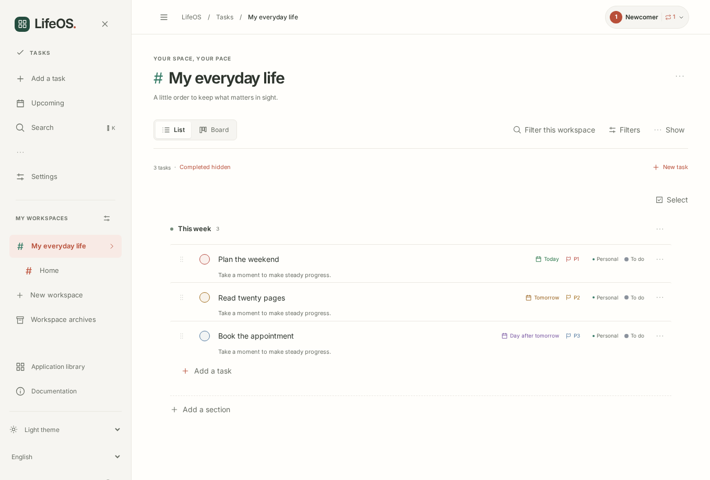
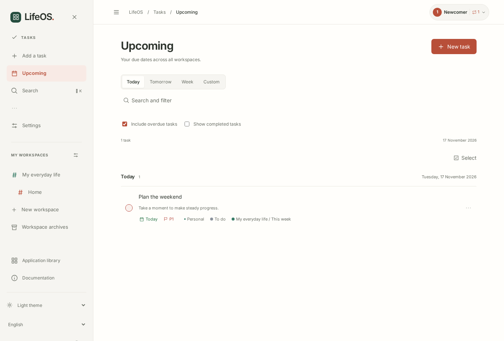
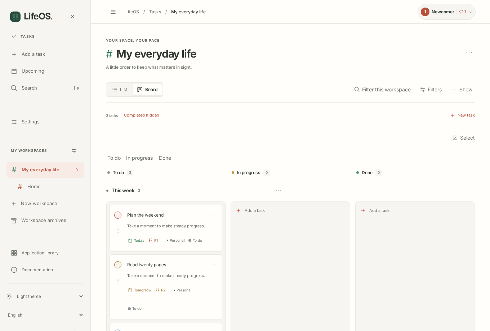
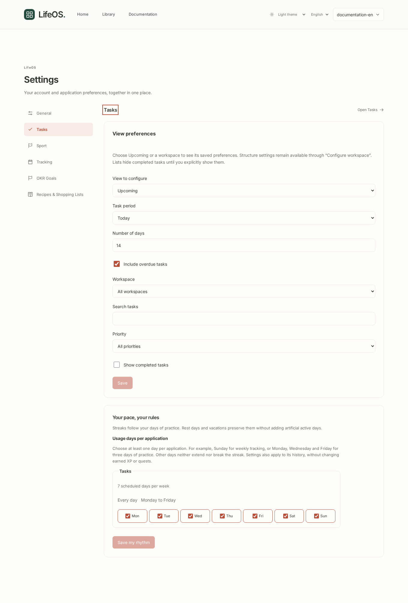

# Using Tasks

Navigation shares its design with Sport. The footer contains the library, Tasks documentation, theme, language and user/sign-out controls. Workspace archives remain among the application links. See [shared navigation](applications.md#shared-navigation).

Tasks is enabled by default in LifeOS. Open it from Home or enable it again in the [library](applications.md). Disabling Tasks blocks access without changing your records or history.

## Immediate interactions

Checking a task shows a short confirmation animation immediately. You can check another task without waiting. Creation, editing, moving, duplication, archiving/restoring, bulk actions and settings also update immediately while saving in the background. Lists, the board and **Upcoming** remain available; the status above the view shows pending saves.

The server supplies the next date of a recurring task. Natural-language dates still require validation before submission. Confirmation dialogs and form validation remain in place.

If a save fails, a visible message explains the problem and the view is reconciled with saved data. Independent actions continue. **Resume editing** recovers a task draft, including after switching views. Review current values after a conflict. Following a connection failure, reload to check whether the action was saved before submitting it again.

Wait for pending saves before closing or reloading the page. The browser warns when leaving with pending writes; drafts and pending actions are not stored offline. The animation follows the system’s reduced-motion preference.

## Workspaces and hierarchy

Choose **New workspace** to create a personal space, work area or project. Give it a name, description, colour and optional parent workspace. New workspaces receive **To do**, **In progress** and **Done** statuses when your account language is English. Existing status names remain unchanged when you switch languages, because they are editable personal content.

Workspace settings let you edit its name, parent, sections, statuses and labels. Selecting no parent moves it to the root. Descendants move with their parent, but tasks keep their original workspace, dates and history. Cycles are rejected. Each workspace owns its own tasks and settings; opening a parent does not combine its descendants’ tasks. The full path appears in navigation and workspace choices. Reorder workspaces within the same parent using the arrow controls.

Sections organize tasks inside a workspace and can appear in lists, boards or both. Statuses determine whether a task is open or complete. At least one open and one completed status must remain; a status used by tasks, including archived tasks, cannot change its completion meaning. Labels belong to their workspace.

### Choosing colours

Workspaces, sections, columns and labels offer the same **16-colour grid** on desktop and mobile, when creating or editing. Click or tap a swatch to select it; a checkmark identifies the current choice. With a keyboard, use Tab to reach a swatch, then Enter or Space to select it.

**Custom color** opens your browser’s free colour picker. Its appearance depends on the device, while the LifeOS grid and its colours stay identical. The selected hexadecimal code is displayed next to the picker. Existing custom colours are preserved even when absent from the grid. Selecting a colour does not submit the form: use **Create workspace**, **Add** or **Save** afterwards. After adding a section, column or label, the creation form returns to its default colour.

Colours are saved through the [existing APIs](api.md#espaces-et-configuration) in the `color` field as `#RRGGBB` and appear on other devices after reloading. The palette does not restrict accepted values; no data changes or migration are required.

{ loading=lazy }

*List: sections group tasks and their due dates.*

## Upcoming tasks

**Upcoming** combines due tasks from active workspaces and is the default `/tasks` view. A link with `?space=…` still opens that workspace. Tasks are grouped chronologically by date with their full workspace path and section.

Choose the period and whether to include overdue or completed tasks. Custom horizons range from 1 to 90 days. These settings are saved to your account. Tasks without a due date remain in their workspace and do not appear in the agenda. Dates use the browser’s local day, including after midnight or when returning to an open tab.

{ loading=lazy }

*Agenda: see upcoming dates across your workspaces.*

## Create and organize tasks

Creating a workspace keeps its form visible while saving, then opens the new workspace. A failed save preserves its inputs. Use **New task** or quick entry. On desktop, pressing **Enter** in quick entry clears the title and keeps the cursor ready for the next task in the same section and status. **Escape** closes quick entry. Enter a title, optional description, status, section, priority, labels and due date. Saved data comes from the server. Closing a changed form or leaving quick entry asks for confirmation; cancelling preserves the draft. Reloading uses the browser’s native unsaved-change warning. A version conflict is explicit and does not silently overwrite another device’s change.

List, board and other available task views share the same records and actions. Completed tasks are hidden in every workspace whenever you open or reload the page, even if you previously showed them. Choose **Show → Show completed tasks** to reveal them in the current workspace until the next reload. This choice remains active when you visit another workspace and come back during the same visit. **Clear filters** also reveals all tasks. Completion dates and history are preserved.

Other view preferences, including layout, density, sorting and filters, persist through the API. **Upcoming** keeps its separate saved settings. Search waits briefly while you type. An update preserves the visible list and scroll position; errors keep the last results and offer **Try again**.

In manual order on desktop, drag a task by its title, body or handle to reorder it or change its list section or board row/column, including empty cells. Drop it on another workspace in the sidebar to move it to **No section**, preserving its open/completed state in the first compatible status. Releasing outside a target or pressing Escape cancels the drag. Area selection starts only on the background outside tasks and controls; it never starts from a task. On touchscreens, use the handle to drag. The accessible move command offers a keyboard alternative and also moves tasks between workspaces. Select several tasks to complete, reopen, reschedule, move, change priority/status/labels, duplicate or archive. The context menu offers the same actions and applies to the whole selection when opened on a selected task. Use Escape to dismiss menus or clear selection. A touch hold starts selection; moving before activation continues scrolling. A task keeps its identity and history when moved.

Marking a task complete records its completion time. Reopening preserves the earlier completion event. Archiving is reversible and does not erase task history. Archived workspaces and sections must be restored before their content can be active again; active child workspaces prevent archiving a parent. There is no permanent deletion operation in this release.

{ loading=lazy }

*Board: sections form rows and statuses form columns.*

## Global search and bulk controls

**Search** in the sidebar or Ctrl/⌘ K outside a dialog searches titles and descriptions across all workspaces, including completed tasks by default. Filter by workspace, priority, label and state (open, completed, both, or archives). Workspace search stays local. **All tasks**, **No due date** and **Task archives** have direct links. Global filters appear in the URL; browser Back/Forward restores the view and criteria. Result paths and workspace parents are clickable.

**Upcoming** saves its search, workspace, priority and label filters through the agenda API. **New task** asks for its destination workspace. Date, priority, status and label metadata open their editing action. Section settings focus the requested section; adding a section focuses its new name. Column buttons navigate a narrow board.

Selection supports **Select all**, per-section selection, Shift-click ranges and Ctrl/⌘ A outside inputs while selecting. Select all includes results not rendered yet. More actions opens the same menu as the task’s three dots or right click; its caption identifies the affected selection. An unselected task keeps individual actions. Bulk operations accept at most 500 tasks and commit atomically. Larger selections offer **Keep the first 500** before applying an action. Completion advances one occurrence per recurring task and leaves already completed tasks unchanged. Status and label choices are explicit for each workspace. Labels can be added or removed without replacing other labels. Duplication creates independent open copies. Archived tasks can be restored individually or in bulk; restore archived parent workspaces/sections first. The last archive offers an undo action protected by task versions. A failed destination read provides **Try again**.

Changed drafts are protected on dialog close, view or language change, sign-out and reload. Ctrl/⌘ K never replaces an open dialog. Drafts remain temporary. Session expiry still removes private views. Task controls own non-overlapping 44px targets. Completion feedback does not shift the list, keyboard focus follows the remaining rows, and reduced motion disables both CSS and drag animations. Drag announcements name the task and destination in the account language.

Global results and each list/agenda/board group initially render 100 tasks; **Show more** adds 100. Counts and selection cover all results. The existing synchronizer still downloads task data in API pages of 200; this is not server-side lazy loading or an unlimited-volume guarantee.

## Dates and natural-language recurrence

Recognition follows the account language. With English selected, type a date or recurrence alongside your title, then check the preview before saving:

| Example | Meaning |
| --- | --- |
| `Read tomorrow` | One due date |
| `Read in twenty-one days` | A relative date |
| `Review on January 21, 2027` | A named calendar date |
| `Run every Monday and Thursday` | Selected weekdays |
| `Read every two days` | A regular interval |
| `Run every Wednesday every three weeks` | A cadence combined with a weekday |
| `Check every other week on Monday through Friday` | A weekday range and interval |
| `Pay every 1st and 21st of the month` | Several days of the month |
| `Review every last business day of the month` | A monthly position |
| `Read every day for five times except tomorrow` | A count limit and exclusion |

Numbers and ordinals can be written as words or digits. Numeric dates use **day/month/year**, including in English; `YYYY-MM-DD` is accepted. A calendar day is not an instant or a time of day. Unsupported combinations, incomplete expressions, hours and public-holiday rules are not silently applied: read the diagnostic and correct the expression or explicitly keep it as literal text.

The recognition preview shows the interpreted words, a description and upcoming dates. Only a recognized expression is removed from the title. To keep words such as “tomorrow” in a title, use the literal-text action or put them in quotation marks. Existing saved titles are never translated or reinterpreted merely because the language changes.

The date picker also offers a calendar and custom recurrence controls. Choose a frequency and interval, selected days or monthly positions, an anchor, optional end date or occurrence limit and excluded dates. The preview uses the same server rules as saving and completion. The timezone is stored with the rule. An impossible rule is rejected rather than saved with an invalid next date.

## Completing recurring tasks

Completing a recurring task records the completion and schedules its next occurrence in one transaction. The same task keeps its ID, rule, history and completed-occurrence count. The next occurrence uses the rule’s scheduled or completion-based calculation mode. An end date or occurrence limit eventually ends the series.

The completion notice offers an undo action. Undo records a compensating event and restores the relevant occurrence; it does not erase history. Editing the recurrence definition restarts its occurrence counter while preserving earlier events. Moving or archiving a recurring task does not reset its dates or history. A language change does not modify any recurrence, anchor, timezone, count or event.

## Accessibility, privacy and limits

The interface supports keyboard navigation, named controls, focus-contained dialogs and narrow screens in light and dark themes. The board scrolls inside its own region. Your browser can still zoom manually. Menus and dialogs close with Escape and restore focus to their trigger where applicable.

All records belong to the signed-in account. Writes require the session, CSRF token and allowed origin. There is no offline business-data store or instant synchronization between devices. A session expiry removes private views; records already saved remain intact. Dedicated task-resolution statistics remain future work. [OKR Goals](okr.md) is available as its own application.

See [language preferences](applications.md), the [French task guide](../taches.md) and the [API reference](api.md).

## Progress and quests

The top-right badge shows your level, title and streak. Open it for nearby quests; the full wall and journal are in Tracking → Achievements. [Points, 60 quests and streak rules](progression.md).

## Simplified layout

Upcoming uses a centered reading column, with metadata below each task title and consistent minimum row heights. Long workspace paths are visually shortened and remain accessible through their links. “Search and filter” reveals fields hidden by default; a count identifies active filters, which remain applied when the panel is closed. “Filter this workspace” reveals local search. Global search opens its field directly after Search or Ctrl/⌘K.

Navigation keeps Add, Upcoming and Search visible. The icon-only “More task views” button opens All tasks, No due date and Task archives. Escape closes the panel or menu and returns focus. Completion notifications keep the message, Undo and dismissal compact without shifting the list.

Preferences are grouped in [General settings](settings.md). An application’s Settings control opens its section; the progression timezone and vacations are under General, and usage days are in each application section.

{ loading=lazy }

*Open Settings to adjust this application’s preferences and usage days.*
