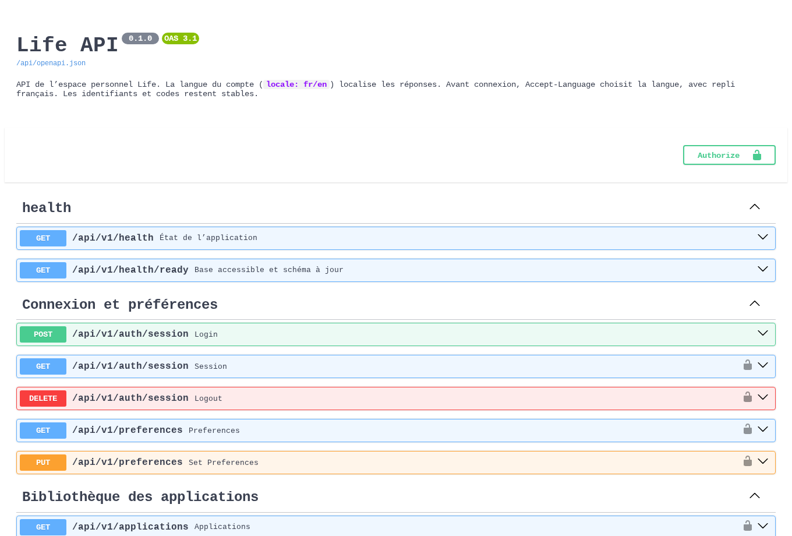

# Technical documentation

This guide is for people developing, integrating or operating LifeOS. User instructions live in [separate guides](index.md): General, Tasks, Sport, Tracking, OKR Goals and Cook & Shop.

## Develop and understand

1. Follow [local setup](demarrage.md), create a development account and open the interface.
2. Read the [architecture](architecture.md), [data and constraints](donnees.md), then the [backend](backend.md) and [frontend](frontend.md) responsibilities.
3. Check [configuration](configuration.md), [translations](internationalisation.md) and [tests](tests.md).
4. To add a feature, follow the [evolution guide](evolution.md) and this guide’s historical decisions.

## Use the APIs

Open [Swagger](https://life.thibault-leveau.com/api/docs), expand an endpoint and inspect its contract. The [platform and Tasks reference](api.md) shows how to sign in, retain cookies and supply the CSRF token. Authenticated writes use the same checks as the interface.

The [Sport](sport-api.md), [Tracking](tracking-api.md), [OKR](okr-api.md), [Recipes and shopping](recipes-api.md) and [integrations](integrations.md) references describe business contracts, errors, limits and examples independent of the browser.

{ loading=lazy }

*OpenAPI explorer: expand an endpoint to inspect its contract.*

## Publish and maintain

Follow [tests and review](tests.md), then [deployment](deploiement.md), then verify the running image and public routes. [Backup and restore](sauvegardes.md) explains migration constraints; [operations](exploitation.md) and [security](securite.md) support diagnosis.

## Maintain these guides

French sources remain in `docs/`, with equivalent paths under `docs/en/` for English. `mkdocs.yml` declares each page’s guide; `scripts/documentation.py` builds isolated menus, titles, language links and search indexes. The framework, public URLs and deployment image stay the same. Previous/next links never leave a guide or its language.

Add each page in both languages and to the guide manifest. Links to other guides remain explicit in the content. Historical French ADRs remain unchanged; translations are marked as such. `make build` rejects pages without a guide or translation. Capture real screenshots only on a synthetic test server, following [Tests](tests.md), then store them under `docs/assets/screenshots/fr/` and `en/` with alternative text and captions.
