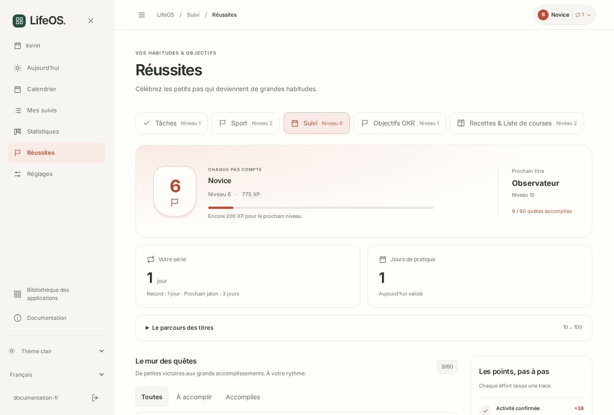
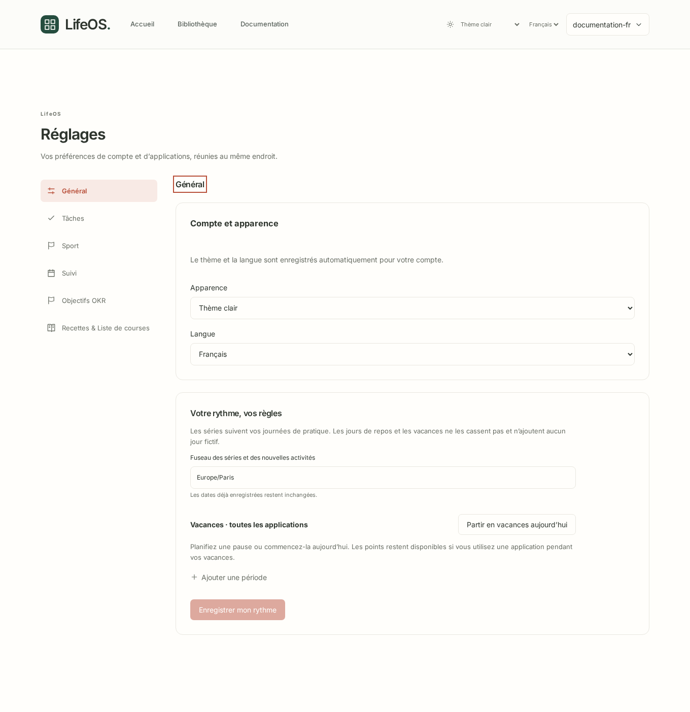

# Réussites et progression par application

[English guide](en/progression.md)

Chaque application possède ses points d’expérience, son niveau, son titre et sa série. Le badge en haut à droite de Tâches, Sport, Suivi, Objectifs OKR et Recettes donne votre progression et les trois quêtes inachevées les plus proches de leur objectif. Ouvrez-le au clavier avec Entrée ; Échap ferme le panneau et rend le focus au bouton.

Dans **Suivi → Réussites**, choisissez une application : le mur présente ses **60 quêtes**, leurs conditions, leur progression et leurs points. Filtrez les quêtes à accomplir ou accomplies, ou recherchez un objectif. Le parcours des titres montre tous les paliers ; le journal détaille chaque gain, avec pagination. Seules les applications activées sont consultables. Désactiver conserve tout ; la progression de Tâches et Sport reste utilisable lorsque Suivi est désactivé.

## Des points pour la pratique

| Application | Action confirmée | Points |
| --- | --- | --- |
| Tâches | Première résolution d’une tâche, ou d’une occurrence récurrente | 10 XP |
| Suivi | Première confirmation d’une période de suivi | 20 XP + 0 à 20 XP selon le score des objectifs |
| Sport | Séance terminée contenant au moins une série effectuée avec une valeur positive | 60 XP + 5 XP par série effectuée, bonus limité à 100 XP |

Les coefficients de base **1 / 2 / 6** distinguent une action fréquente, une saisie structurée et une séance nécessitant davantage d’effort. Le bonus Sport distingue une séance courte d’une séance plus fournie, sans croissance illimitée. Le bonus Suivi vaut deux fois le score sur 10, arrondi à l’entier. Sans objectif, il vaut zéro. Ces points sont une convention de motivation, pas une mesure médicale ou de performance comparable entre personnes.

Dans Tâches, Sport et Suivi, créer, consulter, rafraîchir, modifier ou archiver ne rapporte aucun point. Une séance annulée ou entièrement passée ne rapporte rien. Les points et quêtes restent **acquis** après confirmation : réouvrir, annuler une résolution ou corriger une saisie ne retire pas les gains, et ne permet pas de les recevoir à nouveau. Les objectifs des quêtes sont évalués sur cette première confirmation. Une correction ultérieure peut améliorer le score statistique d’un suivi sans réécrire les récompenses.

L’unicité repose sur la tâche non récurrente, sur la tâche et la date d’échéance de l’occurrence récurrente, sur la période de suivi ou sur la séance. Les séances multiples et les tâches distinctes restent des actions distinctes ; ce système personnel ne cherche pas à détecter une saisie volontairement fictive. Le serveur calcule les gains, y compris pour les actions effectuées directement par API.

## Niveaux et titres

Le niveau commence à 1 et s’arrête à **100**. Passer du niveau L à L+1 coûte **100 + 25 × (L−1) XP** : 100 XP, puis 125, puis 150, etc. Le seuil cumulé du niveau L vaut `100 × (L−1) + 25 × (L−1) × (L−2) / 2`. Le niveau 100 demande **131 175 XP**. Les gains continuent à apparaître dans le journal au niveau maximum.

Un nouveau titre apparaît tous les dix niveaux : dix titres propres à chaque application, jusqu’à « Légende des projets », « Légende du sport » et « Légende du quotidien ». Avant le niveau 10, le titre est « Novice ». Le parcours indique les niveaux et points nécessaires ; il ne demande aucune action pour réclamer un titre.

## Quêtes par application

Chaque application propose six familles de dix paliers. Chaque palier est une quête distincte avec son identifiant, son objectif et sa récompense unique.

| Application | Familles |
| --- | --- |
| Tâches | Résolutions, échéances respectées, occurrences récurrentes, priorités 1/2, jours actifs, séries |
| Sport | Séances, séries effectuées, exercices différents, programmes différents, jours actifs, séries de jours |
| Suivi | Périodes confirmées, scores 10/10, objectifs atteints, suivis différents, jours actifs, séries |

Les dix paliers de chaque famille rapportent respectivement **25, 40, 60, 90, 130, 180, 250, 350, 500 et 750 XP**. Les objectifs sont visibles dans chaque carte. Les quêtes de séries ciblent **3, 7, 14, 21, 30, 45, 60, 90, 180 et 365 jours éligibles**. Une quête accomplie reste acquise, même après changement des réglages de calendrier. Les quêtes sont validées lors d’une nouvelle activité éligible ; modifier les réglages seul ne distribue pas de points.

{ loading=lazy }

*Mur des quêtes : choisir une application, rechercher et filtrer les réussites.*

## Un rythme qui respecte vos pauses

Dans les [réglages généraux](settings.md), choisissez **Général** pour le fuseau et les vacances, ou une application pour ses jours d’utilisation :

- Choisissez le fuseau IANA des nouvelles activités, par défaut `Europe/Paris`.
- Choisissez les **jours d’utilisation de chaque application**, du lundi au dimanche, avec au moins un jour. Par exemple : dimanche uniquement pour un suivi hebdomadaire ; lundi, mercredi et vendredi pour trois jours de pratique. Les raccourcis « Tous les jours » et « Du lundi au vendredi » facilitent le choix. Le badge rappelle les jours prévus.
- Ajoutez des périodes de vacances inclusives, communes à toutes les applications. Le bouton « Partir en vacances aujourd’hui » propose une semaine modifiable ; enregistrez pour activer le mode vacances. Vous pouvez prévoir jusqu’à 100 périodes non chevauchantes.
- « Terminer les vacances aujourd’hui » termine la pause hier, afin qu’aujourd’hui redevienne éligible. Enregistrez pour confirmer.

Une journée avec au moins une première confirmation éligible valide la journée de son application. Plusieurs confirmations le même jour ne donnent qu’un jour de série. Une saisie rétrospective dans Suivi compte le jour où elle est confirmée, et ne reconstitue pas artificiellement une présence passée.

Un jour non choisi ou en vacances **n’incrémente ni ne casse la série**, même si vous utilisez l’application ce jour-là. Ses actions rapportent toujours des XP et comptent dans les jours de pratique. La journée courante inachevée bénéficie d’un délai jusqu’à la fin de la journée. Une journée éligible passée sans activité casse la série ; le record reste calculé sur tout l’historique, sans limite d’un an.

Le changement de fuseau ne déplace pas les dates d’activité déjà enregistrées. Les jours choisis et les vacances s’appliquent au calcul de l’historique, sans modifier les événements ni les gains déjà acquis. La désactivation d’une application conserve ses données mais ne crée pas une pause de calendrier : planifiez des vacances si nécessaire. Chaque application suit son propre calendrier. Les anciennes préférences sont conservées : tous les jours, ou lundi–vendredi si les week-ends étaient exclus. Une série de trois dimanches validés vaut trois jours de série, même si trois semaines se sont écoulées. Une activité le samedi ne remplace pas le dimanche attendu : ce réglage porte sur des jours précis, pas sur un quota libre dans la semaine. Les échéances des suivis ne sont pas modifiées ; seule la série d’utilisation de l’application est concernée.

Les brouillons de réglages sont protégés lors d’une navigation, d’un changement de langue ou d’une déconnexion. Une modification concurrente produit un conflit explicite.

{ loading=lazy }

*Réglages généraux : choisir le fuseau de progression et les vacances.*

## Historique antérieur et accès API

Une reprise explicite peut convertir les activités antérieures vérifiables, sans modifier les tâches, séances ou saisies. Les périodes Suivi existantes gardent leur ancien montant de 10 à 30 XP ; les nouvelles confirmations suivent le nouveau barème. Les quêtes reprises sont datées du moment de l’import, les activités gardent leur date réelle. Les priorités absentes d’un ancien événement Tâches ne sont pas inventées depuis l’état courant. Une reprise répétée ne crée pas de doublons. Voir [la procédure de publication](deploiement.md#livraison-de-la-progression).

L’[API de progression](api.md#progression-par-application) fournit toutes les lectures et préférences. L’ancien `GET /tracking/achievements` reste un contrat historique compatible (XP recalculés sur les saisies courantes et cinq badges), utilisé par les anciennes statistiques de périodes ; le mur, les titres et le badge utilisent exclusivement `/progression`. Ces deux scores répondent à des règles différentes : le nouveau journal conserve les gains acquis.

## Quêtes Objectifs OKR

OKR ajoute 60 quêtes : objectifs accomplis, résultats clés atteints, objectifs personnels, professionnels, jours actifs et séries (dix paliers par famille). Une première clôture vaut 100 XP ; une première atteinte de résultat clé vaut 15 XP. Les identifiants de l’objectif et du résultat dans cet objectif dédupliquent les gains, même après correction/réouverture. Les instantanés fixent les domaines au premier succès. Le badge fonctionne sans Suivi ; le mur et les réglages communs sont disponibles dans Suivi. [Règles et exemples](okr.md#suivi-quetes-et-motivation).

## Quêtes Recettes et courses

Recettes ajoute 60 quêtes : recettes enregistrées, listes terminées, couples liste/recette importés, modèles non vides, jours actifs et séries. Les premières confirmations donnent respectivement 25, 50, 5 et 15 XP de base. Cette application récompense donc aussi la constitution du carnet et des modèles. Les identifiants stables dédupliquent les récompenses ; aucune recoche, modification, réouverture ou réactivation ne multiplie un gain. [Règles détaillées](recipes.md#suivi-quetes-et-motivation). Le catalogue total comprend désormais 300 quêtes pour les cinq applications.

Les préférences sont réunies dans les [réglages généraux](settings.md). Le lien Réglages de l’application ouvre sa section ; fuseau de progression et vacances se trouvent dans Général, jours d’utilisation dans chaque application.
