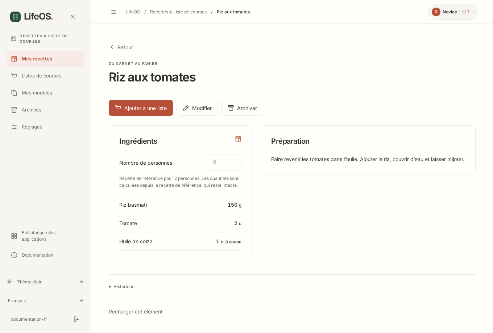
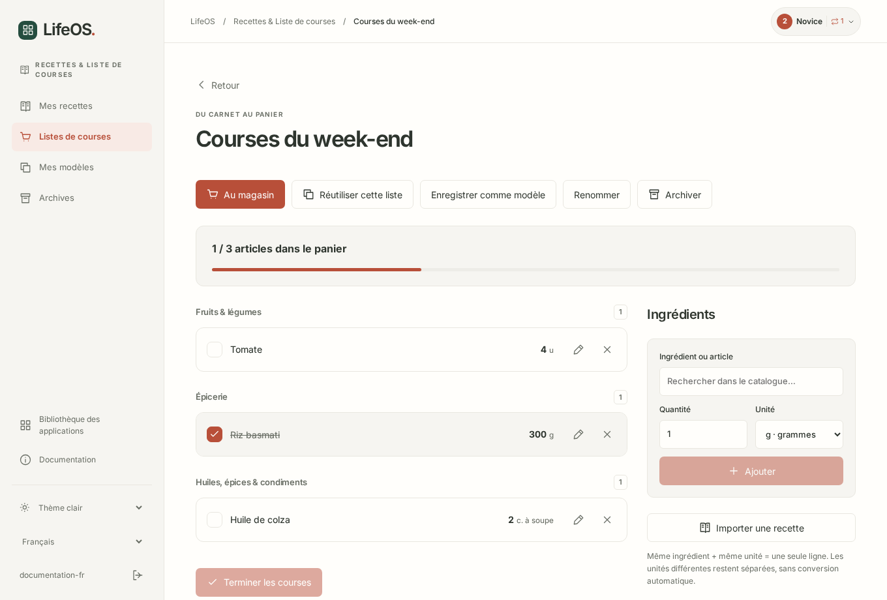
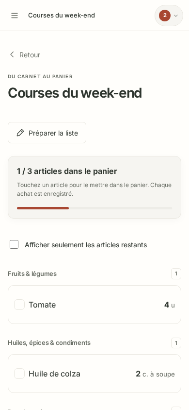
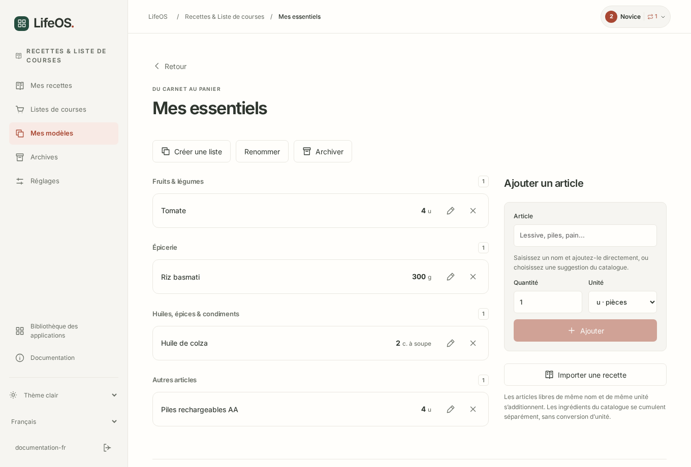
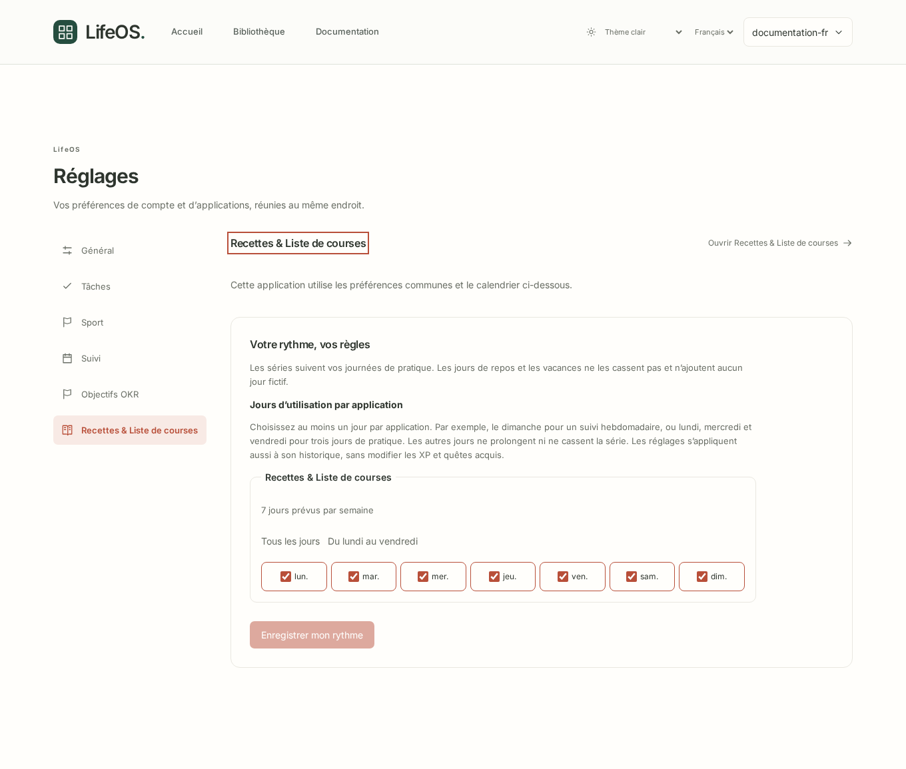

# Recettes & Liste de courses

[English guide](en/recipes.md) · [API](recipes-api.md)

Activez **Recettes & Liste de courses** dans la bibliothèque LifeOS, puis ouvrez `/recipes`. L’application partage la connexion, les thèmes, la langue et la navigation des autres applications. Elle démarre désactivée et conserve toutes ses données lors d’une désactivation.

## Votre carnet de recettes

Dans **Mes recettes → Nouvelle recette**, saisissez un nom, le nombre de personnes de référence, les ingrédients avec leur quantité et leur unité, puis les étapes de préparation. Ajoutez chaque ingrédient avant d’enregistrer la recette ; **Annuler** dans le bloc d’ajout efface seulement cet ajout en cours.

Ouvrez une recette et changez **Nombre de personnes** : les quantités sont recalculées depuis la référence, sans modifier celle-ci. Exemple : 125,1 g pour deux personnes donnent 187,65 g pour trois et 375,3 g pour six. L’import utilise exactement le même calcul serveur. Les quantités en pièces peuvent être fractionnaires (par exemple un demi-citron) ; il n’y a pas d’arrondi automatique à la pièce supérieure.

**Modifier** change les quantités de référence et la préparation. Dans cet éditeur, modifier le nombre de personnes indique à combien de personnes correspondent les quantités saisies ; utilisez la consultation pour obtenir une mise à l’échelle. Une recette doit contenir au moins un ingrédient. **Archiver** la range dans les archives ; **Restaurer** la rend à nouveau disponible. L’historique conserve les créations, modifications et changements d’archivage.

{ loading=lazy }

*Recette : ajuster les portions puis ajouter les ingrédients à une liste.*

## Un catalogue commun, vos ingrédients privés

Le catalogue livré contient **301 ingrédients et articles courants**, avec un nom français et anglais : fruits/légumes, frais, protéines, épicerie, condiments, boissons, surgelés et maison/hygiène. Le nom affiché suit la langue du compte. La recherche accepte les noms dans les deux langues et ignore casse et accents, y compris « oeuf » pour « œuf ».

Dans une recette, une liste ou un modèle, recherchez puis sélectionnez un ingrédient. Choisissez la quantité et l’une des sept unités : **g** (grammes), **mg** (milligrammes), **l** (litres), **ml** (millilitres), **c. à café** (cuillère à café), **c. à soupe** (cuillère à soupe), **u** (pièces/articles). Le catalogue suggère une unité mais vous pouvez en choisir une autre. Vous pouvez saisir directement 250 ml ou 0,5 cuillère à café ; pour 1 kg, saisissez 1 000 g.

Dans l’éditeur de recette, si le nom n’existe pas, **Créer « … » dans mon catalogue** l’ajoute directement, avec l’unité choisie, puis le sélectionne. Cet ingrédient est privé : les autres comptes ne le voient pas. Son nom personnel reste identique dans les deux langues ; aucune traduction automatique n’est appliquée. Un nom exact déjà connu dans l’une des langues réutilise son identité, même si l’appel est répété. La recherche reste une recherche de sous-chaîne, sans rapprochement automatique des synonymes ou des pluriels : sélectionnez l’ingrédient existant pour qu’il se cumule correctement.

## Préparer les courses

Dans **Listes de courses → Nouvelle liste**, donnez un nom à votre liste. Dans **Ajouter un article**, saisissez ce dont vous avez besoin : « Lessive », « Piles AA », « Fleurs »… Appuyez sur **Entrée** ou **Ajouter** : aucune sélection ni création dans le catalogue n’est nécessaire. Par défaut, l’ajout correspond à **1 pièce** ; ajustez quantité et unité si besoin. Les suggestions restent facultatives : sélectionnez-en une pour utiliser un ingrédient du catalogue. Les articles libres apparaissent dans **Autres articles** et leur nom reste identique en français et en anglais.

Après un ajout réussi, le champ de nom se vide et récupère le focus dès qu’il est de nouveau disponible, pour saisir directement l’article suivant. Un échec conserve la saisie.

Un article libre ne crée pas d’ingrédient personnel et n’apparaît pas dans le catalogue des recettes. Les articles libres de même nom (casse, accents et espaces répétés ignorés) et même unité s’additionnent, en conservant le premier libellé. Des noms différents, synonymes ou pluriels restent distincts. Ils ne fusionnent pas avec un ingrédient du catalogue portant le même nom. Une recherche catalogue indisponible n’empêche pas d’ajouter un article libre.

Pour compléter les courses, choisissez **Importer une recette**, la recette et le nombre de personnes. Vous pouvez aussi partir d’une recette avec **Ajouter à une liste**. La recherche et la pagination permettent de retrouver des listes et recettes plus anciennes.

Chaque import **ajoute** les quantités. Deux imports de 200 g du même ingrédient donnent une ligne de 400 g. La même identité et la même unité s’additionnent ; les unités différentes restent séparées, même g/mg et l/ml. Aucune conversion automatique n’est appliquée, y compris pour les cuillères. Relancer volontairement un import ajoute une seconde portion ; en cas de double envoi de la même version, le serveur refuse le second envoi avec un conflit.

Les commandes de préparation permettent de corriger une quantité, retirer un article, renommer, archiver ou restaurer la liste. Une liste terminée est en lecture seule jusqu’à **Rouvrir la liste**. Les articles retirés restent présents dans l’historique de la liste.

{ loading=lazy }

*Liste de courses : ajouter des articles et importer les quantités d’une recette.*

## Au magasin

**Au magasin** ouvre une vue avec de grandes lignes tactiles, groupées par rayon, un compteur et les articles déjà achetés à part. Touchez une ligne pour la cocher ou utilisez Tab puis Espace. **Afficher seulement les articles restants** réduit la liste à ce qu’il reste à prendre. Les achats sont enregistrés immédiatement par API et survivent au rechargement.

L’ajout rapide reste disponible au magasin. Si vous avez déjà pris 200 g et ajoutez 50 g, la ligne redevient à prendre pour **50 g**, en rappelant les 200 g déjà achetés et le total de 250 g. Cocher achète tout le complément ; décocher remet la quantité achetée de cette ligne à zéro. Réduire la quantité totale ne conserve jamais un acheté supérieur au nouveau total.

**Terminer les courses** est disponible quand une liste non vide est entièrement cochée. La date de fin est conservée ; rouvrir ne remet pas automatiquement les achats à zéro. **Réutiliser cette liste** crée une nouvelle sortie de courses avec toutes les cases vierges.

Une connexion réseau est nécessaire. Une erreur ne présente jamais un achat comme enregistré ; réessayez dans le contenu concerné. Si un autre appareil a changé la liste, **Recharger cet élément** récupère sa dernière version. Il n’y a pas de mode hors ligne ni de synchronisation en temps réel.

{ loading=lazy }

*Mode magasin sur mobile : cocher les achats et afficher seulement le reste.*

## Modèles et anciennes listes

Dans **Mes modèles → Nouveau modèle**, composez vos indispensables avec des articles libres, des ingrédients du catalogue et des imports de recettes. Depuis une liste, active ou passée, **Enregistrer comme modèle** crée un modèle indépendant. Depuis un modèle, **Créer une liste** reprend tous ses articles et quantités, sans achats cochés.

**Réutiliser cette liste** fonctionne également sur une ancienne liste, y compris archivée. La copie ne modifie jamais sa source et reste indépendante de ses futures modifications. Les modèles ne portent pas de cases achetées ni de date de fin. Le catalogue d’ingrédients reste commun à vos recettes, modèles et listes.

{ loading=lazy }

*Modèle : préparer des essentiels et créer une nouvelle liste indépendante.*

## Suivi, quêtes et motivation

Le badge commun affiche niveau, titre, série et quêtes proches. Dans **Suivi → Réussites**, choisissez Recettes : **60 quêtes** couvrent recettes enregistrées, listes terminées, couples liste/recette importés, modèles non vides, jours actifs et séries (dix paliers par famille).

| Première action confirmée | XP de base |
| --- | --- |
| Créer une recette avec des ingrédients | 25 |
| Terminer une liste non vide entièrement achetée | 50 |
| Importer une recette dans une liste | 5 par couple liste/recette |
| Préparer un modèle non vide | 15 |

Les corrections, recoches, réouvertures, imports répétés dans la même liste, archives et réactivations ne multiplient pas ces gains. Une nouvelle recette, un nouveau modèle ou une nouvelle liste possède une identité indépendante. Les quêtes ajoutent leurs bonus habituels. Les jours d’utilisation et vacances se règlent dans Suivi, avec le calendrier commun. Le badge fonctionne même si Suivi est désactivé.

Suivi découvre aussi quatre métriques historiques : recettes enregistrées, listes terminées, recettes utilisées pour les courses et modèles préparés. Elles comptent les premières actions, dans la période/fuseau demandés, archives comprises. Désactiver Recettes empêche de nouvelles évaluations et conserve les instantanés déjà enregistrés dans Suivi.

## Limites et conservation

La version livrée accepte 2 000 recettes et 2 000 listes/modèles par compte, 3 000 ingrédients personnels, 200 lignes par recette et 300 couples ingrédient/unité par liste. Les quantités sont positives, jusqu’à 1 000 000 000, avec six décimales ; les portions sont entières de 1 à 1 000. Un calcul hors de ces bornes est refusé, sans import partiel. Les dates sont conservées en UTC. Les contenus personnels ne sont pas traduits.

Il n’y a ni partage de listes, images, prix, nutrition, planification de menus ni suppression définitive des recettes/listes/modèles. Les brouillons sont protégés lors du départ, du changement de langue et de la déconnexion. Toutes les opérations persistantes existent dans l’[API versionnée](recipes-api.md). Voir les [données](donnees.md#donnees-recettes-et-courses) et la [sauvegarde/restauration](sauvegardes.md#migration-0012-recettes-et-courses).

Les préférences sont réunies dans les [réglages généraux](settings.md). Le lien Réglages de l’application ouvre sa section ; fuseau de progression et vacances se trouvent dans Général, jours d’utilisation dans chaque application.

{ loading=lazy }

*Ouvrir Réglages pour adapter les préférences et les jours d’utilisation de cette application.*

## Importer une recette depuis le web

Dans **Recettes → Importer du web**, collez l’URL puis choisissez **Ouvrir la page**. Le cadre est un navigateur temporaire : cliquez, faites défiler la page et répondez vous-même aux demandes de cookies ou de vérification. Le bouton clavier permet de saisir du texte ; **Échap** rend le clavier à LifeOS. Sur mobile, le champ sous le cadre permet aussi de saisir du texte dans le champ sélectionné du site.

Quand la recette est visible, choisissez **Importer la recette**. L’IA utilise le fournisseur, le modèle et le token déjà configurés dans les réglages du compte. Elle lit cette même page et prépare le titre, les ingrédients et la préparation en français ou anglais selon la langue actuelle du compte. Seuls le contenu de la page et les noms du catalogue public sont transmis au fournisseur ; aucune conversation ou mémoire personnelle n’est jointe.

Relisez le brouillon : corrigez le titre, les portions, les quantités, unités et étapes. Les lignes d’ingrédients d’origine et les points à vérifier restent consultables. Une mesure ambiguë (tasse sans taille, pincée, « au goût »…) reste à compléter ; aucune conversion masse/volume n’est devinée. Vous pouvez ajouter ou retirer une ligne et choisir un ingrédient du catalogue. **Enregistrer la recette** crée en une transaction la recette et ses éventuels nouveaux ingrédients privés. L’URL source demeure sur la fiche ; un nouvel envoi de la même sauvegarde ne crée pas de doublon.

Le brouillon reste temporaire jusqu’à l’enregistrement. Quitter, changer de langue ou se déconnecter suit les protections habituelles des formulaires. La navigation expire après 10 minutes sans interaction, 30 minutes au maximum, ou après perte de connexion avec LifeOS. Les cookies du site sont propres à cette session et ne sont pas conservés. Deux navigateurs peuvent fonctionner simultanément sur le serveur, un par compte.

Certains sites bloquent les navigateurs hébergés ou leurs vérifications humaines. Utilisez alors **Coller le texte de la recette** : copiez les ingrédients et étapes depuis votre navigateur. Le collage utilise la même extraction IA et la même relecture. Un changement de page pendant l’extraction demande de relancer l’import. Les erreurs du fournisseur, un quota atteint ou une page sans recette ne créent aucune donnée. Les imports consomment le quota de votre fournisseur IA.

Les fourchettes comme « 2–3 tranches » ou « ¼–1 cuillère » laissent la quantité vide : choisissez une valeur lors de la relecture. La ligne originale est conservée et un avertissement signale les champs à compléter, sans moyenne ni borne choisie automatiquement.

## Préparation en sections et saisie mobile

La préparation peut garder son texte général et comporter jusqu’à **50 sections**, chacune avec un titre et un texte. Dans l’éditeur, **Ajouter une section** crée un bloc vide. Pour séparer un texte existant, placez le curseur au début du passage puis choisissez **Scinder au curseur** : tout le texte à partir du curseur passe dans une nouvelle section, dont vous renseignez le titre. Cette action fonctionne aussi à l’intérieur d’une section. Les flèches changent l’ordre ; retirer une section contenant du texte demande confirmation. Les modifications restent un brouillon jusqu’à **Enregistrer**.

Les mêmes commandes sont disponibles pendant la relecture d’un import web. La fiche affiche le texte général puis les sections dans leur ordre. Les recettes déjà enregistrées gardent leur préparation intacte. Les titres acceptent 160 caractères, et l’ensemble des textes de préparation 20 000 caractères (hors titres). Un titre et un texte sont requis pour chaque section enregistrée ; la préparation générale reste facultative.

Sur mobile, le champ de texte s’adapte à la hauteur visible au-dessus du clavier. Il reste de taille limitée et son texte défile à mesure que le curseur avance. Vous pouvez remonter dans le texte, corriger un passage ou faire défiler volontairement la page ; la saisie suivante ramène le champ actif dans la zone visible. Fermer le clavier ou tourner l’écran conserve le brouillon. Le zoom reste autorisé. Une erreur d’enregistrement conserve les textes pour les corriger ou réessayer.
