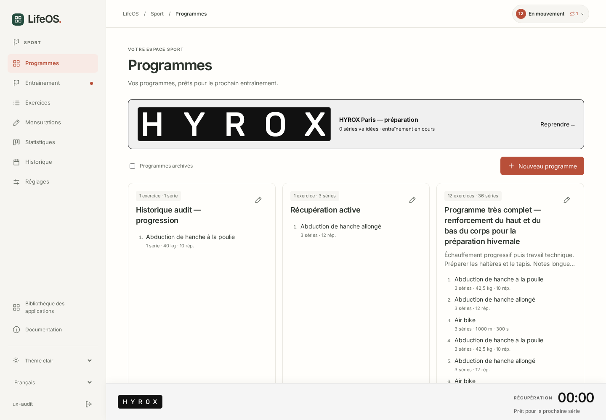
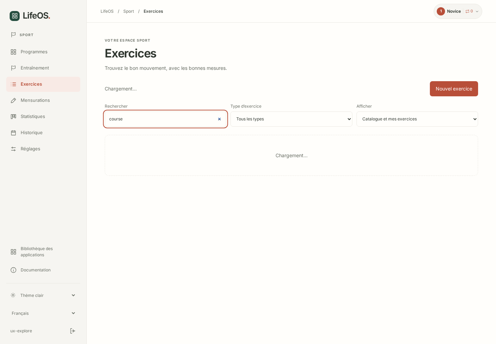
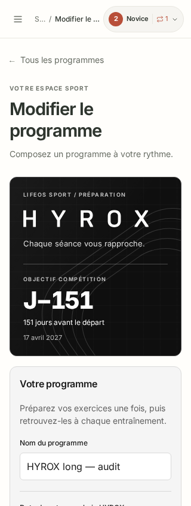
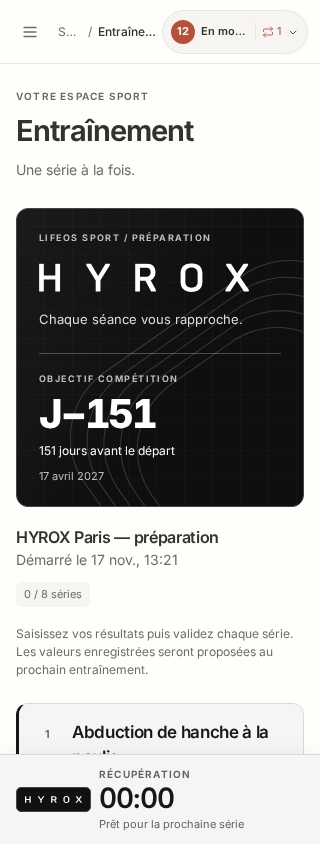
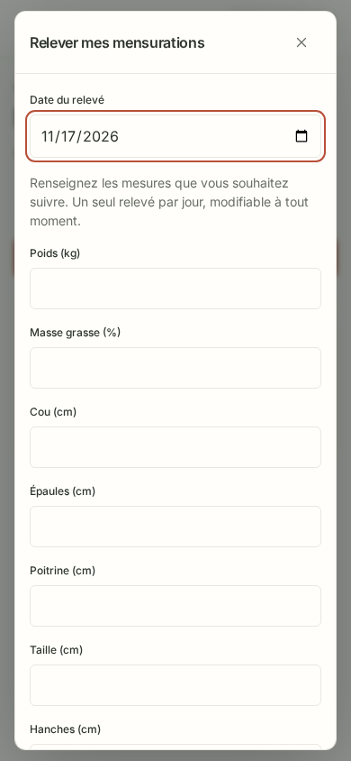
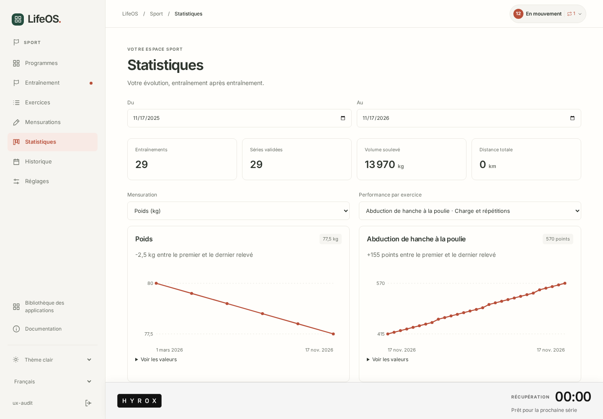
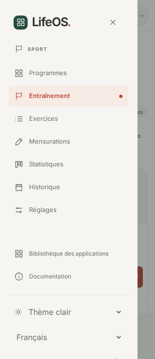
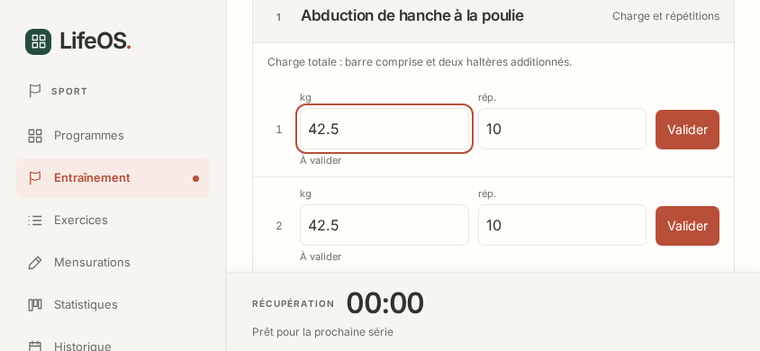

# Revue de Sport — mobile et ordinateur

**Date :** 17 novembre 2026, Europe/Paris. **Demande :** [issue #71](https://github.com/ThibaultLeveau/life.thibault-leveau.com/issues/71). **Version examinée :** [`ecab6ac`](https://github.com/ThibaultLeveau/life.thibault-leveau.com/tree/ecab6ac94a64a11f79722bd43b819cb116505ed8), également exécutée par l’image de recette.

**Conclusion :** Sport possède des parcours métier solides et une bonne adaptation des largeurs. Sa finition reste inégale : certains brouillons se perdent, le clavier perd sa position après une validation, les listes se vident pendant les recherches et plusieurs présentations occupent trop de place. Les priorités sont de fiabiliser ces interactions, d’introduire le choix **Liste / Grille**, puis de rendre la préparation et la séance plus rapides à utiliser.

Ce document livre **39 améliorations proposées**, leur justification et leurs critères de validation. Il constitue une revue : **aucune de ces évolutions produit n’est implémentée par cette livraison documentaire**. Les comportements actuellement disponibles restent décrits dans le [guide Sport](sport.md) et l’[API Sport](sport-api.md).

## Périmètre et méthode

Les sept rubriques et leurs interfaces secondaires ont été examinées : Programmes, éditeur, catalogue d’ajout, Exercices et formulaire, Entraînement, repos, confirmation de fin/abandon, Historique et détail, Mensurations et formulaire, Statistiques et tableaux, Réglages. La revue inclut le cadre LifeOS, la bibliothèque, le compte, le badge de progression et les variantes HYROX.

- **196 états de pages mesurés** : 7 rubriques × 7 largeurs (320, 390, 768, 800, 801, 1 024 et 1 440 px) × 2 langues × 2 thèmes. Les tailles sont des pixels CSS ; ces mesures de largeur ne simulent pas, à elles seules, un téléphone physique.
- **28 états sur compte vide**, à 320 et 1 440 px, français/clair et anglais/sombre ; tests supplémentaires du thème système clair/sombre.
- **56 analyses axe-core 4.14.0** sur les pages à 320/1 440 px, plus une analyse du menu mobile ouvert. Elles complètent l’examen visuel et les essais clavier ; elles ne certifient pas une conformité complète.
- Parcours tactiles séparés avec pointeur tactile, contexte mobile, défilement, formulaires, orientation 844 × 390 et clavier virtuel simulé dans les tests existants.
- Reproductions ciblées avec lenteur réseau, erreur 503, conflit de version, changement de rubrique, retour navigateur, modification rétablie, fermeture pendant sauvegarde et changement de jour selon le fuseau.
- Captures examinées des sept rubriques, des principaux formulaires et des variantes clair/sombre, français/anglais, HYROX/classique. Les données sont entièrement fictives.

Le jeu de revue contient huit programmes actifs et un archivé, dont un de douze exercices, 33 séances historiques, six relevés espacés irrégulièrement et une séance active. Les tests existants complètent ce jeu avec les dix types d’exercice, des noms longs, des conflits et des limites de programme. Les 680 libellés du catalogue n’ont pas été relus individuellement ; les commandes répétées d’un même modèle de ligne sont évaluées comme un même composant.

### Résultats et limites

| Vérification | Résultat |
| --- | --- |
| `make check` | Réussi : Ruff, format de 129 fichiers Python, TypeScript et syntaxe shell. |
| `make test` | **693 tests réussis** sur PostgreSQL jetable ; un avertissement de dépréciation Starlette/httpx. Sources du worktree sélectionnées explicitement par `PYTHONPATH`. |
| Chromium 156.0.8078.4 / Playwright 1.64.1 | **55 parcours réussis** : Sport 9, programmes 10, HYROX 6, navigation 8, internationalisation 7, progression 4, bibliothèque 4, confort mobile 7. |
| WebKit 27.2 | **25 parcours Sport réussis** : 9 séances/catalogue, 10 programmes et 6 HYROX, avec rendu logiciel. |
| Largeurs et JavaScript | Aucun débordement horizontal du document ni exception JavaScript dans les 196 états mesurés. Cela n’exclut pas une information tronquée ou située très loin sous l’écran. |
| Accessibilité automatique | Un défaut de couleur récurrent : rubrique active à **4,24:1** en thème clair. Détecté dans les 14 états de bureau concernés et dans le menu mobile ouvert. Les autres analyses ne remontent pas d’autre violation dans leur périmètre. |
| Thème système | Passage vérifié de `rgb(255, 254, 251)` à `rgb(26, 32, 29)` selon la préférence système, avec la préférence de compte conservée à `system`. |
| Animations | Transition du menu à **180 ms** ; aucune animation active détectée avec réduction des animations (transition calculée à 0,01 ms). Les confirmations de série changent immédiatement d’état, sans animation métier dédiée observée. |
| Compilation | Frontend et documentation stricts vérifiés par `make build` ; résultat détaillé dans l’issue. |

Un premier lancement Chromium manquait de bibliothèques ; celles déjà présentes sur le VPS ont permis les essais. Le premier lancement WebKit échouait avant toute page à cause du rendu EGL ; le rendu logiciel a permis de reprendre la recette. Le scénario Bibliothèque a d’abord échoué parce que d’autres suites avaient déjà activé Sport/Suivi : il réussit sur un compte neuf correspondant à son prérequis. Ces incidents de recette ne sont pas des défauts de Sport.

**Non vérifié sur matériel réel :** iPhone/Safari, Android/Chrome, clavier logiciel natif, lecteur d’écran VoiceOver/TalkBack/NVDA, écran verrouillé, batterie, notifications système et comportement en plein soleil. Pas de campagne Firefox ni de mesure de performance sur téléphone peu puissant/réseau mobile réel. Les attentes réseau simulées évaluent la continuité de l’interface, pas un score de performance de production. Les tests de contrats incluent les contrôles d’accès existants ; cette revue UX n’est pas un audit de sécurité exhaustif.

Les [mesures synthétiques](assets/reviews/sport-2026-11-17/mesures.json) conservent les résultats utiles sans cookies ni traces de session. Les captures publiées ne contiennent que les comptes de recette.

## Ce qui fonctionne déjà et doit être préservé

- Les dix types de saisie, validation/correction/annulation des séries, résultats proposés, fin incomplète, repos après rechargement et préservation de l’historique sont couverts par les parcours réussis.
- L’éditeur est une page avec URL, retour navigateur, protection de brouillon, ordre des exercices et limites explicites. Les échecs de sauvegarde conservent les champs.
- Les archives sont réversibles ; désactiver/réactiver Sport conserve ses données. L’archivage d’une mensuration a été vérifié de six relevés à cinq, puis retour à six, avec parité API.
- Menu mobile : ouverture sur le bouton de fermeture, confinement clavier, Échap, retour du focus et passage au bureau. Les champs tactiles sont généralement à 16 px et les commandes métier offrent des hauteurs de 44 px ou davantage.
- Les thèmes, les textes FR/EN, les exercices fournis traduits et les contenus personnels conservés fonctionnent. Le cadre visuel est partagé avec les autres applications.
- Les graphiques disposent déjà de tableaux de valeurs consultables au clavier. Le score distingue les séances comparables et les séries réellement effectuées.

## Priorités et nature des constats

**P1** : fiabilité, accessibilité ou obstacle important à un usage fréquent. **P2** : amélioration sensible du confort et de la compréhension. **P3** : enrichissement à réaliser après les fondamentaux. Aucun défaut P0 n’a été identifié dans ce périmètre.

**Reproduit** signifie observé dans le navigateur. **Code** signifie établi par lecture du composant ou du contrat. **Proposition** désigne une amélioration de produit, sans prétendre que le comportement actuel constitue un bug. Les tailles et durées proposées ci-dessous sont des objectifs de conception à valider, pas des normes automatiquement applicables.

### 01–12 · Fiabilité, navigation et densité

| ID / priorité | Constat et impact | Amélioration et critère de validation |
| --- | --- | --- |
| **01 · P1** | **Reproduit.** Saisir un nouvel exercice ou un relevé, puis Échap et rouvrir : les champs sont vides, sans confirmation. Modifier le repos de 90 à 180 s, quitter Réglages puis revenir : 90 s, sans avertissement. [Exercices], [Mensurations], [Réglages]. | Appliquer les protections de brouillon existantes à ces trois parcours, y compris fermeture, langue et déconnexion. Après refus de quitter, toutes les valeurs restent présentes ; après abandon explicite, elles disparaissent. Ne pas ajouter de stockage métier dans le navigateur. |
| **02 · P1** | **Reproduit sous délai de 1,2 s.** Fermer le formulaire d’exercice pendant sa sauvegarde ferme la fenêtre ; le serveur crée l’exercice, mais la liste ne se réactualise pas. Il apparaît après rechargement. Risque de seconde création parce que le résultat est ambigu. [Exercices], [Commun]. | Empêcher une fermeture ambiguë pendant l’écriture ou laisser le parent suivre son résultat ; annoncer « Enregistrement… », succès ou erreur et réconcilier la liste. Un clic suivi d’Échap ne produit qu’un objet, immédiatement retrouvable après succès. Vérifier aussi mensurations et fin de séance. |
| **03 · P1** | **Reproduit au clavier.** Valider une série avec Entrée place le focus sur `BODY` quand le fieldset devient désactivé. La pagination de l’historique perd également le focus. [Séance], [Commun]. | Conserver un point de focus stable pendant l’écriture puis revenir à la commande ou au champ suivant logique. Après validation, correction, annulation et pagination, poursuivre au clavier sans repartir en haut de l’application ; ne pas déplacer le focus pendant une simple saisie. |
| **04 · P1** | **Reproduit.** Modifier le même programme par un autre client, puis enregistrer : « Cet élément a changé. Rechargez-le avant de réessayer. » Le brouillon reste présent, mais aucune commande de rapprochement n’est proposée ; réessayer réutilise la version obsolète. [Éditeur]. | Présenter « Voir la version enregistrée », « Conserver/copier mon brouillon » et une résolution explicite des différences. Vérifier un vrai conflit entre deux contextes et la sauvegarde de la résolution sans écrasement silencieux. Étendre ce traitement aux autres formulaires versionnés. |
| **05 · P1** | **Reproduit et mesuré.** Le texte de la rubrique active, `#b84f39` sur `#f8eae5`, atteint 4,24:1 pour 13 px. Le défaut touche aussi le menu mobile ouvert. [Navigation], [Tokens]. | Ajuster la combinaison de couleurs dans le composant/tokens communs. Atteindre au moins 4,5:1 pour ce texte et conserver des états distincts au survol/focus dans toutes les applications. Refaire les contrôles clair/sombre/système. |
| **06 · P1** | **Proposition demandée.** Programmes impose une grille ; Exercices impose une liste. Aucun contrôle de vue ni préférence API n’existe. [Programmes], [Exercices], [API]. | Ajouter **Liste / Grille**, avec deux présentations réellement différentes, un choix adapté à la largeur et une préférence API. Voir la spécification ci-dessous. Même recherche, même ordre, mêmes actions et même position utile lors de la bascule. |
| **07 · P1** | **Reproduit à 1 440 px.** Avec un programme de douze exercices, les huit cartes atteignent toutes **884 px**, y compris celles d’un exercice. `grid-auto-rows: 1fr` propage cette hauteur à toutes les rangées. Les boutons démarrer descendent sous le premier écran. [Styles]. | Limiter les aperçus sur PC aussi : quelques exercices, « + N exercices », notes bornées, fiche complète accessible. Garder l’alignement des actions par rangée, sans imposer la hauteur maximale de tout le catalogue. Comparer des programmes de 1/3/12/50 exercices et des titres longs. |
| **08 · P2** | **Reproduit.** Rechercher « squat », choisir le type charge/répétitions, ouvrir Historique et revenir : recherche et type sont vides. La page catalogue n’inscrit pas ses filtres dans l’URL ; même problème de continuité pour plusieurs sélections locales. [Page], [Exercices], [Statistiques]. | Conserver recherche, filtres, pagination, sélection de graphique et position dans le parcours. URL pour l’état partageable ; état de navigation pour le défilement. Retour navigateur et changement temporaire de rubrique restituent la même sélection, sans restaurer de données après déconnexion. |
| **09 · P1** | **Reproduit.** Taper « squat » à 150 ms par caractère produit cinq requêtes. Avec 1,2 s de délai, les 40 lignes disparaissent et la hauteur passe de **4 904 à 1 000 px**, remplacées par un grand « Chargement… ». [Commun], [Exercices]. | Garder les résultats précédents pendant l’actualisation, indiquer discrètement l’activité, temporiser la recherche et continuer à ignorer les réponses obsolètes. En première visite seulement, afficher une structure de chargement. Aucun saut de page ni perte de frappe sous réseau lent/erreur. |
| **10 · P2** | **Reproduit.** Dans une série, remplacer 40 par 41 puis remettre 40 laisse « Saisie à enregistrer » et désactive Terminer. Le brouillon est défini par sa présence dans un dictionnaire, pas par sa différence avec la valeur de départ. [Séance]. | Comparer les valeurs normalisées à leur référence. Revenir exactement aux valeurs initiales libère Terminer ; une différence réelle reste protégée. Conserver la distinction entre une proposition non validée et un résultat enregistré. |
| **11 · P2** | **Reproduit en UTC+14.** Le formulaire propose le 18 novembre alors que le serveur est au 17 ; enregistrer cette date proposée produit « Une mensuration ne peut pas être datée dans le futur. » Le navigateur utilise le jour local, le contrat le jour UTC. [Mensurations], [Service]. | Aligner la date proposée/maximale et la politique serveur, en rendant la règle compréhensible. Vérifier UTC−12, UTC, Europe/Paris autour de minuit et UTC+14. Documenter toute évolution du contrat de date ; ne pas changer les dates déjà enregistrées. |
| **12 · P2** | **Reproduit.** Un nom composé d’espaces est rejeté correctement en français, mais l’erreur générique ne nomme pas le champ et celui-ci n’a pas `aria-invalid`. Le navigateur et le serveur présentent des formes d’erreur différentes. [Exercices], [Transport]. | Afficher l’erreur près du champ, l’associer par `aria-describedby`, identifier les champs invalides et offrir un résumé lorsque plusieurs erreurs existent. Conserver la saisie et placer le focus sur la première erreur pertinente. Vérifier FR/EN, espaces seuls, bornes et conflit de date. |

### 13–18 · Préparer et retrouver ses programmes

| ID / priorité | Constat et impact | Amélioration et critère de validation |
| --- | --- | --- |
| **13 · P2** | **Code + constat visuel.** La liste des programmes n’offre ni recherche, ni tri choisi, ni duplication. Plus le nombre de programmes augmente, plus le parcours devient une inspection de cartes. [Programmes], [API]. | Recherche par nom, tris explicites (nom, modification, dernière utilisation si calculée), duplication avec nouveau nom. Une copie garde exercices/cibles mais n’hérite pas des séances ou scores ; les opérations et tris doivent être cohérents avec l’API. Les favoris peuvent venir ensuite, avec préférence serveur. |
| **14 · P2** | **Reproduit.** Le catalogue d’ajout ne montre que 20 résultats sur 680, sans page suivante. Chaque choix ferme le catalogue ; à sa réouverture, la recherche est vide. Pour plusieurs mouvements voisins, il faut répéter toute la manipulation. [Exercices], [Éditeur]. | Permettre de parcourir davantage de résultats et de conserver recherche/type pendant l’ajout. Proposer une sélection de plusieurs exercices ou « Ajouter et continuer », avec compteur et validation finale. Pas de doublon accidentel, ordre choisi conservé, limites 50/300 toujours expliquées. |
| **15 · P2** | **Reproduit à 320 × 844.** Dans l’éditeur HYROX de douze exercices, le premier champ de série est à **1 514 px** et Enregistrer à **5 829 px** du haut du document. Les flèches existent mais un long programme exige beaucoup de défilement. [Éditeur], [Styles]. | Compacter/réduire le bandeau pendant l’édition, replier les paramètres secondaires et proposer une barre d’actions métier persistante dans le contenu. Garder Enregistrer/Annuler accessibles avec clavier et repos visible ; faciliter les déplacements répétés au clavier et offrir un déplacement direct. Ne pas recréer la topbar commune. |
| **16 · P2** | **Reproduit + code.** Archiver un exercice ou relevé le retire de la liste sans retour d’action détaillé ni raccourci d’annulation. L’archive d’un programme est mieux protégée, mais très bas dans sa fiche. [Exercices], [Mensurations], [Éditeur]. | Annoncer « Archivé » avec **Annuler** et accès aux archives, en réutilisant la restauration API. Pour un exercice utilisé, expliquer l’effet sur le démarrage des programmes avant l’action et proposer d’ouvrir les programmes concernés. Une erreur ne retire pas visuellement un objet enregistré comme actif. |
| **17 · P2** | **Code + parcours de recherche.** « Afficher » propose catalogue + personnels ou archives, mais pas les exercices personnels actifs seuls. Les filtres muscle/matériel existent dans l’API et ne sont pas exposés comme filtres dédiés. [Exercices], [API]. | Ajouter « Mes exercices », muscle et matériel, avec résumé des filtres et « Tout effacer ». Les filtres doivent porter sur l’ensemble du catalogue, pas seulement sur les 40 éléments chargés. Ajouter le filtre d’origine au contrat serveur si nécessaire ; rendre ces filtres accessibles dans le catalogue d’ajout aussi. |
| **18 · P2** | **Code + inspection.** « Personnaliser » ouvre un formulaire « Nouvel exercice » : l’effet de copie est peu explicite. Les lignes du catalogue offrent peu de contexte permettant de distinguer des variantes proches. [Exercices]. | Renommer l’action en « Créer une copie personnelle » ou l’expliquer dans le formulaire ; confirmer l’indépendance du catalogue fourni. Ajouter une fiche légère avec type de mesure, matériel, groupe musculaire et notes, puis « Ajouter à un programme ». N’introduire ni conseil sportif inventé ni média externe non maîtrisé. |

{ width="320" }

### 19–25 · Pendant et après la séance

| ID / priorité | Constat et impact | Amélioration et critère de validation |
| --- | --- | --- |
| **19 · P1** | **Reproduit.** À 320 × 844, le bandeau HYROX, les titres et explications repoussent les champs de séance sous le premier écran. Sur une séance classique à 390 px, le premier champ est à environ 505 px. [Séance], [HYROX], [Styles]. | Donner la priorité à la série suivante : bandeau compact/repliable en séance, sommaire des exercices, repère « prochaine série » et bouton pour y accéder. Les blocs terminés peuvent se replier sur action explicite. Garder l’accès aux corrections et éviter tout défilement automatique qui perturbe une saisie. |
| **20 · P2** | **Code.** Les « Notes de préparation » du programme ne sont pas copiées dans la séance ni affichées par `ActiveTraining`. Les notes de séance correspondent au ressenti de fin. Une consigne de matériel peut donc être difficile à retrouver au moment utile. [Service], [Séance]. | Afficher les notes de préparation dans un emplacement repliable de la séance, distinct du ressenti. Si elles sont figées dans l’instantané, compléter le contrat et la compatibilité des données. Modifier le programme après démarrage ne doit pas changer rétroactivement les instructions de cette séance. |
| **21 · P2** | **Reproduit.** Le repos occupe environ **90 px** en bas du téléphone sur toutes les rubriques même à `00:00`. La barre ne ramène pas directement à la séance ; elle reste présente pendant l’exploration des statistiques. [Page], [Séance]. | Garder le repos actif lisible, puis réduire la barre à l’état prêt. Hors Entraînement, proposer « Reprendre la séance » avec son contexte. Le compteur, les erreurs et les dernières commandes restent visibles au zoom, avec clavier et en paysage. |
| **22 · P3** | **Code + parcours.** Le réglage de repos est éloigné de la séance ; la seule commande du compteur actif est Passer. Aucun signal sonore ou tactile n’est prévu actuellement. [Séance], [Réglages], [API]. | Proposer des durées usuelles 60/90/120 s et une aide « 0 = sans repos ». Étudier +15/−15 s pendant un repos avec contrat API explicite. Son/vibration uniquement en option et après test sur appareil réel ; ne pas présenter une notification en arrière-plan comme acquise. |
| **23 · P2** | **Reproduit.** Terminer mène directement à la liste Historique, sans récapitulatif de la séance ni message de réussite dédié. Le bouton de série devient Corriger et l’état Validée apparaît, mais le retour visuel reste discret. [Séance], [Page]. | Afficher un bilan de fin : séries effectuées/non effectuées, durée, volume/distance utiles, score comparable et gains réellement renvoyés par l’API de progression. Proposer « Voir le détail » et « Retour aux programmes ». Une courte confirmation visuelle et annoncée suffit ; aucune animation ne doit ralentir la validation. |
| **24 · P2** | **Reproduit avec 34 séances.** L’historique est une succession de lignes sans recherche ni filtre de programme, état ou date. Les sessions actives, terminées et abandonnées peuvent y coexister. [Séance], [API]. | Ajouter filtres et regroupement temporel, indiquer clairement les états, conserver le contexte pendant la pagination. Les filtres doivent être appliqués par l’API à l’historique entier. Un abandon conserve ses résultats mais ne rejoint pas les statistiques des séances terminées. |
| **25 · P2** | **Reproduit + code.** Ouvrir un détail d’historique ne change pas l’URL ; recharger le ferme. Le détail ne présente pas toutes les métadonnées utiles, notamment la date de compétition figée, la durée et un état de séance explicite. [Séance]. | Donner au détail une URL ouvrable directement, faire correspondre Retour à sa fermeture et proposer précédent/suivant. Présenter début/fin/durée, état, notes et contexte HYROX lorsque présent. Les valeurs historiques restent immuables ; aucune correction de programme ne réécrit la séance. |

{ width="320" }

### 26–32 · Mensurations, statistiques et premiers usages

| ID / priorité | Constat et impact | Amélioration et critère de validation |
| --- | --- | --- |
| **26 · P2** | **Inspection tactile.** Ajouter uniquement le poids ouvre un long formulaire avec toutes les mensurations ; Enregistrer se trouve après les autres champs et notes. [Mensurations]. | Un mode de saisie rapide pour les mesures utilisées, puis « Autres mesures » ; regrouper poids/composition et tours corporels. Garder la validation accessible sans parcourir tous les champs. Préserver les mesures non affichées lors d’une modification ; un PUT partiel ne doit pas les effacer accidentellement. |
| **27 · P3** | **Inspection.** Les cartes de relevés sont lisibles mais rendent la comparaison de plusieurs dates laborieuse. Elles n’affichent pas l’écart avec le précédent relevé. [Mensurations]. | Ajouter une vue tableau/liste compacte et des écarts numériques neutres, avec accès au graphique de la mesure. Ne pas assimiler automatiquement une hausse/baisse de poids ou de tour à un résultat positif/négatif. Les archives restent exclues et leur restauration recalculée. |
| **28 · P2** | **Reproduit.** Les statistiques imposent deux dates manuelles ; une période inversée vide le contenu et affiche une erreur globale. Les choix repartent à leur valeur initiale après démontage. [Statistiques]. | Raccourcis 30 jours/3 mois/année/personnalisé, validation des bornes près des champs, conservation du dernier résultat pendant la correction et période explicite. La même période et les mêmes filtres doivent être accessibles dans l’URL et l’API. |
| **29 · P2** | **Reproduit, comportement documenté.** Les points du 1 mars, 15 avril, 1 juin, 1 septembre, 1 novembre et 17 novembre sont espacés exactement de 84,6 px sur le graphique examiné. L’axe représente les observations, pas le temps écoulé ; les pentes peuvent suggérer un rythme trompeur. [Statistiques]. | Préférer un axe de dates proportionnel, ou rendre le mode « observations » explicitement visible. Une même progression sur une semaine et sur trois mois doit se lire différemment. Distinguer aussi les séances d’une même journée par leur heure ou un regroupement expliqué. |
| **30 · P2** | **Code + clavier.** Les points ont des `<title>` SVG, mais pas de commande tactile ou clavier individuelle. Le tableau est une bonne alternative, déjà vérifiée. [Statistiques]. | Ajouter un point sélectionnable et une infobulle date/valeur/unité au toucher et au clavier, avec une cible confortable distincte du petit point visuel. Conserver les tableaux, le résumé du graphique, Échap et un ordre de focus raisonnable pour beaucoup de points. |
| **31 · P2** | **Code + inspection.** Les performances de certains exercices sont des « points » issus d’une formule, et les références de programme sont numérotées sans contexte parlant. Plusieurs occurrences du même exercice peuvent produire plusieurs points pour une séance. [Statistiques], [Service]. | Proposer les métriques réellement utiles par type, expliquer l’unité à côté du graphique et nommer une référence par sa date/structure. Distinguer ou agréger explicitement les occurrences selon une règle métier adaptée. Garder le score descriptif et sa comparabilité ; aucune réécriture rétroactive des scores. |
| **32 · P2** | **Inspection de 28 états vides.** Les explications existent, mais Entraînement vide renvoie textuellement aux Programmes et les graphiques vides n’offrent pas de prochaine action. Les archives restent aussi visibles sur un compte neuf. [Page], [Commun], [Statistiques]. | Ajouter une action adaptée dans chaque état vide : créer un programme, démarrer depuis les programmes, enregistrer un premier relevé, élargir la période, effacer les filtres. Distinguer absence de données, aucun résultat filtré et erreur ; éviter les compteurs ou graphiques factices. |

{ width="390" }

### 33–39 · Navigation commune, identité et finition

| ID / priorité | Constat et impact | Amélioration et critère de validation |
| --- | --- | --- |
| **33 · P2** | **Reproduit à 320 px.** Le fil d’Ariane et le titre du badge sont simultanément tronqués (« S… », « Progra… », « En mo… »). Les noms accessibles existent, mais le repère visuel devient pauvre. [Navigation], [Badge]. | Réduire progressivement l’information secondaire du badge et donner priorité au nom de la rubrique ; conserver le nom complet dans son panneau et son libellé accessible. Faire évoluer le composant partagé, avec vérification des autres applications, des niveaux longs et des deux langues. |
| **34 · P2** | **Reproduit en tactile à 844 × 390.** Le seuil fondé sur la largeur rétablit la sidebar de **252 px** et masque le bouton menu ; le repos occupe encore environ 88 px de hauteur. Il reste peu de place utile. [Navigation], [Styles]. | Tester une navigation compacte pour les écrans tactiles peu hauts, en cohérence dans toutes les applications. Valider rotation portrait/paysage, accès au footer, focus et contenu avec clavier ouvert, sans se fonder uniquement sur le seuil de 800 px. |
| **35 · P2** | **Mesuré.** De nombreuses métadonnées, unités et états sont à 11 px. Le lien LifeOS du fil d’Ariane mesure 38 × 18 px ; le champ de repos sur PC environ 41,5 px de haut. Les commandes métier mobiles sont généralement mieux dimensionnées. [Styles], [Navigation], [Réglages]. | Relever les informations utiles vers 12–14 px selon la hiérarchie, préserver 16 px pour les saisies tactiles et appliquer la cible interne de 44 px aux contrôles concernés. Conserver des libellés de mesure compréhensibles, notamment assistance/durée. Valider à 200 % et sur appareil réel ; ne pas confondre petite police et violation automatique WCAG. |
| **36 · P3** | **Inspection.** Le drapeau, les flèches et le symbole de répétition servent à plusieurs notions différentes. Le catalogue manque de repères visuels pour reconnaître rapidement force, cardio, mobilité et durée. [Page], [Exercices]. | Affiner les icônes dans le système existant et créer une hiérarchie typographique commune : nom, type, matériel, information secondaire. Un symbole reste accompagné de texte ou d’un nom accessible ; la couleur seule ne porte jamais le sens. Préserver les tokens et la marque LifeOS. |
| **37 · P2** | **Reproduit + code.** Le branding HYROX apparaît implicitement quand le titre contient le mot. Dans la bannière de reprise, le logo s’étire largement au lieu de rester au format de tampon prévu : environ la moitié de la bannière sur PC. [HYROX], [Styles]. | Borner le logo de reprise et harmoniser trois niveaux de présence : carte, éditeur, séance. Rendre le mode HYROX et sa date découvrables, éventuellement par un choix explicite de contexte conservé par API. Préserver les programmes existants et ne pas faire dépendre la disparition d’une date d’un simple renommage. |
| **38 · P2** | **Mesuré + inspection.** Le menu possède une transition et respecte la réduction des animations. Les autres changements sont surtout immédiats : listes effacées/réapparues, correction de série, archivage, arrivée dans l’historique. [Navigation], [Commun], [Séance]. | Ajouter une petite grammaire d’animations utiles : confirmation d’une série, ouverture d’un détail, ajout/retrait d’une ligne, changement de vue et bilan final. Préférer opacité/transformations courtes, garder le clic immédiat et une variante sans mouvement. Les valeurs précises proposées figurent ci-dessous. |
| **39 · P2** | **Reproduit.** Effacer le champ de repos le transforme immédiatement en `0` (`Number("")`), alors que 0 désactive le repos. La saisie intermédiaire n’est pas distinguée de la valeur métier. [Réglages]. | Garder une chaîne vide pendant l’édition, valider à l’enregistrement, expliquer clairement le mode sans repos. Ajouter des préréglages et, pour les durées d’exercice, étudier une saisie min:s convertie explicitement en secondes API. Ne pas modifier silencieusement une durée existante. |

{ width="320" }

## Spécification proposée du sélecteur Liste / Grille

Le contrôle doit répondre au besoin de densité, sans devenir une simple variation décorative.

| Aspect | Proposition vérifiable |
| --- | --- |
| Emplacement | Dans la barre d’outils du contenu, près de la recherche/du tri. Deux commandes **Liste** et **Grille**, icône + texte lorsque la place le permet. Aucune modification spécifique de sidebar ou topbar Sport. |
| Premier périmètre | Programmes en priorité ; Exercices ensuite avec une grille informative, sans emplacement d’image vide. Historique garde par défaut une liste chronologique ; Mensurations peut proposer liste/tableau en complément. Ne pas imposer la grille aux écrans qui gagnent à rester tabulaires. |
| Valeur initiale | Sans choix enregistré, liste sur une largeur étroite ; grille lorsque le contenu permet plusieurs cartes confortables. Un choix explicite reste prioritaire. À 320 px, la grille reste une seule colonne lisible. Le seuil exact se valide avec 768/800/801/1 024 px. |
| Présentation liste | Ligne compacte : nom, type/contexte HYROX, nombre d’exercices/séries, dernière utilisation si disponible, action Démarrer/Reprendre et accès Modifier. Sur mobile, empiler les métadonnées sous le titre en conservant des cibles de 44 px. |
| Présentation grille | Cartes d’aperçu bornées : titre, contexte, quelques exercices, « + N », actions visibles. Une carte longue ne dilate pas toutes les rangées. Le détail complet reste accessible sans démarrer une séance. |
| Continuité | La bascule conserve recherche, tri, archives, pagination et élément visible. Elle ne modifie aucun programme, série ou sélection. Tester pendant une séance active et depuis une liste longue. |
| Accessibilité | Groupe nommé « Affichage des programmes/exercices », sélection exposée par des boutons pressés ou un groupe radio cohérent, focus visible, clavier et toucher. Le nom accessible demeure présent si le texte est masqué. |
| Persistance | Étendre les réglages **Sport existants** via GET/PUT API. Une préférence par rubrique, éventuellement distincte entre écran étroit et large, évite qu’un choix desktop dégrade le téléphone. Valeurs validées côté serveur, compte isolé, défaut explicite et conservation après désactivation. Aucun `localStorage` métier. |
| Contrat proposé | Documenter les valeurs admises `list`/`grid`, les défauts, la priorité éventuelle d’un paramètre URL et la gestion des écritures partielles. Le contrat actuel ne contient que `rest_seconds` : ne pas laisser un client de vue réinitialiser ce réglage, ni un ancien client supprimer les nouvelles préférences. |
| Mise en œuvre | Rester dans `apps/sport`, utiliser transport/session/tokens existants et une migration globale additive si le stockage évolue. Décrire sauvegarde/restauration, compatibilité de retour arrière et conflits. Cette proposition ne crée pas de couche, service ou catalogue parallèle. |
| Recette | FR/EN, clair/sombre/système, clavier/tactile, 0/1/8/50 programmes, titres longs, HYROX/classique, archives, erreur d’enregistrement, rechargement, deux comptes, deux appareils et désactivation/réactivation. Mesurer le nombre de programmes consultables avant défilement dans les deux vues. |

## Animations et finition à viser

Ces valeurs sont des points de départ de conception, à vérifier sur téléphone :

| Interaction | Effet proposé | Validation |
| --- | --- | --- |
| Survol/focus/pression | Variation de couleur/bordure, 100–160 ms ; focus immédiatement visible. | Aucune modification de largeur, aucun déplacement de la cible sous le doigt. |
| Série validée | Coche et léger changement de fond, 120–180 ms ; état annoncé. | Le résultat est confirmé par l’API ; le focus et le compteur restent corrects. Pas de double écriture ni délai artificiel. |
| Liste/grille | Transition brève, 150–200 ms si elle reste stable ; préférer une bascule directe pour une grande liste. | Même élément retrouvé, aucune perte de filtre ou de scroll. |
| Panneau/repli | Ouverture 160–200 ms avec espace maîtrisé. | Focus cohérent, aucun contenu masqué en fin d’animation, retour Échap/fermeture. |
| Archivage | Retrait discret après succès, message avec Annuler. | En erreur, l’élément demeure ; en restauration, focus et position utiles reviennent. |
| Fin de séance | Bilan immédiatement lisible, éventuel accent visuel court. | Pas de confettis imposés, pas de son automatique ; XP/score issus des réponses serveur. |
| Réduction des animations | Supprimer les déplacements et raccourcir les transitions ; garder textes, coches et états. | Test `prefers-reduced-motion: reduce` sur chaque nouvelle animation, pas seulement le menu. |
| Chargement | Maintien de la structure et indication locale, sans grande disparition du contenu. | Saisie et défilement stables avec 1,2 s de latence, réponses inversées et erreur 503. |

Le branding devrait rester **LifeOS en premier**, avec une identité Sport reconnaissable dans le contenu. HYROX peut être fort dans un aperçu ou un objectif, mais doit laisser les commandes et les résultats prioritaires pendant la séance. Les évolutions de couleurs, navigation, dimensions et footer communs doivent être appliquées au socle et vérifiées dans les autres applications conformément aux consignes du dépôt.

## Inventaire des commandes examinées

Les familles de boutons répétées sur chaque ligne ont été examinées comme un composant. « Parcours » renvoie à des scénarios exécutés ; « lecture » signifie que le comportement ou l’absence a été confirmé dans le code. Une fonction absente, comme Liste/Grille, ne peut pas être présentée comme testée.

| Interface | Commandes et états examinés | Preuves / recommandations |
| --- | --- | --- |
| Accès | Activer/désactiver, ouvrir Sport, accès direct désactivé, réactiver | Parcours Sport, applications ; conservation et refus API vérifiés. |
| Navigation commune | Sept rubriques, ouvrir/fermer menu, fond, Échap, Tab/Maj+Tab, lien d’évitement, changement de largeur | Parcours navigation + inspection ; 03, 33, 34, 35. Le `main` est rendu inerte ; la barre de repos est un élément frère : compléter l’essai lecteur d’écran réel du fond modal. |
| Footer | Bibliothèque, documentation dans la langue du compte, thème système/clair/sombre, langue, déconnexion | Parcours navigation/i18n/applications ; gardes manquantes couvertes par 01. |
| Progression | Ouvrir badge, fermer, clic extérieur, Échap, quêtes, accès au mur quand Suivi est actif, reprise après erreur | Parcours progression/navigation ; 23, 33. La progression Sport fonctionne sans activer Suivi. |
| Programmes | Nouveau, crayon Modifier, Démarrer, Reprendre, état désactivé si une séance existe, archives, Restaurer | Parcours programmes/Sport/HYROX ; 06, 07, 13, 16, 37. |
| Éditeur | Tous les programmes, Annuler, Enregistrer, Archiver, refus/acceptation de sortie, retour/suivant du navigateur | Parcours programmes ; conflit réel supplémentaire ; 01, 04, 15. |
| Éditeur : exercices | Ajouter, fermer catalogue, rechercher, type, choisir, nombre de séries, cibles des dix types, monter/descendre, retirer, bornes | Parcours programmes et Sport ; exploration du plafond de 20 résultats ; 14, 15, 18. |
| HYROX | Apparition au renommage, date absente/future/jour J/passée, effacer la date, sauvegarde, reprise, archives | Parcours HYROX/i18n ; inspection des trois surfaces ; 19, 25, 37. |
| Exercices | Recherche accentuée/non accentuée, type, affichage actifs/archives, précédent/suivant, aucun résultat | Parcours Sport + explorations ; 08, 09, 17. |
| Formulaire exercice | Nouveau, Personnaliser, Modifier, type/mesures annoncées, nom/muscle/matériel/notes, Enregistrer, fermer/Échap, invalide/503 | Parcours Sport + reproductions ; 01, 02, 12, 18. |
| Cycle exercice | Archiver/restaurer, exercice archivé ou type changé référencé dans un programme | Parcours Sport et contrats HTTP ; lecture des erreurs de démarrage ; 16. |
| Série | Saisir, Valider, Corriger, Annuler la validation, Annuler la saisie, Entrée, conflit, rafraîchir, recharger | Parcours Sport pour les dix types + reproduction de focus et du faux brouillon ; 03, 10, 19. |
| Repos | Compte à rebours, échéance après rechargement, Passer, compteur fixe, changement de rubrique, petit écran, clavier simulé | Parcours Sport + mesures tactiles ; 21, 22. |
| Fin de séance | Terminer, fermer confirmation, ressenti, Enregistrer les résultats, séries restantes à zéro, Abandonner/confirmer | Parcours Sport FR/EN + exploration du retour à l’historique ; 20, 23. |
| Historique | Ligne de séance, détail, fermeture/Échap, page suivante/précédente, état actif/terminé/abandonné | Parcours Sport + pagination tactile 34 séances et rechargement du détail ; 03, 24, 25. |
| Mensurations | Nouveau, date, toutes les mesures, notes, Modifier, Enregistrer, archive/restauration, archives, formulaire vide | Parcours Sport/i18n + contrôle des 6→5→6 relevés, brouillon et fuseau ; 01, 11, 12, 26, 27. |
| Statistiques | Du/Au, mesure, exercice, programme/référence, Voir les valeurs, explication du score, état vide/erreur | Parcours Sport + tableau au clavier, période inversée, points à dates irrégulières ; 28–32. |
| Réglages | Temps de repos, bornes, Enregistrer, confirmation de succès, lien guide | Parcours Sport + effacement du champ et navigation avec brouillon ; 01, 22, 39. |
| États transversaux | Chargement, Réessayer, réseau lent, erreur, réponse obsolète, expiration, déconnexion, activation externe | Parcours Sport/applications/i18n/progression + délais ciblés ; 02, 04, 09, 12. |
| Absences examinées | Liste/grille, recherche/tri/duplication des programmes, ajout multiple, filtres d’historique, alarme, bilan de fin | Lecture et interface ; propositions clairement identifiées, sans test fictif de fonctions inexistantes. |

## Ordre de réalisation conseillé

1. **Fiabiliser les interactions** : 01–05, 09–12 et 39. Gardes de brouillon, résultat des écritures, focus, conflits, contraste, stabilité des recherches et dates. Ajouter des tests qui échouent aujourd’hui sur ces reproductions.
2. **Livrer le choix de présentation** : 06–08, 13–18. Commencer par les programmes et leurs aperçus bornés, puis le catalogue ; préserver la parité API et les préférences.
3. **Rendre la séance immédiatement utilisable** : 19–25, en priorité contenu visible, repos compact, notes et bilan. Vérifier le parcours complet d’une main sur téléphone.
4. **Améliorer lecture et navigation** : 26–35. Mesures rapides, historique utile, graphiques explicites, onboarding et adaptations communes.
5. **Polir les détails** : 36–38 et options de 22/27. Icônes, niveaux de branding et animations après stabilisation de la structure.

Les évolutions proposées restent dans les modules existants tant qu’elles ne changent pas leurs frontières. Les changements de stockage métier doivent suivre les migrations, contrats API et procédures de sauvegarde existants. Toute nouvelle responsabilité transversale, infrastructure ou bibliothèque structurante exige la proposition et l’accord architectural prévus par le dépôt. Cette revue ne vaut pas cet accord.

## Recette à ajouter pour les prochaines améliorations

- Tests comportementaux des reproductions 01–04 et 08–12 ; vérifier à la fois interface et données API, avec deux contextes pour les conflits.
- Assertions sur la **position et la visibilité des actions**, la continuité de défilement et le focus. Un simple `scrollWidth <= innerWidth` ne détecte pas les cartes de 884 px ni un bouton situé plusieurs écrans plus bas.
- Matrice Liste/Grille : langue, thème, largeur, données longues, état vide/archivé, préférence enregistrée et échec d’écriture.
- Comparaisons visuelles ciblées du cadre commun et de quelques écrans stables. Éviter des captures fragiles de chaque valeur de minuterie ou de chaque exercice.
- Analyses de contraste dans les menus **ouverts**, dialogues, erreurs et états désactivés, en plus des pages de repos.
- Essai physique iPhone et Android : saisie décimale, clavier, rotation, retour d’arrière-plan, repos, zones sûres et utilisation d’une main. Compléter par lecteur d’écran et zoom volontaire ; les simulations existantes ne remplacent pas ces essais.

## Références de conception et sources

La cible **44 px** vient des consignes du projet. Elle est plus exigeante que le minimum WCAG 2.2 AA de 24 × 24 px assorti d’exceptions ; une cible de 38 × 18 px ne suffit donc pas, seule, à conclure à un échec WCAG. Voir [Target Size (Minimum), W3C](https://www.w3.org/WAI/WCAG22/Understanding/target-size-minimum.html). Pour le texte ordinaire, le seuil de contraste de référence est 4,5:1 : [Contrast (Minimum), W3C](https://www.w3.org/WAI/WCAG22/Understanding/contrast-minimum.html). La largeur de 320 px est aussi pertinente pour le redimensionnement du contenu : [Reflow, W3C](https://www.w3.org/WAI/WCAG22/Understanding/reflow.html).

Les sources ci-dessous sont figées sur le commit audité ; les constats ne décrivent pas automatiquement une version ultérieure.

[Page]: https://github.com/ThibaultLeveau/life.thibault-leveau.com/blob/ecab6ac94a64a11f79722bd43b819cb116505ed8/frontend/src/apps/sport/Page.tsx
[Programmes]: https://github.com/ThibaultLeveau/life.thibault-leveau.com/blob/ecab6ac94a64a11f79722bd43b819cb116505ed8/frontend/src/apps/sport/components/Workouts.tsx
[Éditeur]: https://github.com/ThibaultLeveau/life.thibault-leveau.com/blob/ecab6ac94a64a11f79722bd43b819cb116505ed8/frontend/src/apps/sport/components/ProgramEditor.tsx
[Exercices]: https://github.com/ThibaultLeveau/life.thibault-leveau.com/blob/ecab6ac94a64a11f79722bd43b819cb116505ed8/frontend/src/apps/sport/components/Exercises.tsx
[Séance]: https://github.com/ThibaultLeveau/life.thibault-leveau.com/blob/ecab6ac94a64a11f79722bd43b819cb116505ed8/frontend/src/apps/sport/components/Training.tsx
[Mensurations]: https://github.com/ThibaultLeveau/life.thibault-leveau.com/blob/ecab6ac94a64a11f79722bd43b819cb116505ed8/frontend/src/apps/sport/components/Measurements.tsx
[Statistiques]: https://github.com/ThibaultLeveau/life.thibault-leveau.com/blob/ecab6ac94a64a11f79722bd43b819cb116505ed8/frontend/src/apps/sport/components/Statistics.tsx
[Réglages]: https://github.com/ThibaultLeveau/life.thibault-leveau.com/blob/ecab6ac94a64a11f79722bd43b819cb116505ed8/frontend/src/apps/sport/components/Settings.tsx
[Commun]: https://github.com/ThibaultLeveau/life.thibault-leveau.com/blob/ecab6ac94a64a11f79722bd43b819cb116505ed8/frontend/src/apps/sport/components/common.tsx
[Styles]: https://github.com/ThibaultLeveau/life.thibault-leveau.com/blob/ecab6ac94a64a11f79722bd43b819cb116505ed8/frontend/src/apps/sport/styles.css
[HYROX]: https://github.com/ThibaultLeveau/life.thibault-leveau.com/blob/ecab6ac94a64a11f79722bd43b819cb116505ed8/frontend/src/apps/sport/components/HyroxBrand.tsx
[API]: https://github.com/ThibaultLeveau/life.thibault-leveau.com/blob/ecab6ac94a64a11f79722bd43b819cb116505ed8/backend/src/life_app/apps/sport/router.py
[Service]: https://github.com/ThibaultLeveau/life.thibault-leveau.com/blob/ecab6ac94a64a11f79722bd43b819cb116505ed8/backend/src/life_app/apps/sport/service.py
[Navigation]: https://github.com/ThibaultLeveau/life.thibault-leveau.com/blob/ecab6ac94a64a11f79722bd43b819cb116505ed8/frontend/src/shared/ui/ApplicationNavigation.tsx
[Tokens]: https://github.com/ThibaultLeveau/life.thibault-leveau.com/blob/ecab6ac94a64a11f79722bd43b819cb116505ed8/frontend/src/shared/styles/ui.css
[Badge]: https://github.com/ThibaultLeveau/life.thibault-leveau.com/blob/ecab6ac94a64a11f79722bd43b819cb116505ed8/frontend/src/platform/progression/ProgressionBadge.tsx
[Transport]: https://github.com/ThibaultLeveau/life.thibault-leveau.com/blob/ecab6ac94a64a11f79722bd43b819cb116505ed8/frontend/src/platform/api.ts
