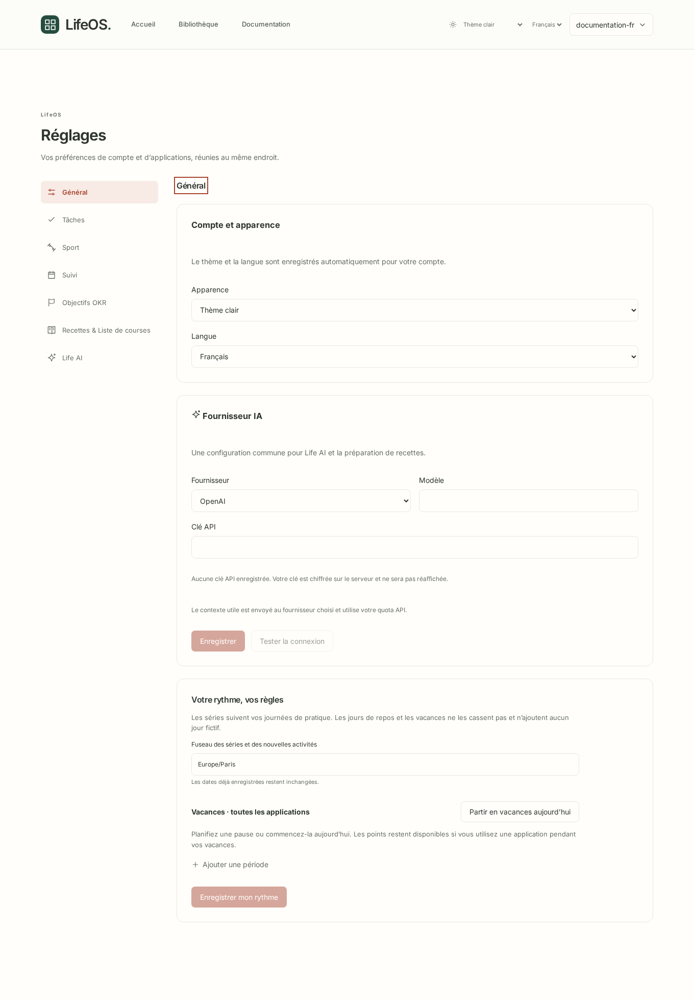
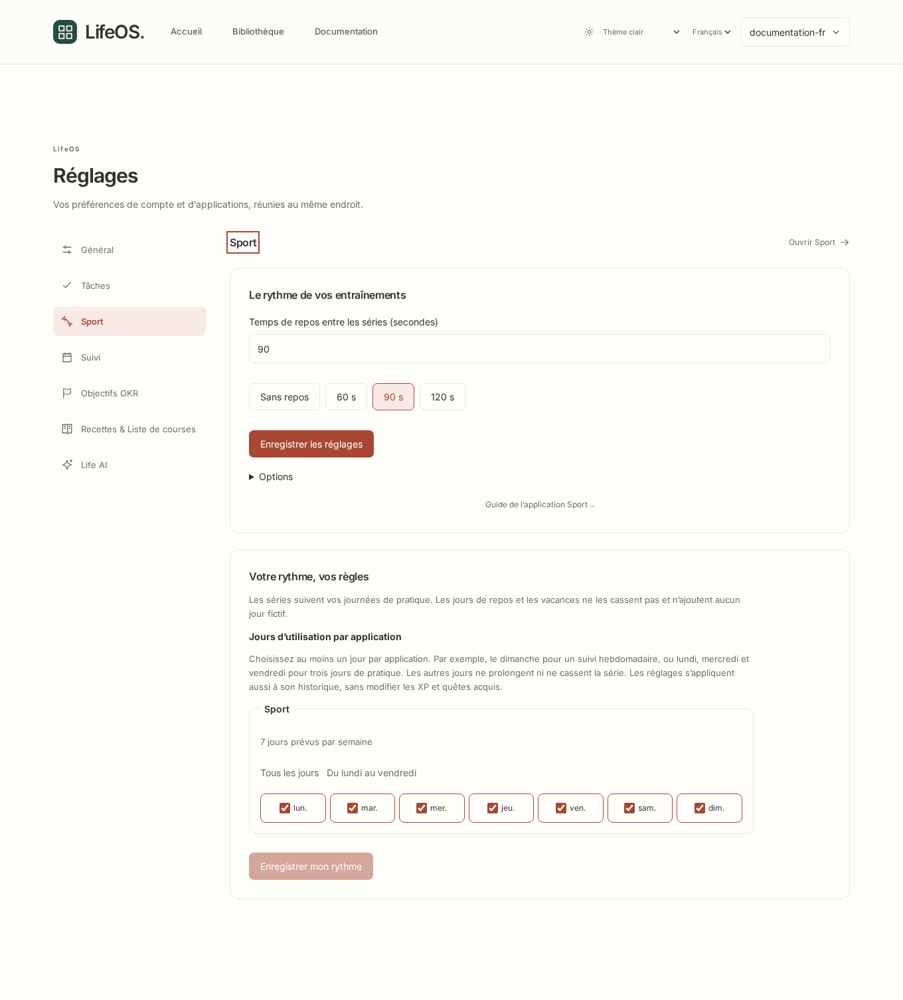

# Réglages généraux

[English guide](en/settings.md)

Depuis l’accueil, utilisez **Réglages** dans la navigation ; depuis la bibliothèque, le menu du nom propose **Réglages** et **Se déconnecter**. Le menu fonctionne avec Entrée, les flèches, Début/Fin et Échap. Depuis une application, **Réglages** ouvre directement sa section dans la même page. Les anciennes adresses comme `/sport?tab=settings` restent utilisables.

## Général

Le thème **système / clair / sombre** et la langue **français / anglais** sont enregistrés immédiatement pour votre compte. Le thème système suit votre appareil. Les textes personnels ne sont pas traduits.

Le **calendrier de progression** possède son propre fuseau IANA et les périodes de vacances communes. Cliquez sur **Enregistrer mon rythme** pour les conserver. Les vacances neutralisent les jours concernés sans créer d’activité ni supprimer les gains. Ces réglages sont disponibles même si Suivi est désactivé.

{ loading=lazy }

*Réglages généraux : apparence, langue, fuseau de progression et vacances.*

## Assistant IA

La section Général comprend l’encart **Fournisseur IA** partagé avec Recettes : fournisseur OpenAI/Anthropic/Gemini, modèle et token API. Il reste accessible si Life AI est désactivée. Enregistrer précède **Tester la connexion**. Un champ token vide conserve la valeur ; sa suppression est explicite. Changer de fournisseur efface l’ancien token et le modèle. **Life AI** possède sa section : même fournisseur partagé, réglages de dictée et mémoire (activation, consultation, correction et oubli). Voir le [guide Life AI](assistant.md) et son [API](assistant-api.md).

## Une section par application

| Section | Réglages disponibles |
| --- | --- |
| Tâches | Choix de l’agenda ou d’un espace, période et horizon de 1 à 90 jours, retards, visibilité des tâches terminées, recherche, espace, priorité, étiquette ; par espace : liste/kanban, densité, tri, statut et échéance. Le lien Configurer l’espace ouvre ses nom, description, parent, couleur, sections, colonnes, étiquettes et archives. |
| Sport | Repos entre les séries, de 0 à 3 600 secondes. |
| Suivi | Fuseau horaire des occurrences et du calendrier. |
| Objectifs OKR | Fuseau horaire des horizons et périodes. |
| Recettes et courses | Calendrier d’utilisation ; les portions, ingrédients, recettes et listes se règlent sur leurs objets. |

Chaque section présente aussi les **jours d’utilisation** de l’application : au moins un jour, avec raccourcis tous les jours ou lundi–vendredi. Enregistrez chaque formulaire séparément ; changer de section avec un brouillon demande confirmation. Une écriture en cours doit se terminer avant une navigation interne, un changement de langue ou une déconnexion. Le navigateur avertit avant fermeture/rechargement avec une saisie non enregistrée.

Dans Tâches, les préférences de vue sont celles utilisées par l’agenda et les espaces. Les listes masquent toujours les tâches terminées jusqu’à leur affichage explicite pendant la visite. Les réglages de structure ne créent pas de préférence globale parallèle.

## Applications désactivées et erreurs

Toutes les applications du catalogue restent listées. Une application désactivée affiche son état et un lien vers la bibliothèque ; ses formulaires métier ne sont pas chargés. Ses données et réglages sont conservés, et son calendrier d’utilisation reste configurable. Réactivez-la pour retrouver ses préférences métier.

Une lecture en échec propose **Réessayer**. Une sauvegarde en échec conserve la saisie et affiche l’erreur. Les conflits OKR/progression ne remplacent pas silencieusement les données : **Recharger les valeurs enregistrées** abandonne le brouillon après confirmation. Les autres réglages gardent la règle existante de dernière écriture. À la déconnexion ou à l’expiration, les données privées sont démontées.

## API et conservation

La page compose les API du socle et des applications, sans stockage métier dans le navigateur. L’assistant conserve ses réglages dans `assistant_settings` :

| Préférences | Lecture / écriture |
| --- | --- |
| Thème et langue | `GET /api/v1/preferences`, `PUT /api/v1/preferences` (champs partiels) |
| Fournisseur IA commun | `GET/PUT /api/v1/assistant/provider-settings`, `POST /api/v1/assistant/provider-settings/test` |
| Life AI (active) | `GET/PUT /api/v1/assistant/settings`, `/assistant/memories`, `/assistant/transcription/settings` ; voir les méthodes dans l’API Life AI |
| Progression | `GET /api/v1/progression/settings`, `PUT /api/v1/progression/settings` (`expected_version`) |
| Agenda | `GET /api/v1/agenda/view`, `PUT /api/v1/agenda/view` |
| Vue d’espace | `GET /api/v1/workspaces/{id}/view`, `PUT /api/v1/workspaces/{id}/view` |
| Sport | `GET /api/v1/sport/settings`, `PUT /api/v1/sport/settings` |
| Suivi | `GET /api/v1/tracking/settings`, `PUT /api/v1/tracking/settings` |
| Objectifs OKR | `GET /api/v1/okr/settings`, `PUT /api/v1/okr/settings` (`expected_version`) |

Les mutations nécessitent session, origine autorisée et jeton CSRF. Les routes métier exigent l’application active et le propriétaire. Voir les [exemples API](api.md), les [données](donnees.md) et la [sauvegarde/restauration](sauvegardes.md). Le dump conserve les réglages ; `0015_assistant` ajoute ceux de l’IA, dont le trousseau de chiffrement doit être sauvegardé séparément.

{ loading=lazy }

*Réglages Sport : repos entre séries et jours d’utilisation.*

Life AI n’a pas de calendrier ou de quêtes propres. Sa section désactivée affiche uniquement son état et l’accès à la bibliothèque ; aucune donnée de conversation, mémoire ou dictée n’est chargée.
