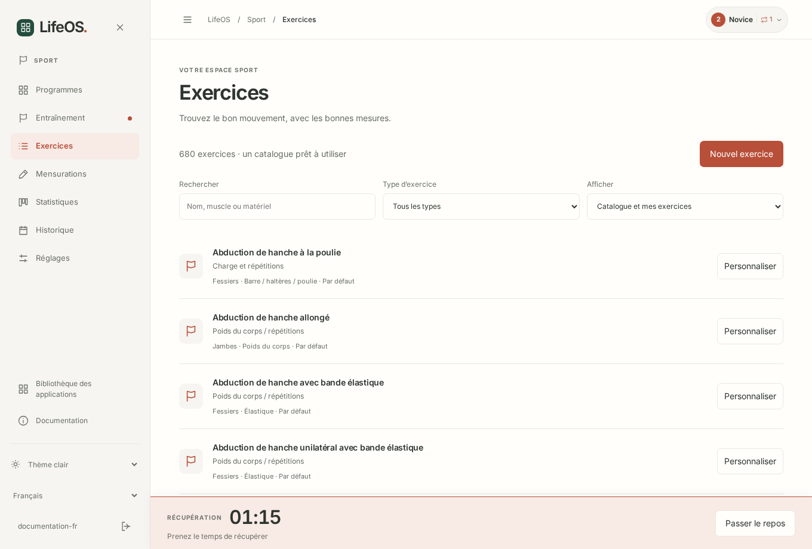
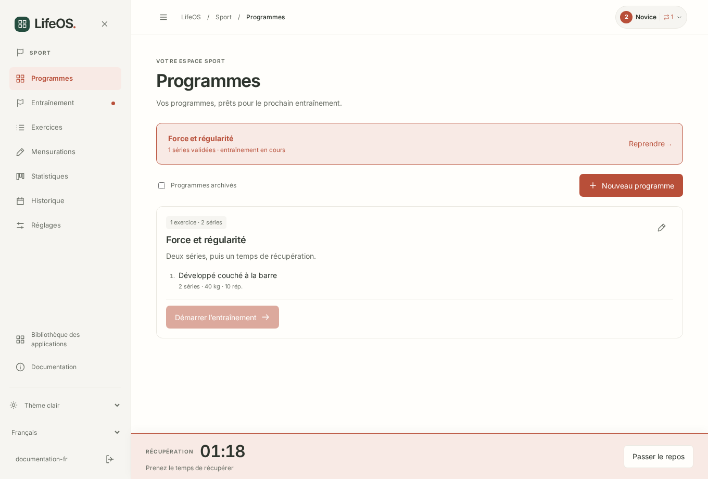
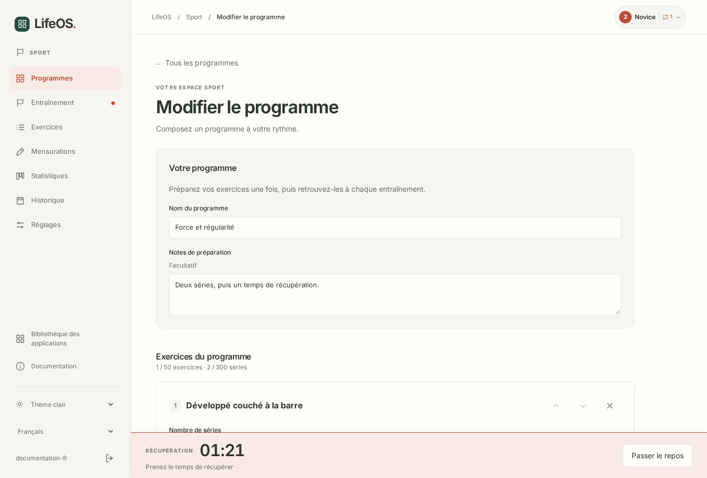
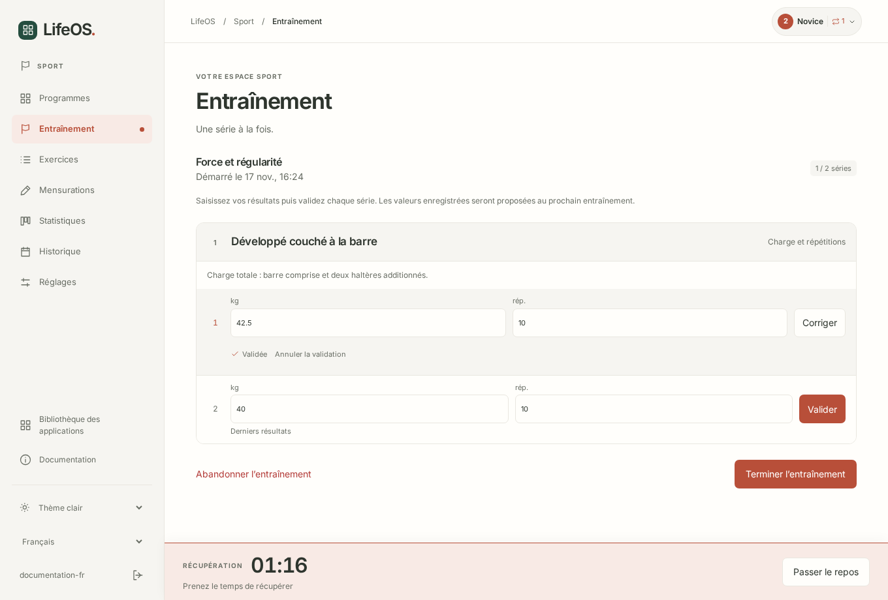
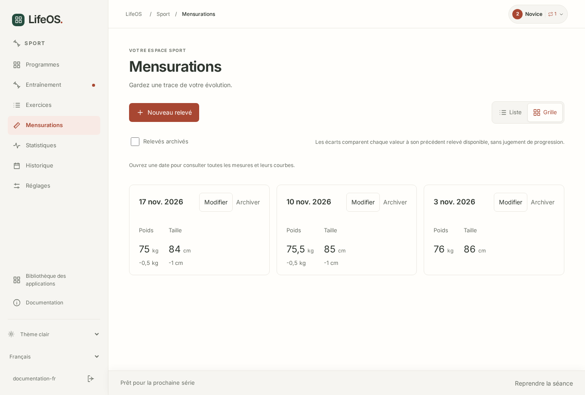
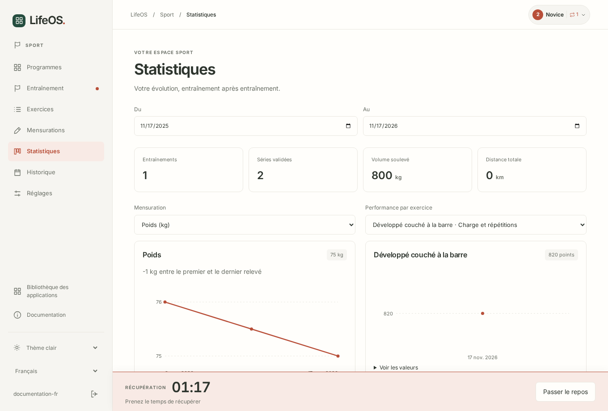
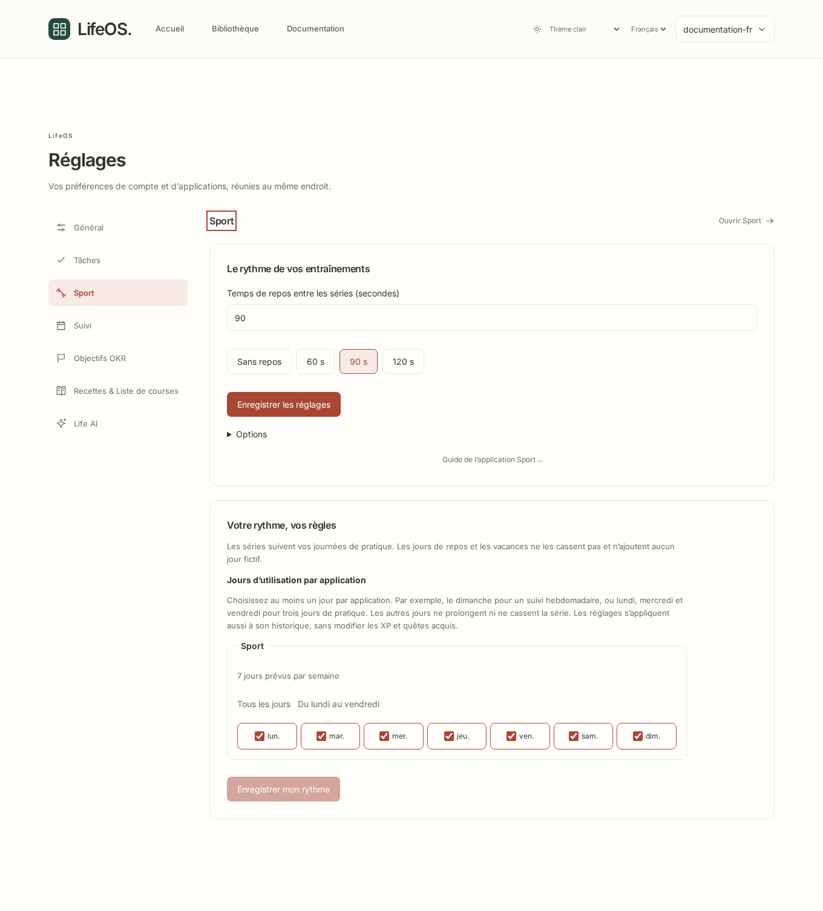

# Sport

La navigation partage son design avec Tâches. La barre supérieure indique uniquement le fil d’Ariane et le bouton de menu mobile : le rechargement global et le prénom ont été retirés. Bibliothèque, documentation Sport, thème, langue et utilisateur/déconnexion sont réunis dans le footer, également sur mobile. Voir la [navigation commune](applications.md#navigation-commune).

Sport est disponible dans la [bibliothèque LifeOS](applications.md). Activez **Sport**, puis ouvrez l’application. Elle partage la connexion, le thème et les commandes accessibles de LifeOS. Sa navigation latérale reprend l’organisation de Tâches ; sur mobile, le bouton de navigation ouvre les mêmes onglets. Chaque rubrique possède son titre et son URL ; la navigation replace le contenu en haut de page et le focus sur le titre. Les commandes tactiles, les champs et les graphiques s’adaptent aux écrans étroits, en thème clair ou sombre.

Sur mobile, l’ouverture du menu place le focus sur **Fermer la navigation**, sans ouvrir le sélecteur de thème. **Apparence** reste accessible pour changer volontairement le thème. Fermer le menu sans changer de rubrique rend le focus au bouton de navigation.

## Exercices prêts à utiliser

Le catalogue fournit **680 exercices disponibles en français et en anglais**, couvrant musculation, poids du corps, cardio, gymnastique, portés, mobilité, étirements et mouvements chronométrés. Recherchez par nom, muscle ou matériel, avec ou sans accents, puis filtrez par type. Il n’y a aucun import à effectuer ni compte externe à connecter.

**Nouvel exercice** crée votre propre mouvement. **Personnaliser** copie les caractéristiques d’un exercice fourni dans un exercice personnel : vous pouvez changer son nom, son type, son matériel et ses notes. Le catalogue commun reste stable. Les exercices personnels se modifient et s’archivent ; l’affichage des archives permet de les restaurer.

| Type | Mesures par série | Exemples |
| --- | --- | --- |
| Charge et répétitions | kg et répétitions | Développé couché, squat, soulevé de terre |
| Poids du corps / répétitions | répétitions | Pompes, burpees, tractions |
| Répétitions avec assistance | assistance en kg et répétitions | Tractions, dips sur machine assistée |
| Maintien / durée | secondes | Planche, chaise, étirement |
| Distance et durée | mètres et secondes | Course sur tapis, vélo, natation, rameur |
| Charge et distance | kg et mètres | Farmer carry, traîneau, marche lestée |
| Charge et durée | kg et secondes | Maintien du fermier, planche lestée |
| Répétitions chronométrées | répétitions et secondes | Burpees chronométrés, corde à sauter |
| Distance seule | mètres | Saut en longueur, marche sur les mains |
| Énergie machine et durée | kcal affichées et secondes | Air bike, rameur, SkiErg |

Les types décrivent des **mesures**, pas une liste fermée de sports. Un même mouvement peut avoir plusieurs variantes de saisie. Les calories sont celles affichées par la machine : aucune estimation physiologique n’est calculée. Les champs inadaptés à un type sont refusés par le serveur. Utiliser la **charge totale**, barre comprise et deux haltères additionnés ; noter l’assistance affichée pour une machine assistée. Pour un élastique sans assistance chiffrable, choisir le type répétitions et préciser la résistance dans les notes.

{ loading=lazy }

*Catalogue : rechercher un exercice et choisir son type.*

## Préparer un programme et démarrer un entraînement

Dans **Programmes**, choisir **Nouveau programme**, donner un nom, ajouter des exercices et indiquer leur nombre de séries. Les cibles par série sont facultatives. Les flèches changent l’ordre ; la croix retire un exercice du brouillon. Un programme accepte jusqu’à 50 exercices et 300 séries au total, avec 1 à 30 séries par exercice.

Sur ordinateur, les cartes HYROX et classiques ont toutes la même hauteur, avec les boutons alignés en bas de chaque rangée. Sur téléphone, elles affichent le nom, le total d’exercices et de séries, les deux premiers exercices et le nombre d’exercices restants. Le bandeau HYROX conserve son logo, son compteur et la date dans un format réduit. Le bouton crayon ouvre la fiche complète avec les notes, toutes les séries et leurs cibles.

Pour archiver un programme, ouvrir sa **fiche de modification**, puis choisir **Archiver** en bas de page. Ce bouton n’apparaît ni sur les cartes ni à la création. Si des modifications ne sont pas enregistrées, une confirmation permet de les abandonner avant l’archivage ; une erreur conserve le brouillon. L’archivage utilise la version enregistrée et conserve exercices, notes, date de compétition et historique. Activer **Programmes archivés**, puis **Restaurer** sur la carte pour retrouver le programme.

La création et la modification ouvrent une **page dédiée**, sans fenêtre modale. **Tous les programmes** ou **Annuler** ramène à la liste ; quitter un brouillon modifié demande confirmation. Les boutons précédent/suivant du navigateur fonctionnent aussi. L’URL `/sport?tab=workouts&program=new` ouvre la création ; `program=<uuid>` ouvre un programme enregistré, y compris après rechargement. Le filtre `archived=true` conserve le retour vers les archives.

**Ajouter un exercice** ouvre le catalogue dans la page. La recherche reçoit le focus ; après un choix, le nombre de séries du nouvel exercice reçoit le focus. Les exercices s’ajoutent à la suite et les flèches conservent les champs et valeurs associés. Le compteur affiche les limites et explique un dépassement. **Enregistrer le programme** utilise l’API ; une erreur réseau ou un conflit laisse les champs intacts pour permettre une correction ou une nouvelle tentative. Le brouillon reste temporaire : il n’est pas sauvegardé en cas de rechargement confirmé ou de fin de session.

**Démarrer l’entraînement** démarre un entraînement avec un instantané des exercices, types et cibles. Un compte ne peut avoir qu’un entraînement actif. **Reprendre** ou l’onglet **Entraînement** ramène aux séries. Le brouillon d’un formulaire n’est enregistré qu’à sa validation.

Chaque exercice forme un bloc délimité : son titre et son type sur un fond distinct, puis ses séries juste en dessous. Chaque série aligne son numéro, ses champs (unités affichées) et le bouton **Valider** ou **Corriger** sur une seule ligne, même sur petit écran. L’état et les commandes d’annulation restent sous cette ligne. Les champs conservent leurs libellés complets pour les lecteurs d’écran.

1. Saisir le résultat réellement effectué dans les **champs directement visibles de chaque série**, puis choisir **Valider la série** (ou Entrée depuis un champ). Les champs correspondent au type de l’exercice : charge, répétitions, durée, distance, assistance ou calories. La coche et le compteur « x / y séries » indiquent la progression, sans barre horizontale ni texte barré.
2. Le repos démarre automatiquement. Sa durée se règle dans **Réglages**, entre 0 et 3 600 secondes ; le défaut est 90 secondes. Une nouvelle durée concerne la prochaine validation, sans modifier un repos en cours.
3. Le compteur de récupération reste **fixé en bas de l’écran tant qu’un entraînement est en cours**, même lors du défilement ou d’un changement d’onglet dans Sport. Un espace sous les dernières commandes évite qu’il les masque ; il suit la hauteur visible sur mobile. Le compte à rebours utilise une échéance serveur et reste correct après rechargement ou retour du navigateur en arrière-plan. **Passer le repos** l’arrête. Il n’y a pas de notification système ni d’alarme sonore.
4. Modifier les champs d’une série validée puis choisir **Corriger la série** conserve sa date de validation et ne relance pas le repos. **Annuler la validation** retire son résultat et arrête le repos, en gardant les valeurs à l’écran pour une nouvelle saisie. **Annuler la saisie** retrouve les valeurs enregistrées ou proposées.
5. **Terminer l’entraînement** reste disponible même si vous manquez de force pour finir toutes les séries, y compris si aucune n’a été validée. La confirmation indique que les séries non validées seront enregistrées à **0 répétition**, ou zéro pour les autres mesures de leur type (charge, assistance, durée, distance, calories). Les résultats et dates déjà validés sont conservés ; le repos s’arrête. L’historique indique **Non effectuée** pour les séries mises à zéro. Les notes accueillent le ressenti. **Abandonner** conserve uniquement les séries validées dans l’historique, sans statistiques ni score.

Les **derniers résultats** sont proposés automatiquement au prochain entraînement du même programme, **série par série** : par exemple 40 kg × 12 pour la première et 42,5 kg × 8 pour la deuxième. Ils restent modifiables et ne valident aucune série. Le serveur reprend la dernière valeur réellement enregistrée de chaque série, y compris dans un entraînement abandonné ; une série annulée ou enregistrée automatiquement à zéro en fin de séance n’est pas reprise et ne remplace pas un résultat antérieur. Un entraînement vide ne fait pas oublier les précédents résultats.

La correspondance utilise l’exercice et son type, même après réordonnancement du programme. Si le même exercice apparaît plusieurs fois, chaque occurrence conserve son propre suivi selon son rang. Un nouveau programme ou un type différent repart sans résultat antérieur. Sans résultat pour une série, la dernière série précédente validée de l’entraînement courant sert de proposition, puis la cible du programme. Les cibles restent inchangées. Les propositions sont figées au démarrage et conservées après rechargement ou désactivation/réactivation.

Les modifications de champs sont des **saisies en cours** jusqu’à validation ou correction : une erreur réseau, un conflit ou l’actualisation ne les efface pas. Une sortie demande confirmation ; le rechargement confirmé et la déconnexion les perdent. Terminer demande d’abord d’enregistrer ou d’annuler ces saisies. Après une erreur de séance, **Actualiser l’entraînement** apparaît dans le contenu pour récupérer les résultats serveur en conservant vos champs modifiés, à réconcilier avant de réessayer.

Une session terminée ou abandonnée est conservée et ne se modifie plus. Modifier ou archiver le programme d’origine ne change pas les sessions existantes. Avant un nouveau lancement, les exercices personnels doivent être actifs ; si leur type a changé, retirer puis ajouter à nouveau l’exercice dans le programme pour saisir ses nouveaux objectifs. Une version obsolète produit un conflit explicite, sans écraser les données.

{ loading=lazy }

*Programmes : ouvrir, modifier ou démarrer sa prochaine séance.*

{ loading=lazy }

*Éditeur : définir exercices, séries et objectifs du programme.*

{ loading=lazy }

*Séance : saisir et valider chaque série ; la suivante conserve les propositions.*

## Mensurations

Dans **Mensurations**, ajouter un relevé daté : poids, masse grasse, cou, épaules, poitrine, taille, hanches, bras, cuisses et mollets gauche/droit. Un seul champ suffit. Un compte conserve un relevé actif par date ; les dates futures sont refusées selon le jour UTC du serveur. Modifier le relevé pour le compléter ou corriger une saisie. L’archivage retire le relevé des graphiques et reste réversible. Une restauration est refusée si un autre relevé actif utilise déjà cette date.

{ loading=lazy }

*Mensurations : enregistrer un relevé daté et consulter son évolution.*

## Statistiques et score

**Statistiques** présente les sessions terminées, même incomplètes, le nombre de séries réellement validées (hors séries non effectuées), le volume réellement soulevé (kg × répétitions) et la distance totale. Choisir la période, une mensuration, un exercice et un programme et sa référence de comparaison. Les graphiques proposent aussi un tableau de valeurs, utilisable au clavier et par lecteur d’écran. L’axe horizontal suit les observations dans leur ordre chronologique ; leur espacement n’exprime pas une durée. La période est inclusive et utilise les dates UTC des entraînements, sur un an par défaut et dix ans au maximum.

Le score **v2** est calculé dès la première séance terminée, même partielle. Chaque série prévue a le même poids ; une série non effectuée contribue zéro. Le détail affiche le score, la **complétion** (séries confirmées / prévues) et la **difficulté relative** (effort moyen des séries réalisées par rapport aux références).

```text
rapport de série = effort réalisé / effort de référence
score = 100 × somme des rapports des séries réalisées / nombre de séries prévues
      = complétion (%) × difficulté relative (%) / 100
```

Les calculs utilisent les valeurs non arrondies ; seuls le score et les pourcentages affichés sont arrondis à deux décimales. Ainsi, 3 séries sur 4 à 120 % de l’effort de référence donnent **90 points**. Une séance vide vaut **0**, avec une difficulté non mesurable (« — »). La complétion compte les séries confirmées : une série avec moins de répétitions est confirmée mais son effort relatif diminue. Le score peut dépasser 100 ; il n’est pas plafonné globalement.

| Type | Effort ou rapport par série |
| --- | --- |
| Charge et répétitions | `(charge + 1) × répétitions` |
| Répétitions | répétitions |
| Assistance | `répétitions / (assistance + 1)` |
| Durée | durée |
| Charge et distance | `(charge + 1) × distance` |
| Charge et durée | `(charge + 1) × durée` |
| Distance seule | distance |
| Distance et durée | rapport de distance × `min(1,5 ; racine(rapport de vitesse))` |
| Répétitions chronométrées | rapport de répétitions × `min(1,5 ; racine(rapport de cadence))` |
| Énergie et durée | rapport de calories affichées × `min(1,5 ; racine(rapport de débit))` |

Les rapports comparent toujours la réalisation à sa référence dans la même unité. Pour les types chronométrés, allure = quantité / durée. Une demi-distance à la même vitesse vaut 50 % ; à vitesse double, environ 70,71 % ; même à très grande vitesse, au plus 75 %. Cela valorise la distance et modère le bonus d’allure. Le `+ 1` permet les charges/assistances nulles ; ce sont des points de comparaison, distincts du tonnage réel.

**Références figées par série et mesure.** Au début d’une famille de score, utiliser l’objectif de l’instantané, sinon la proposition historique de cette série (y compris les résultats réellement réalisés lors d’un abandon), sinon sa première valeur réalisée. Pour une série omise, utiliser la moyenne des autres séries réalisées de cet exercice si disponible. La provenance apparaît dans **Références du score**. Sans aucune valeur, le champ reste inconnu et se complète lors d’une réalisation suivante ; une série omise ne crée jamais de dénominateur nul. Une cible partielle peut donc être complétée avec l’historique ou la calibration initiale.

Les références connues sont réutilisées pour le même programme, identifiants/types/ordre d’exercices et nombres de séries. Modifier les objectifs ne modifie pas les références déjà établies. Changer la structure démarre une autre famille. Sans cible ni historique, la difficulté initiale est calibrée à partir des résultats : elle ne compare pas votre niveau à une norme sportive.

**Compatibilité historique.** Les scores déjà enregistrés avec l’ancienne formule restent inchangés et identifiés comme historiques. Ils ne partagent pas le graphique ni une agrégation Suivi avec la nouvelle famille. Les anciennes séances terminées sans score peuvent être réparées par l’[opération API explicite](sport-api.md#reparer-les-scores-manquants), sans changer séries, dates, notes, version ou récompenses. Les lectures n’effectuent aucune écriture. Les sessions actives et abandonnées restent sans score. Une nouvelle séance termine son calcul dans la transaction de fin.

Le score décrit un **effort mesuré relatif**, pas la technique, le ressenti, la santé ni une comparaison entre personnes ou programmes. Les métriques brutes des graphiques par exercice (tonnage, répétitions, durée, distance et vitesse/cadence) restent inchangées : le score v2 ajoute sa propre combinaison du volume et de l’allure, sans mélanger des unités physiques.

{ loading=lazy }

*Statistiques : consulter séances terminées, volumes et scores comparables.*

## Conservation et limites

Désactiver Sport conserve programmes, exercices personnels, séries, échéances de repos, historique, réglages et mensurations. Réactiver restitue ces données ; un repos écoulé apparaît terminé. L’archivage est réversible et aucune suppression définitive n’est proposée. Les données restent privées au compte.

Le catalogue est embarqué, sans images, vidéos, coaching ou requête réseau externe. Les données métier passent exclusivement par l’API ; pas de stockage métier dans le navigateur, de mode hors ligne ou de synchronisation instantanée entre appareils. Les listes d’exercices et de sessions sont paginées ; programmes et mensurations sont chargés intégralement. La statistique sur dix ans peut être volumineuse pour un très grand historique.

## Catalogue et provenance

Le catalogue est une sélection éditoriale versionnée : identifiants et classification dans `apps/sport/catalogue.json`, textes dans `locales/exercises.fr.json` et `exercises.en.json`, constituée à partir de la nomenclature courante des mouvements et de la consultation du [jeu public free-exercise-db](https://github.com/yuhonas/free-exercise-db) le 14 novembre 2026 ([licence Unlicense](https://github.com/yuhonas/free-exercise-db/blob/main/LICENSE.md)). Il comporte des variantes nommées pour le matériel, la prise, l’unilatéral, les sports d’endurance et les types de mesure. Il ne prétend pas recenser tous les exercices possibles. Les textes d’instructions et images de ce jeu ne sont pas importés. Les noms et la classification français sont propres à cette livraison ; le catalogue consulté ne définit pas notre formule de score.

Les identifiants `builtin-…` de cette version sont stables ; toute correction de libellé doit préserver l’identifiant. Les exercices personnels utilisent des UUID. Ajouter un exercice au catalogue demande une livraison, sans migration des données privées. Voir l’[API Sport](sport-api.md), le [modèle de données](donnees.md#sport) et les [sauvegardes](sauvegardes.md#migration-0006-sport).

## Préparer un HYROX

Un titre contenant **Hyrox**, quelle que soit la casse (`HYROX`, `hyrox`, `Prépa hYrOx…`), active automatiquement un habillage noir et blanc : logo, motifs de piste et compte à rebours. Il apparaît sur la carte du programme, pendant sa création ou sa modification, dans le catalogue d’ajout d’exercices et pendant l’entraînement, jusque dans la barre de récupération. Le noir et blanc reste limité aux cartes et surfaces délimitées ; le fond de page et les espaces entre les cartes conservent le thème habituel. L’interface LifeOS et ses commandes restent identiques ; les champs et états d’erreur gardent leurs contrastes dans les thèmes clair et sombre.

Dans l’éditeur, **Date de votre prochain HYROX** est facultative. Choisir une date affiche **J−…** avant le départ, **JOUR J** le jour prévu, puis **APRÈS COURSE**. Sans date, le bandeau affiche **EN ROUTE**, sans inventer d’échéance. **Effacer la date de compétition**, puis enregistrer, retire la date. Les dates passées restent acceptées pour conserver un programme et son contexte.

Le compteur compare les jours civils du fuseau du navigateur, indépendamment des heures et des changements d’heure. Il s’actualise toutes les 30 secondes et au retour au premier plan. Il n’a pas d’alarme. Les programmes sans « Hyrox » gardent leur présentation habituelle ; retirer ce mot masque l’habillage mais conserve la date déjà saisie, qui revient avec le mot. La date du programme est enregistrée avec ses autres champs, par API ; un brouillon non enregistré reste temporaire.

Au démarrage d’une séance, son nom et sa date de compétition sont figés. Modifier ensuite le programme n’altère pas une séance en cours ou historique. Les séances antérieures à cette livraison n’ont pas de date, même si le programme en reçoit une ensuite. Archivage/restauration et désactivation/réactivation conservent les dates.

Le [logo HYROX](https://hyrox.com/wp-content/uploads/2022/03/HYROX-Logo.svg), consulté le 16 novembre 2026 sur le site de la marque, est embarqué localement dans Sport ; aucune requête vers HYROX n’est nécessaire pendant l’utilisation. La marque et son logo appartiennent à leurs titulaires. Cet habillage identifie la préparation personnelle et n’indique aucun partenariat officiel.

## Langue et exercices personnels

Le menu du compte propose **Langue / Language**. Les exercices fournis portent le badge **Par défaut / Default** et suivent la langue choisie, y compris dans les programmes et historiques. Les exercices **Personnels / Personal**, leurs notes et vos autres textes ne sont jamais traduits automatiquement. Personnaliser crée une copie personnelle dans la langue affichée à cet instant. Changer la langue n’altère aucun résultat, score, date ou identifiant. Voir [Langues](internationalisation.md) et le [guide anglais](en/sport.md).


## Progression et quêtes

Le badge en haut à droite affiche votre niveau, titre et série. Ouvrez-le pour consulter les quêtes les plus proches ; le mur complet et le journal sont dans Suivi → Réussites. [Barèmes, 60 quêtes et règles de séries](progression.md).

## Revue de l’interface

La [revue mobile et ordinateur du 17 novembre 2026](revue-sport-2026-11-17.md) inventorie les parcours testés et les améliorations proposées, dont le choix Liste / Grille. Elle décrit un plan d’amélioration ; ces propositions ne sont pas des fonctionnalités déjà livrées.

Les préférences sont réunies dans les [réglages généraux](settings.md). Le lien Réglages de l’application ouvre sa section ; fuseau de progression et vacances se trouvent dans Général, jours d’utilisation dans chaque application.

{ loading=lazy }

*Ouvrir Réglages pour adapter les préférences et les jours d’utilisation de cette application.*
