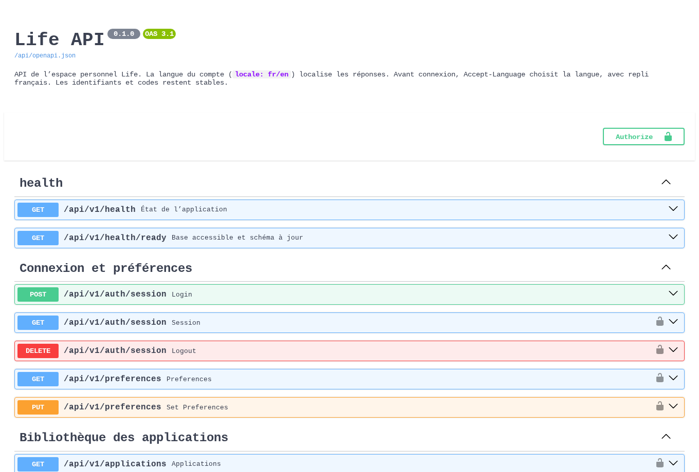

# Documentation technique

Ce guide s’adresse aux personnes qui développent, intègrent ou exploitent LifeOS. Les procédures utilisateur sont dans des [guides séparés](index.md) : Général, Tâches, Sport, Suivi, Objectifs OKR et Cook & Shop.

## Développer et comprendre

1. Suivre le [démarrage local](demarrage.md), créer un compte de développement et ouvrir l’interface.
2. Lire l’[architecture](architecture.md), les [données et contraintes](donnees.md), puis les responsabilités [backend](backend.md) et [frontend](frontend.md).
3. Vérifier la [configuration](configuration.md), les [traductions](internationalisation.md) et les [tests](tests.md).
4. Pour ajouter une fonctionnalité, suivre le [guide d’évolution](evolution.md) et les décisions historiques de ce guide.

## Utiliser les API

Ouvrir [Swagger](https://life.thibault-leveau.com/api/docs), développer une route et consulter son contrat. Les exemples de la [référence commune et Tâches](api.md) montrent comment ouvrir une session, conserver les cookies et fournir le jeton CSRF. Les écritures authentifiées exigent les mêmes contrôles que l’interface.

Les références [Sport](sport-api.md), [Suivi](tracking-api.md), [OKR](okr-api.md), [Recettes et courses](recipes-api.md) et [intégrations](integrations.md) décrivent les contrats métier, erreurs, limites et exemples indépendants du navigateur.

{ loading=lazy }

*Explorateur OpenAPI : ouvrir une route pour consulter son contrat. Swagger conserve ses libellés techniques en anglais.*

## Publier et entretenir

Suivre dans l’ordre [tests et revue](tests.md), [déploiement](deploiement.md), puis vérification de l’image et des routes publiques. Les [sauvegardes et restaurations](sauvegardes.md) détaillent les contraintes de migrations ; l’[exploitation](exploitation.md) et la [sécurité](securite.md) aident au diagnostic.

## Entretenir ces documentations

Les sources FR restent dans `docs/` et leurs traductions à chemin identique dans `docs/en/`. `mkdocs.yml` décrit l’appartenance de chaque page à un guide ; `scripts/documentation.py` construit les menus, titres, liens de langue et index de recherche isolés. Le framework, les URL publiques et l’image de déploiement restent les mêmes. Les liens précédents/suivants ne quittent jamais un guide ni sa langue.

Ajouter chaque page dans les deux langues et dans le manifeste des guides. Les liens vers un autre guide restent explicites dans le contenu. Les ADR français historiques restent immuables ; les traductions sont identifiées comme telles. `make build` refuse les pages sans guide ou sans traduction. Les captures réelles sont produites uniquement sur un serveur de test à données synthétiques, selon [Tests](tests.md), puis conservées sous `docs/assets/screenshots/fr/` et `en/` avec texte alternatif et légende.
